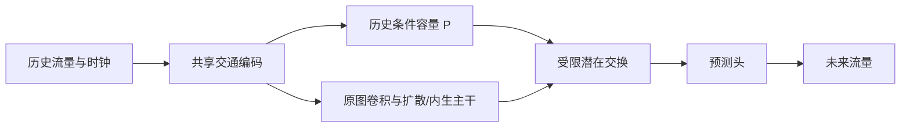

# B3R-MIN：移除事故分支的精简候选

日期：2026-10-13。

## 1. 这个版本保留什么

只保留当前有必要继续验证的交通预测主干：历史流量与时钟编码、原有图卷积及扩散/内生预测结构、历史条件容量 P、带收发预算约束的潜在交换、预测头。



图中是主要数据依赖；实际交换位于各层局部图卷积内部，以残差方式加入。P 每次前向计算一次，各层共享。原主干仍负责候选道路结构未覆盖站点的预测。

移除 TIID、D 报告条件残差、报告编码与报告 K 投影、可学习强度门。保留原事故空间接口中的输出 LayerNorm，因为它仍参与历史交通处理。参数会从模型和优化器中实际删除，而非仅设置开关。

496 站配置下，参数由 455,780 减至 435,856，删除 19,924 个（约 4.37%）。主干仍占主要规模，因此不能据此承诺显存或耗时按相同比例减少。

这是基于当前筛查证据的精简版本，不表示整个 IGSTGNN 主干已达到参数最小。进一步删除原图卷积或扩散/内生结构，需要另做独立训练验证。

## 2. 为什么选择这一步

现有 G1.1 B3R 第 10 轮最佳检查点、917 个验证窗口的同权重筛查：

| TIID | D | MAE | RMSE macro | 窗口 P95 |
|---|---|---:|---:|---:|
| 开 | 开 | 26.229965350 | 38.866096196 | 37.441566358 |
| 开 | 关 | 26.221402778 | 38.859645905 | 37.509423164 |
| 关 | 开 | 26.229516085 | 38.865772980 | 37.442768776 |
| 关 | 关 | 26.220979491 | 38.859358147 | 37.510419357 |

来源为用户提供的服务器报告 `module_factorial_B3R_20261013_015852_c2912f/report.md`；这些数值不是本精简模型从头训练的结果。

两路全关的平均误差最低，但 P95 变差。D 在 12 个时距上的净 MAE 作用均为负，TIID 的非零短期作用也为负。因此可以训练双关版本，检验精简后是否仍成立。不能把同检查点的这一结果直接当作删模块重训的结论；成熟旧 B3R 的 D 单路筛查曾有小幅正收益，也说明结论依赖训练阶段。

## 3. 数据与物理含义

模型前向只需历史流量和时钟，不依赖事故位置、事故年龄、报告内容或封道资料。静态道路图与候选交换结构仍是模型的结构输入。

当前训练器继续读取原开发数据包，事故元数据用于固定数据协议核验与报告关联区域评估；它们不进入精简模型预测。因而这里的“无需事故输入”不等于“现有训练数据包可以删除所有事故文件”。数据样本本身仍来自原事故相关开发集合，不能由此宣称已验证自然无事故场景。

P 与交换容量是无量纲潜在约束，不是已识别的真实道路通行能力。删除全部报告路径之后，这个版本不再包含显式事故信息创新；它是交通历史与传播约束的精简参照。后续事故模块必须证明相对它的增量价值。

预测截点时钟从历史最后时刻向前推算两个 5 分钟槽：原包 `x_end=x_start+55min`，`t0=x_start+65min`。未来标签起点为 `x_start+70min`。这项规则属于当前固定协议，不能直接套用于不同采样或窗口定义。

## 4. 训练与续跑

独立新目录，默认单组 `B3R_MIN`；从与 B3R 相同种子的公共初始化构建，再删除未使用参数，不从已训练 B3R 检查点启动。保留 batch 48、优化器、学习率计划、数据顺序、100 轮上限和原早停规则，便于利用已有对照。

服务器先单独更新代码：

```bash
cd /seu_share/home/huangkai/220243809/paper/IGSTGNN/IGSTGNN-code
git pull --ff-only origin research/chronological-tiid
```

运行精简组至总计 10 轮：

```bash
bash experiments/chronological/run_b3_r_minimal.sh \
  --run-dir experiments/chronological_runs/contra_b3r_min_v1_seed2025 \
  --epochs 10
```

在已有 Slurm 作业内直接运行；登录节点调用会提交作业。脚本不包含 Git 操作，不申请 `--mem`。

续跑同一目录至总计 30 轮：

```bash
bash experiments/chronological/run_b3_r_minimal.sh \
  --run-dir experiments/chronological_runs/contra_b3r_min_v1_seed2025 \
  --epochs 30
```

`--epochs` 是绝对目标轮数。已完成轮次不会重复训练；中断后以最后完整轮次恢复模型、优化器、学习率和训练顺序。旧 B3R/G1.1 目录不能冒充精简版续跑目录。

## 5. 训练之后怎样判断

只读评估精简组与已有 G1.1 B3R/B3R_NO_D 的相同 10 轮预算：

```bash
bash experiments/chronological/run_model_evaluation.sh \
  --run-dir experiments/chronological_runs/contra_b3r_min_v1_seed2025 \
  --control B3R_MIN \
  --epoch 10 \
  --reference-run-dir experiments/chronological_runs/contra_b3rg11_v1_seed2025 \
  --reference-arms B3R B3R_NO_D
```

检查全网 MAE/RMSE、各时距、各道路、各自尾部分布，以及固定同一困难窗口的结果。以相同训练预算和公共前缀最佳结果比较，不与更长训练的最低误差直接排名。

精简模型删除了参数，完整参数哈希自然不同。评估器验证真实精简参数哈希，并利用“同种子完整参考初始化 → 所有保留张量完全相等”的映射证书检查已有对照。源代码、数据包、道路图、训练政策、批次顺序仍须匹配。证书不等于重复执行全部审计，也不构成显著性证明。

若精简模型在主要指标与困难场景均不退化，才支持将其作为新的主干；若平均误差改善但尾部明显变差，需要保留这一取舍，不能仅凭平均值决定。之后再做配对多种子和固定方案的独立测试。

当前没有本精简版本的正式服务器训练结果。

## 6. 本地工程验证

- 71 项相关测试通过；最终针对恢复环境来源标记与评估证据完整性的修改，再运行 9 项针对测试通过。
- 覆盖参数真实删除、保留张量精确一致、报告内容完全不影响预测、跨日/跨周时钟、P 与交换梯度、严格重载、连续训练与断点续跑一致。
- 496 站、4 个训练窗口与 4 个验证窗口完成一轮 CPU 工程检查；与已有开发检查产物的只读评估通过。
- Bash 语法检查通过；原模型与原训练文件未修改。

工程检查误差不能用于判断正式模型优劣。可复核记录见 `docs/verification/igstgnn_b3_r_minimal_20261013.json`。
