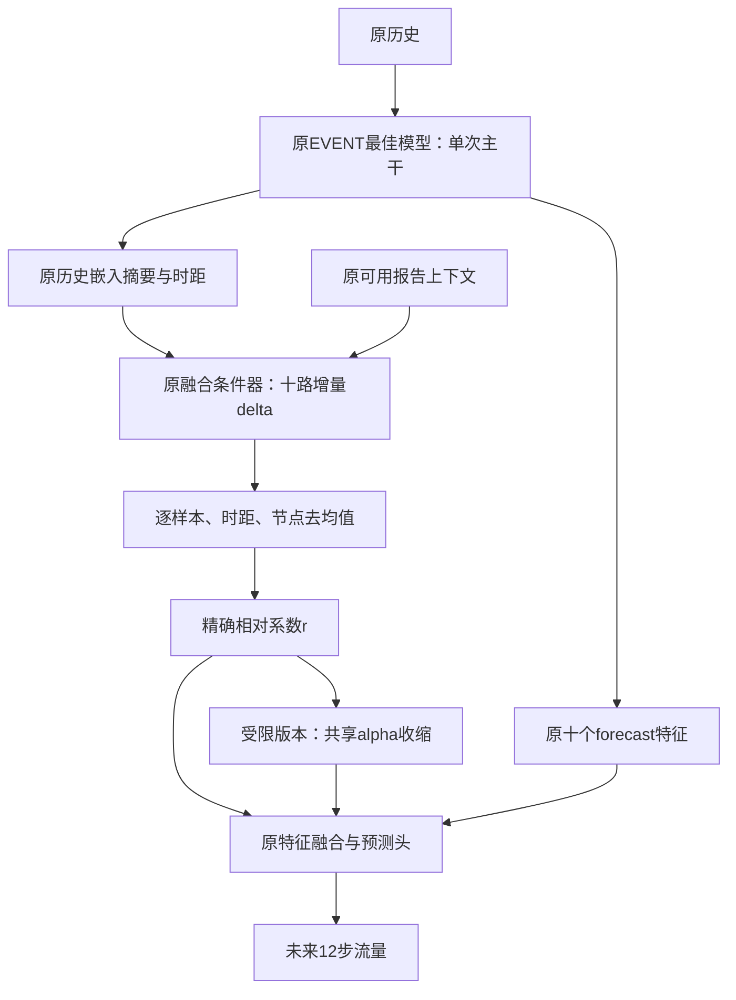

# MIN-F1相对分量权重：同检查点诊断

日期：2026-10-15。目的：补齐“去掉共同增益、只保留相对分量系数”的检查点证据，决定下一版是否采用受限再分配。主baseline仍为原IGSTGNN；本轮仅诊断当前MIN-F1的读出融合，不作为超过原IGSTGNN或事故因果的证据。

## 为什么做这一项

正式837窗口已有分析已完成，见[结果记录](igstgnn_f1_formal_gain_results_20261015.md)。共同均值缩放的MAE macro收益−0.151677202，差异化相对统一缩放+0.092169107，合计完整融合−0.059508095；完整融合全部12时距、13/14道路为负。低流量及长时距退化突出，远离真值的损害超过过冲后恶化。

现有数据只有固定求和、共同缩放和完整融合，缺少独立相对权重状态。因此不能只凭上述误差算术分解，就宣布去掉共同均值有效。

## 模型实际改变在哪里

保持现有EVENT最佳权重、原历史输入、五层主干、图、P预算、潜交换、backcast、十个forecast特征及原预测头。临时钩子只替换融合条件器输出的十个系数增量；每次预测仍只运行一次主干。推理结束或出现异常均移除钩子。

原模型系数为`1 + delta_k`，`delta_k = 0.1 * tanh(score_k)`。每个样本、节点、预测时距单独计算十个分量的均值`mu`，相对部分`r_k = delta_k - mu`。

| 状态 | 增量系数 | 来源 | 要回答的问题 |
|---|---|---|---|
| EVENT_FUSION_OFF | 0 | 已有预测复用 | 当前主干固定求和参照 |
| EVENT_UNIFORM | mu | 已有预测复用 | 单独共同增益的作用 |
| EVENT_ON | mu+r | 已有预测；完整回放核验 | 当前完整融合 |
| EVENT_RELATIVE_EXACT | r | 新增推理 | 精确去掉共同均值，保留原相对部分 |
| EVENT_RELATIVE_BOUNDED | alpha*r | 新增推理 | 在原幅度限制内使用相对再分配 |

其中`alpha = min(1, 0.1 / max_k(abs(r_k)))`；r全零时alpha为1，同一位置十个系数共用alpha。精确版本r可能超过原±0.1范围；受限版本维持系数约0.9～1.1，并记录收缩位置比例、最小因子与范围。



零均值只约束系数，不保证最终预测没有整体偏移，也不保证隐藏特征尺度或真实物理流量守恒。十个特征的尺度、符号与非线性预测头仍影响输出。

精确版本与受限版本必须分开：后者在去掉均值之外还可能收缩相对部分。若二者表现不同，应结合alpha触发比例解释，不将结果全部归于去均值。

## 运行和保护

只加载现有EVENT所选最佳权重；正式源为阶段5，以保存的最佳张量哈希、选模指标和旧归档证书核对，不假定last权重等于best。

原八状态预测、原目标、显式掩码、站点/样本轴、事故区域和SOURCE_MIN固定84个困难窗口全部复用。旧源码不修改，原训练与检查点身份指纹保留。不执行旧训练器的preflight，因为其中会额外调用源MIN/STATE；只复用非推理加载和身份验证步骤。

1. 核对原PASS归档及运行身份、输入来源和检查点。
2. 按原批次完整回放EVENT_ON，要求预测逐值匹配旧EVENT_ON，同时通过原选模指标校验；失败则阻断相对系数干预并报告差异。
3. 原批次逐一运行EXACT、恢复ON、BOUNDED、恢复ON；每次恢复与已通过的ON逐值一致。
4. 检查模型参数/缓冲、模式、梯度、钩子、RNG、输入与源文件保护，写入新目录，不覆盖原制品。

原始发布包可能整体反序列化，其中含测试记录；本轮不迭代测试loader、不评价测试集。新增训练更新0。正式837窗口、batch64共14批，正常流程预计新增70次EVENT调用：完整回放14、EXACT14、BOUNDED14、恢复28；以实际记录为准。旧SOURCE_MIN和STATE等状态新增模型调用0。

## 评价与解释

EXACT与BOUNDED分别相对当前FUSION_OFF、EVENT_ON等比较；明确最佳检查点敏感性，而不是新结构训练效果。报告pooled和horizon macro MAE/RMSE/MAPE、道路、流量、当前F高低估、三事故分区、十二时距、固定困难窗口及正负收益抵消。

高低估和54个交叉组固定以当前FUSION_OFF划分；SOURCE_MIN偏差另列。未来真值分层只作事后诊断，不能用作推理门控。所有计数与贡献守恒使用已修复的稳定累加；空组不可用，缺时距不补零。

精确版本可补齐四状态描述性对照：F=0、U=mu、R=r、E=mu+r。MAE交互为`err(U)+err(R)-err(E)-err(F)`，正数表示联合降低误差的幅度超过两者单独作用之和。它不是训练因果或真实事故因果；受限alpha*r与原mu+r不同，不冒充同一个完整四状态对照。

判断是否进入新结构训练时，同时看总体MAE、RMSE、MAPE、低流量、长时距及固定困难集。小验证净收益不直接认定可发表；当前验证已反复用于研发，原IGSTGNN的主比较及后续独立确认仍另行组织。

## 服务器入口

更新Git与运行Bash分开。Bash不含Git或Slurm提交，也不申请`--mem`。

```bash
bash experiments/chronological/run_min_forecast_fusion_relative_probe.sh \
  --run-dir experiments/chronological_runs/contra_min_forecast_fusion_f1_bs64_seed2025 \
  --evaluation-dir experiments/chronological_runs/contra_min_forecast_fusion_f1_bs64_seed2025/forecast_fusion_evaluation_20261015_120750_e7476e
```

输出目录以控制台打印为准；主要回传`report.md`。本轮不新增训练方案，不自动决定最终模型或访问测试集挑选结构。

## 本地验收

27项不同测试通过：系数/钩子10项、纯指标9项、探针入口8项。覆盖独立手算、实际五层预测头、单次主干、两类中心化与收缩、异常清理、回放阻断、最佳权重/轴/掩码/文件漂移拒绝，以及正式规模的纯合成守恒回归。Bash语法检查通过。

复用已有496站四窗口工程归档完成最终集成：原八状态预测逐值复用，新增EVENT调用10次（ON回放/恢复6、EXACT2、BOUNDED2），训练更新0，未评价测试集；模型、输入、RNG及受保护源文件检查通过。原模型/训练/数据21项指纹保持不变。第一次集成期间并行编辑了新探针源码，文件保护正确阻断；冻结最终代码后另用新目录完成验收，失败目录保留。

机器可读记录：[开发验证文件](verification/igstgnn_f1_relative_probe_20261015.json)。工程数值不构成正式预测效果。服务器837窗口已于2026-10-15完成，见[正式结果记录](igstgnn_f1_relative_probe_results_20261015.md)；不重复安排本探针。
