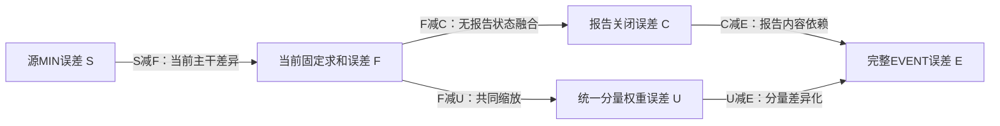

# IGSTGNN改进：F1已有预测分析与下一版优化依据

日期：2026-10-15。研究目标：以原IGSTGNN为主baseline，得到可解释、可检验的改进方法。MIN为结构中间对照，STATE为同架构内容对照，ON/OFF为同检查点敏感性。此次实现分析工具，尚未修改模型结构；先定位损害，再决定下一版的一项小改动。

阶段更新：服务器正式837窗口已有预测分析现已PASS，完整结果见[正式结果与下一版依据](igstgnn_f1_formal_gain_results_20261015.md)。以下设计和首次故障记录按发生顺序保留，后文的“待服务器重跑”由该成功记录覆盖，不再重复同一分析。

## 已有正式结果说明了什么

数据来自作者发布的Contra Costa划分，验证837窗口、496站。STATE/EVENT均从同一成熟MIN最佳权重开始联合适应，各完成十轮、620次更新，分别选择阶段7/5。下表为用户服务器完整报告回传，本地尚未独立读取正式837窗口NPZ；后续入口在服务器核对归档内部一致性。

| 状态 | 验证MAE pooled | RMSE pooled | MAPE（%） | 窗口P95 |
|---|---:|---:|---:|---:|
| SOURCE_MIN | 13.944357853 | 23.502925867 | 18.315216475 | 18.352191474 |
| STATE_ON | 13.771632498 | 23.217150927 | 21.731100443 | 17.858323142 |
| EVENT_ON | 13.696262963 | 23.166069413 | 20.595016426 | 17.764674075 |
| EVENT_REPORT_OFF | 13.696750723 | 23.166198646 | 20.609809451 | 17.764763333 |
| EVENT_FUSION_OFF | 13.636760328 | 23.173933483 | 18.504700296 | 17.707625946 |
| EVENT_UNIFORM | 13.788427569 | 23.235316577 | 21.004049631 | 17.929573027 |

EVENT优于STATE和源MIN，但报告内容即时净收益小，融合相对当前主干有MAE负作用。EVENT_FUSION_OFF是已共同更新的当前主干，不是原MIN；这说明“融合本身改善了主干训练”尚不能从现结果识别。ON优于UNIFORM、同时不如固定求和，可以同时成立。

全网macro误差收益：

- EVENT相对STATE：+0.075377182。
- EVENT相对SOURCE_MIN：+0.248121830。
- 完整融合相对当前FUSION_OFF：−0.059508095。
- 报告上下文相对REPORT_OFF：+0.000487778。
- 分量差异化相对UNIFORM：+0.092169107。

这些是不同控制状态的比较，不能混用。原报告EVENT相对STATE在12时距与13/14道路上正向，但流量20～100区间退化；源高估组贡献−0.518507301、源低估组+0.593884407。这只是源MIN偏差分组，不能据此认定当前融合的修正方向。当前内容路径没有新增跨节点传播，不能把全网变化解释为事故容量或传播改进。

原IGSTGNN已有历史权重/日志，公式对齐版还有完整验证预测。主基线实现、训练batch、指标聚合及数据独立性边界详见[基线审计](igstgnn_f1_paper_baseline_audit_20261015.md)。当前源MIN验证13.944不是原IGSTGNN baseline，F1验证13.696也不能与论文测试13.43直接排名。

## 本轮新增的分析

使用同一归档的八组预测、原目标、有效掩码、原样本与站点轴，以及已选定的SOURCE_MIN困难窗口。不读原始数据和检查点，不导入Torch，不训练、不推理、不访问测试集。保留并验证原归档证书与文件哈希，不将归档核对称为新增检查点回放或独立签名认证。

记绝对误差分别为：S=SOURCE_MIN，ST=STATE_ON，E=EVENT_ON，C=REPORT_OFF，F=FUSION_OFF，U=UNIFORM。所有“收益”都是控制误差减候选误差，正数为改善。



十二种比较中，四条恒等式在每个有效预测点以及每个分组核对：

| 总收益 | 两项净收益之和 | 能回答 |
|---|---|---|
| S−E | (S−F)+(F−E) | 整体变化与当前融合即时作用分别在哪里 |
| F−E | (F−C)+(C−E) | 状态融合与报告上下文的作用分别在哪里 |
| F−E | (F−U)+(U−E) | 共同缩放和分量差异化是否抵消 |
| ST−E | (ST−C)+(C−E) | 模型间总体差异和当前内容依赖是否重合 |

上表是误差的算术分解，不是模型训练或真实事故的因果分解。正收益/负收益部分不能按恒等式相加，也不计算“净事故收益/总收益”作为事故贡献比例。RMSE不满足这种线性分解。

还保留EVENT/STATE、语义UNK、全站位置重排等已有比较。UNK和重排可能产生分布外输入，不能认证事故因果。

## 怎样定位应当改的结构

1. **共同缩放与分量差异化分开。** 原融合`delta_k=0.1*tanh(score_k)`同时允许所有分量整体增减，以及分量间重新分配。UNIFORM仅保留均值权重；固定求和的权重全1。分别检查两者的流量、道路、时距和困难窗口收益，避免把统一缩放负效应归咎于全部差异化机制。
2. **用当前基准判断方向。** 所有比较的`bias:*`及54个交叉分组统一以F的高估/低估固定划分，`source_bias:*`单独以S划分。八类修正方向则分别使用各自控制预测：完整融合以F为基准，报告路径以C为基准。报告的`bias:over`因此仍指F高估，不能读成C高估；SOURCE_MIN偏差也不能当成当前主干偏差。
3. **把远离与过冲区分。** 八类为不变、朝向且未越过、恰好到达、越过后改善、越过后等误差、越过后恶化、远离真值、原已准确却改动。预测升高/降低不直接等于误差改善/恶化。响应阈值仅统计响应点，不改变方向或收益的零点。
4. **同时看局部收益与全网贡献。** 分析6档流量×当前F高低估3类×事故三分区3类，共54组，以及道路、十二步、原固定困难集。组内均值不直接相加；MAE/MAPE贡献分别用共同有效点/正目标点分母。空组标不可用，缺时距不补零伪造macro。固定ID逐点指标保留其中全部有效点，窗口等权指标只使用十二时距均有有效点的完整窗口，缺失时两者集合可能不同。
5. **收益位置与信息位置核对。** 事故直接关联节点来自发布关系，候选范围为内部图弱连通包络，不是真实事故影响范围。报告内容直接效应在原支持外应为0；模型间的支持外变化不证明事件传播。

JSON/CSV同时输出pooled与horizon macro MAE/RMSE/MAPE、正负收益、抵消比例、预测升降和响应比例。权重表只描述最佳检查点的12步×10分量统计，不把权重当重要性，不拿last阶段10诊断解释best阶段5。

## 预先写明的优化判据

下列是等待正式新分析检验的候选解释，不是已经确认的设计结论，也不自动启动所有新训练。

| 新分析若显示 | 优先的小改动 | 必须保留的对照/限制 |
|---|---|---|
| 共同缩放在多数损害组为负，差异化净正 | 研究围绕原求和的分量再分配，约束公共增益、分开建模公共与相对系数 | 系数均值固定不代表预测均值固定；十个分量尺度与非线性头使零和系数仍可能偏移输出；必须配对验证 |
| 远离真值占主要损害，正负收益高度抵消 | 简化条件输入并限制状态相关响应，先检查条件器是否主要学到全局校准 | 高低估使用真值事后定义，不能拿它直接当门控或输入 |
| 越过后恶化集中且较大 | 研究有界幅度或独立于真值的置信度收缩 | 不能仅凭更小幅度保证整体改善；要保留固定求和与现融合对照 |
| 融合损害集中在少数时距/流量 | 选一个有依据的时距或历史状态条件改动 | 真值流量分桶只能诊断；实际模型使用预测截止前观测，不能用未来桶标签 |
| 内容效应持续微小或在直接关联区域恶化 | 重新考虑报告与哪个预测分量交互，避免只是最后的自由缩放 | 不声称事故已经有效，也不为论文保留没有证据的复杂分支；一次只改一个信息入口 |

本轮不导出FUSION_OFF为最终方法，不改变既有选模规则，也不从这份反复研发的验证集宣布泛化胜利。是否修改融合结构，取决于新报告能否提供一致局部证据。若证据不支持，保留负发现并收缩方案。

## 文件和运行

- 核心：`experiments/chronological/min_forecast_fusion_gain_metrics.py`。
- 入口：`experiments/chronological/analyze_min_forecast_fusion_gain.py`。
- Bash：`experiments/chronological/run_min_forecast_fusion_gain_analysis.sh`；CPU分析，不含Git或Slurm提交。
- 输入：原评估目录的summary/analysis/replay/preservation/comparability/region_definitions/paired_predictions/mechanisms/provenance。
- 输出：新目录report.md、summary.json、analysis.json、各分层CSV、方向CSV、权重统计、来源与保护记录；不覆盖原目录。

在服务器仓库目录运行：

```bash
bash experiments/chronological/run_min_forecast_fusion_gain_analysis.sh \
  --evaluation-dir experiments/chronological_runs/contra_min_forecast_fusion_f1_bs64_seed2025/forecast_fusion_evaluation_20261015_120750_e7476e
```

也可`--run-dir experiments/chronological_runs/contra_min_forecast_fusion_f1_bs64_seed2025`选择其最新完整PASS评估；最新PASS制品损坏时拒绝分析，不静默回退旧结果。输出目录以控制台打印为准，回传其中`report.md`即可继续确定结构修改。

本地验收使用已有496站、4窗口工程归档，只验证工具正确性，不用小样本数值替代正式效果。机器可读记录见[验证文件](verification/igstgnn_f1_saved_gain_20261015.json)。

20项不同测试通过：核心11项、归档入口9项；最后报告展示调整后又定向验证1项，未重复真实集成。已有四窗口完整归档分析通过，15项源文件哈希保持一致，原模型/训练/数据源码21项指纹未变，新增训练与推理均0。Bash语法通过。正式837窗口的新分解仍需执行上面的服务器命令，不把小样本工具验收写成正式效果结论。

## 全量服务器守恒检查的数值修复

服务器首次运行目录`forecast_fusion_gain_analysis_20261015_124320_d1013c`通过了原八状态归档核验，但在`EVENT_vs_STATE / current_MIN_bias`分组守恒处中止，没有产生完整新分析结论。原评估与预测可复用，失败输出目录保留，不覆盖。

独立合成大数组复现同类问题：338,686项普通百分比误差分别用`np.bincount`逐项累加，全网与分组的累加顺序不同，舍入残差可超过原检查阈值。此前四窗口验收不足以覆盖这个规模的数值问题；服务器日志没有分项残差，不能把该合成复现冒充原服务器数组的独立重算。

修复将加权和改为每64个输入的小块累加，再显式两两合并。整数点数仍精确核对，原`1e-10 + 128 * float64_eps * scale`守恒阈值保持不变；没有跳过检查、修改原掩码或补造样本。所有加权指标、方向、重合分组和固定窗口使用同一稳定累加方法。错误消息增加逐时距残差与阈值，便于识别后续真正的不一致。

补充大规模合成回归并用`math.fsum`作为独立高精度参考；验证记录见[数值修复验收](verification/igstgnn_f1_sum_fix_20261015.json)。更新代码后重跑同一分析命令，新输出目录自动生成；仍是训练0、推理0，不重跑模型评价。

修复后25项不同测试通过（原核心11项、归档9项、大规模数值5项）。837×12×496广播轴、单时距338,686个有效点的十二比较守恒通过，故意破坏加权和/整数计数仍被拒绝；已有496站四窗口真实工程归档分析通过、15项源文件哈希不变。原模型/训练/数据21项指纹仍未变化。正式服务器837窗口仍待更新后重跑分析确认。
