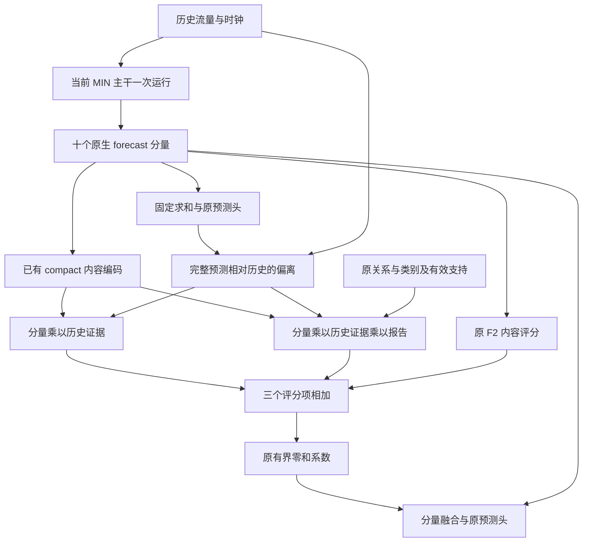

# IGSTGNN 结构改进：F2 后的五问题头脑风暴与首个原型

日期：2026-10-15。状态：证据整理、独立发散、文献核对与工程原型；没有新正式预测效果。决策归属研究者，本文记录本轮推进选择，不把 AI 讨论的一致性当成科学证据。

## 🎯 焦点与预先确定的选择标准

焦点：在只有历史流量、日内时间、星期、已发布事故关系及类别的条件下，怎样改变预测结构，使完整方法能够在同口径比较中超过原 IGSTGNN，并对收益来源给出可否定的解释？MIN 是中间结构，不能替换论文主 baseline。

本轮以实验证据匹配、区分竞争解释的能力、对预测计算的实质改变、成熟权重复用可行性、资源成本及负结果的信息价值作定性判断；不按虚构精确分数或代理投票选赢家。学习率、层数、宽度、训练轮数搜索不属于本轮改进方向。

已知约束：历史 12×496×3 的三通道是流量/日内时间/星期，并非流量/速度/占有率。没有密度、真实通行容量、库存、可靠事故年龄/恢复轨迹。关系数组不能自动反解成公里、速度或完整有向路网。真值流量、高低估标签只用于监督和事后诊断。已反复使用的 837 窗口验证集用于探索；不访问测试集挑结构。

## 📊 实验如何改变我们对五问题的判断

原始五问题及既有方案来自 [MIN-R1 五问题计划](igstgnn_min_response_r1_plan_20261014.md)。本轮详细数值整理在 [F2 正式结果](igstgnn_f2_formal_results_20261015.md)。

| 五个问题 | 本轮观察 | 对设计的约束 |
|---|---|---|
| 1. 关系细节没有体现额外价值 | F2 EVENT 优于 STATE，但同检查点报告净收益 −0.000067076；UNK/位置重排净变化很小 | 总体模型差异与报告即时效应分开；不能为论文预设事故一定有价值 |
| 2. 修正缺少选择性 | 融合有正作用；完整 EVENT 的收益仍由 ≥200 真值桶 +0.171456108 抵消其余桶 −0.090155765 | 需要历史可见的选择条件；低流量风险不能只归咎于融合或用真值门控修补 |
| 3. 跨目标槽的状态职责不清 | MIN 原有 DIF/INH 四块递推，gap=3；F2 没有额外事故持续状态 | 有递推不等于新增事故状态；没新增状态也不自动说明缺陷已成立 |
| 4. 局部约束与最终预测联系弱 | 潜 exchange 工程约束通过，但没有真实容量识别证据 | 不把局部平衡当预测收益；新模块必须有直接可检验的输出路径 |
| 5. 仅训练预算 MLP 限制共同适应 | F2 已联合训练全部主干与融合器 | 保持共同适应；解冻不再算新贡献 |

三个历史负结果继续约束本轮：旧 P2 全层事故门控没有超过其同协议 baseline；E1 一次早期历史注入的事故净效应接近零；R2 唯一硬存量—流量输出头严重退化，且必要条件审计发现 37.354% 合格窗口×站点组合不满足账本假设。这些结果来自不同阶段/协议，不能把 22.xx、79.xx 与 F2 的 13.xx 直接混排。它们也不否定所有早期注入、持续状态或统计轨迹读出。

## 💡 独立发散与保留的不同意见

三个 AI 代理分别从表示学习、部分观测/图动力学、时间读出角度先独立提出方案，之后才共享和检索。主持人随后提出历史参照交互作为备选，第二轮代理意见因此可能受这一提示锚定；不能把第二轮趋同写成独立验证。没有人类领域小组参与本次代理讨论。

| ID / 来源 | 初轮构想 | 可判别预言 | 反方意见与当前处置 |
|---|---|---|---|
| A1，表示代理 | 报告 token 与节点中间表示交互，进入现有递推 | 正确关联优于错配；报告内容优于存在标记 | E1/P2 已削弱“提前注入就够”的解释；留作报告入口竞争者 |
| A2、C1，两个独立代理 | 共享未来曲线系数/低秩轨迹头 | 多槽形状改善，解除共享后优势减弱 | 可能过平滑，重换头损失成熟映射；暂缓，未来可检验小型轨迹残差 |
| B1，动力学代理 | 单轨有界持续响应状态 | 打断跨槽传递损害中远槽 | MIN 已递推，可能只是额外容量或平滑；保留为问题 3 的专门候选 |
| B2，动力学代理 | 报告改变稀疏图算子并持续演化 | 正确关系优于存在标记/位置干预；局部消息变化有对应预测影响 | 可能放大报告噪声；条件传播已有文献，需明确区别；后续再议 |
| B3，动力学代理 | 组总量×节点份额的观测聚合解码 | 总量/份额误差能解释收益 | 任意分组带来错误竞争，传感器求和并非车辆库存；下调优先级 |
| C2，时间代理 | 事故初始化单状态未来解码 | 完整报告优于同解码器无报告；重置状态损害持续收益 | 与 E1 的区别须具体落实，换头混入额外解释；暂缓 |
| C3，时间代理 | 历史水平/差分分开建模的多尺度时间算子 | 改善随历史可见波动/反转变化，优于同感受野普通算子 | 差分不增加信息且会放大噪声；十二槽不支持声称学到日/周周期；保留 |
| A3、B4，文献后修订；混合来源 | 历史参照下的分量乘性交互，报告作为独立兼容项 | 历史项与报告项可分开验证，真实报告须胜过有效负对照 | 可能只是一般非线性容量；选择为首个工程原型，不等于最终论文主模型 |

## 📚 定向文献核对及适用边界

检索日期为 2026-10-15。实际查询包含 PDFormer propagation delay traffic、TiDE dense encoder、NHITS hierarchical interpolation、Graph Neural PDE Solvers conservation、ConFormer conditional accident forecasting；随后核对 LMF、FiLM、IGSTGNN 和技能工作流程论文的精确来源。没有将未发表的实验数字上传作为搜索词。此为有界定向检索，不是系统综述，不证明新颖性。

| 原始来源 | 本轮核对层级 / 可以借鉴什么 | 不可迁移什么 |
|---|---|---|
| [IGSTGNN](https://arxiv.org/abs/2602.02528)，Fan、Li、Zou、Ye、Du，2026，arXiv:2602.02528 | 官方摘要；本地既有论文/源码审计：ICSF 初始空间影响与 TIID 后续衰减 | “使用事故”本身不是新的模型贡献 |
| [LMF](https://aclanthology.org/P18-1209/)，Liu 等，ACL 2018，DOI 10.18653/v1/P18-1209 | 官方摘要、元数据与可访问 PDF；低秩因子化模态交互 | 乘性交互不是本轮发明；其他模态任务效果不代表交通效果 |
| [FiLM](https://arxiv.org/abs/1709.07871)，Perez、Strub、de Vries、Dumoulin、Courville，AAAI 2018 | 官方摘要；条件改变内部特征计算 | 仿射条件化已有先例；不能据此宣称事故信息足够 |
| [ConFormer](https://arxiv.org/html/2512.09398)，Wang、Yong、Wang、Fukushima、Jiang，2026；arXiv:2512.09398 | HTML 方法 4.1/4.2；固定图条件传播与 GLN；[作者代码](https://github.com/Dreamzz5/ConFormer)说明默认事故存在指示 | 不把其图上条件特征传播等同于事故重写边权；不照搬性能数字或数据条件 |
| [PDFormer](https://ojs.aaai.org/index.php/AAAI/article/view/25556)，Jiang、Han、Zhao、Wang，AAAI 2023，DOI 10.1609/aaai.v37i4.25556 | HTML DFT 方法段；训练历史短期模式增强空间 key | 学得的传播依赖不等于认证交通方向或真实旅行延迟 |
| [NHITS](https://ojs.aaai.org/index.php/AAAI/article/view/25854)，Challu 等，AAAI 2023，DOI 10.1609/aaai.v37i6.25854 | 官方摘要与元数据；多尺度采样及层级插值 | 长时距/平滑条件的证据不能替十二槽事故突变背书 |
| [TiDE](https://arxiv.org/html/2304.08424v5)，Das、Kong、Leach、Mathur、Sen、Yu；arXiv:2304.08424 | 官方最新记录与方法 4；完整未来向量、逐槽解码及历史线性残差 | TiDE 不等同低秩时间基底；未来协变量必须事先已知 |
| [FluxGNN](https://proceedings.mlr.press/v235/horie24a.html)，Horie、Mitsume，ICML 2024；arXiv:2405.16183 | 官方摘要/元数据与 HTML 入口；约束须贯通编码、计算与输出的责任 | 不能把物理 PDE 设置的守恒保证移到任意潜变量预算 |

上述论文 PDF 入口可访问性不等于本轮逐页精读；未批量下载、运行作者代码或统计引用次数。引用数全部未核，不用于排序。ConFormer DOI 出版页本轮访问失败，方法引用使用 arXiv 与作者代码，不把该失败写成论文不存在。TiDE 作者列表随版本有变化，此处沿用 v5 官方记录。

## 🧩 推进决定：先原型分量与历史证据的显式交互

F2 已显示内容融合有正作用，因此先保留十个 forecast、原预测头、原 MIN 潜 exchange 和成熟权重，不重建唯一物理输出。首轮检验：显式利用完整预测与历史的偏离，能否帮助评分器选择分量；报告交互作为独立第二因素，允许作用为零。

记 `c_k` 为 F2 的 compact 分量内容，`x` 为训练既有尺度下的历史流量，`p⁰_h` 为**同一当前主干固定求和经原预测头得到的完整预测**。不是 SOURCE_MIN 的历史归档，也不是单个分量的独立预测。定义：

```text
e_h = [x_last, mean(x), x_last-x_first, p⁰_h-x_last, p⁰_h-mean(x)]
history_score_kh = w_Hᵀ [U_H(c_k) ⊙ V_H(e_h, horizon_h)]
report_score_kh  = M · w_Rᵀ [U_R(c_k) ⊙ V_R(e_h, horizon_h) ⊙ W_R(report)]
relative_history_score = history_score - mean_components(history_score)
relative_report_score  = report_score - mean_components(report_score)
score_new = score_F2 + relative_history_score + relative_report_score
delta_new = 原 F2 的 bounded-centering(score_new)
```

`⊙` 是逐坐标乘积。两个新增评分输出投影零初始化，其前面的因子随机初始化，避免两层同时为零导致默认首步梯度断开。报告投影无偏置并在输出端乘有效支持 M。两个分支分别开关，不让报告开启隐式改变历史分支。采用共享小因子，避免十套大网络。分量原生为四块，gap=3 按原顺序映射十二槽。

新增评分先各自去分量均值，再加原 F2 评分。理由是：共同 score 平移在 tanh 之前可能改变各分量压缩率，之后再把系数中心化也不会严格消除该作用。前置去均值保证新增的纯公共 score 没有效果，但仍不保证输出均值或 MAE 不偏移。原 F2 评分不改变；原有的报告共同上下文仍保留，新报告交互是可分别关闭的额外残差，不冒充替换了旧报告路径。

这里的 `p⁰−x` 只是模型预测的变化证据，**不是创新残差的统计认证，不是预测误差，不告诉模型真实高估/低估**。分量隐坐标与流量不可直接相减。F2 已有历史输入及非线性交互能力；本轮新增的是明确可关闭的乘积结构和完整预测参照，不声称 F2 只能产生公共偏移。公共报告导数在中心化中可能减弱只是待检验解释，不是已证实根因。



独立模块计算两个评分增量；现已另建模型转换工厂，将它接入上述完整 F2 前向。固定求和参考需要一次额外预测头计算，**没有额外主干前向并不等于没有额外计算**；需要实测时间。参考预测与历史必须处于同一既有标准化尺度，不重新拟合 scaler，主干/分量不 detach。

接口为 `from_component_fusion(parent_F2) -> (model, certificate)`，只接受未被重复包装的原 F2 模型，源权重不修改。新模块参数为 `16*C+344`，C=8 时 472 个；按既有正式 F2 的 440,853 参数推算为 441,325，总量不是本轮正式服务器测量。默认 `history_interaction_enabled`、`report_interaction_enabled` 可分别控制新增支路。`report_enabled=False` 关闭旧、新全部报告输入；只关闭 `report_interaction_enabled` 仍保留旧 F2 报告路径。

## ✅ 五问题验收与没有解决的部分

| 问题 | 原型本轮负责的验收 | 本轮不能宣称 |
|---|---|---|
| 1 | 报告对不同分量产生可不同的增量；缺报告/支持外严格为零；真实内容后续须胜过仅 M 的训练对照 | 强行把报告敏感性做大就是有效；三列关系已获增益 |
| 2 | 历史与完整预测改变交互结果；修正有正有负；不读目标；低流量和偏差事后分开评价 | 零和保证低流量、MAPE 或每个点不退化 |
| 3 | 保持已有递推职责，明确原型没有新增跨槽状态 | 已解决事故持续状态；把图层号当物理时间 |
| 4 | 新评分沿原融合直接作用于输出；保留已有潜 exchange 不变 | 已证明预算物理有效；已解决原潜预算可识别性 |
| 5 | 接入时继续全主干和融合器共同训练，不用冻结小 MLP 作为最终模型 | 解冻是本轮创新；额外微调全算结构收益 |

## 🧪 最小实验顺序与否定条件

先做原型的默认梯度、精确零初始化、输入/支持隔离和中心化后仍有分量差异的工程检查。合成数据可以证明通路能工作，不能证明真实报告有用。

接入后的第一个正式结构问题仅比较两个新阶段：**同 F2 起点继续训练控制 vs 只开历史参照交互**。源最佳权重、初始化、重置优化器规则、训练样本及顺序、完成更新预算、全十二槽损失和选模规则一致；源 epoch0 参加选模。已有 F2 的五轮结果不能代替新的同预算继续训练控制。不在这一步同时改变图、读出器、损失、时距权重或支持范围。

若历史交互获得值得继续的证据，再对报告乘积作独立同结构对照；仅 M、完整关系/类别及等参数普通加性 MLP 是关键竞争者。参数匹配应匹配参与训练的有效部分，不能用未激活语义注册量作假匹配。同检查点 reportOFF/UNK/shuffle 仍保存，但不是结构重训消融，且干预可能分布外。

判别结果及下一动作：

1. 历史交互有益，报告无益：只支持选择性结构改造；不写事故语义成功，优先考虑 C3 或轨迹残差竞争者。
2. 交互不优于普通同容量评分残差：不能将收益归于显式乘积，撤销相应结构动机。
3. 正确报告优于仅支持及合理错配，且在独立确认中稳定：才考虑 B2 的内部条件传播，不自动扩大到全网。
4. 低流量/MAPE 继续恶化、收益仍是大幅抵消：原型未解决选择性，不能仅凭微小全网 MAE 正差宣布成功。
5. 路由路线持续无益：转向 C3 或保留成熟输出的低秩轨迹残差。新增持续状态应与逐槽同容量模型比较；它不是默认下一步必做项。

最终论文需要固定版本的原 IGSTGNN 同口径比较、多种子及独立确认。已有成熟 MIN 和旧 F1/F2 不为本次重复从头训练；原作者实现、公式对齐版、MIN、当前融合 OFF 各自身份保持清楚。当前单种子探索不能承诺“在模型上已经打败 baseline”。

## 🛠️ 工程验收与交付边界

独立模块在 [incident_component_interaction.py](../src/models/incident_component_interaction.py)；模型接入在 [incident_spatial_interaction_fusion.py](../src/models/incident_spatial_interaction_fusion.py)。新增测试分别为 [模块合同](../tests/test_min_component_interaction.py) 与 [模型接入](../tests/test_min_interaction_fusion_model.py)。

本地 CPU：Python 3.10.16 / PyTorch 2.8.0+cu126。新模块 8 项、新模型 11 项及原 F2 模型回归 10 项，合计 **29 项通过，10.426 秒，退出 0**。非实现者另一次复跑新增 19 项通过。没有将同一测试的重复运行计为不同测试数。

覆盖成熟且评分非等值的工程 F2 零增量/双新增 OFF 精确复现、源状态/RNG/独立副本、训练模式 dropout/BN 一致性、4块→12槽且保留槽差异、报告支持外严格零、STATE 不读报告、报告 OFF 与新增报告 OFF 区别、一次主干/活跃时两次原预测头/一次最终 bound、首步读出及后续因子/完整预测/compact/主干梯度。新增常量评分在成熟非等值基准下严格无效。

工程样例中的“成熟”指人为激活的非零 F2 评分，**没有加载服务器正式 F2 最佳权重**。测试内有合成损失的一步优化用于检查梯度，不是正式实验训练；没有新正式数据推理或测试评价。逐分量收缩避免新增完整 `[B,12,N,10,rank]` 激活；GPU 耗时、显存及服务器 PyTorch 2.3.1 环境尚未测量，不宣称已提速。

当前交付是可运行模型原型和转换工厂，**没有接入正式训练/评估命令**；不要将旧 F2 Bash 当作新原型入口。后续需按上文两个新阶段控制接入保存/恢复、数据证书与评估，再进行服务器结构试验。机器记录见[验收 JSON](verification/igstgnn_component_interaction_prototype_20261015.json)。

## 📝 来源与交付边界

代码核对起点 `d95689c`：`incident_spatial_component_fusion.py`、`incident_spatial_forecast_fusion.py`、`incident_spatial_minimal.py`、`igstgnn.py` 与旧 `incident_spatial_response.py`。本轮新原型另存，旧模型、训练、评估和服务器制品不覆盖。

本轮使用 scientific-brainstorming、academic-search 的独立发散、文献后重开讨论及反方审查流程。工作流程参考：Kassis, T., Agarwal, V., He, Y., Patel, D., & Brueckner, A. M. (2026). [Scientific Agent Skills: A Library of Procedural Knowledge for Research Agents](https://arxiv.org/abs/2609.00065). 官方当前 v2 元数据于本日核对；该文不作为模型有效性证据。
