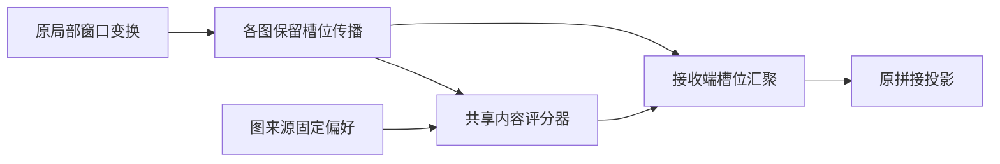

# GW2：图消息感知的窗口聚合

**运行策略更新：已有实验不重复。** 默认启动器已切换到复用入口：ORIGINAL 和 STATIC 读取 GW1 已完成的五轮检查点与 best/last 预测；只继续 POST_LOCAL、POST_MESSAGE 尚未完成的轮次。现有 `a2c5b32` 训练源码和 checkpoint 身份保持不变。请使用 [更新后的服务器命令](igstgnn_graph_message_gw2_server.md)，下文开发阶段的全四组命令已被替代。

## 动机与证据

2026-10-17 用户回传的 GW1 四组五轮、seed2025 验证报告：ORIGINAL MAE 16.288490、STATIC 15.228789、GRAPH_CONTENT 15.461667；后者同检查点 UNIFORM 15.484475。STATIC 平均系数最大偏离 1 约 0.02633；GRAPH_CONTENT 汇总标准差最大约 0.11681。三组最优均为第 5 轮，不能视为收敛排名。

这些数字来自用户粘贴的服务器报告和曲线，本地未独立读取服务器归档。观察支持保留固定图来源偏好，但尚不支持动态选择优于 STATIC。汇总方差混合样本、节点与调用阶段，也不证明场景匹配。模型差异与同检查点消融不能互作因果解释。

GW1 的路由器读取本节点窗口，图来源差异来自不同评分头；并未读取图实际传来的邻居消息。GW2 的可检验假说：**在相同接收端选择位置及评分器容量下，实际图消息是否比本地内容更适合判断槽位取舍？**

相关研究参照：[Graph Attention Networks](https://arxiv.org/abs/1710.10903)、[TimeFilter, ICML 2025](https://proceedings.mlr.press/v267/hu25ac.html)。图消息评分本身不是新颖性认证；本方案的待验证差异是原 IGSTGNN 的多来源图、混合槽位与图阶共享条件下的受控比较。

## 模块与流程

仅替换第一层 DIF 的 STLocalizedConv。原始源码目录 `experiments/chronological/original_igstgnn_558ab01/`、GW1 文件、其余四层 DIF、INH、ICSF、TIID 和输出头保持原实现。所有组都沿用原报告与传感器输入，没有新增未来标签或独立事故特征。



局部变换 V 的形状为 `[B,T,N,K,C]`。原图 bank 的列轴为 `[slot*sender]`、行轴为 receiver；保留槽位得到：

`M[g,order,slot] = A[g,order,slot] @ V[slot]`

`c = concat(value, value - mean_over_slots(value))`

`score = static_logits[g,slot] + Linear_16_to_1(tanh(Linear_2C_to_16(c)))`

`a = K * softmax_over_slots(score)`

`H[g,order] = sum_over_slots(a[g,slot] * M[g,order,slot])`

POST_MESSAGE 的 value 为该图一阶消息，POST_LOCAL 的 value 为接收节点 V；同来源高阶图复用一阶评分。固定偏好已有于 GW1，GW2 的变化是选择位置、图消息输入以及跨来源共享评分器。self 路径保留 `mean(V)`，不加权。不增加图传播阶数，但增加保留槽位的中间张量和评分运算，成本必须实测。

冻结原实现的 `STLocalizedConv.get_graph` 和 `DynamicGraphConstructor.st_localization` 在 K 个槽位重复相同邻接矩阵。正式计算利用这一契约，将 K 打包到通道，一次图乘法得到全部槽位消息，避免为每槽位展开图 batch。通用逐槽位参考核保留于数值测试。该优化对原邻接及其上游梯度等价；若未来改成槽位不同的图，必须使用通用核，不能直接复用此快捷路径。

评分头权重零初始化；无公共标量输出偏置（该偏置会在 softmax 中抵消）。零初始化系数为 1。改变归约顺序后承诺数值容差恢复，**不承诺逐位相同或训练轨迹等于原模型**。构造器保护 CPU/目标 CUDA RNG，原始参数初始化保持一致。初始 encoder 梯度为零，评分头首步可学习，实际一次 Adam 更新后 encoder 可获得非零梯度。

## 四组模型定义与复用策略

| 训练组 | 固定偏好 | 动态评分内容 | 选择位置 |
|---|---|---|---|
| ORIGINAL | 原固定汇聚 | 无 | 原实现 |
| STATIC | 按图来源学习 | 无 | 接收端 |
| POST_LOCAL | 按图来源学习 | 接收节点变换后的槽位 | 接收端 |
| POST_MESSAGE | 按图来源学习 | 各图一阶槽位消息 | 接收端 |

候选三组注册相同新增张量：15 个固定 logits、1040 个 encoder 参数、16 个评分头权重，共 1071；总参数 456291，原模型 455220。STATIC 仅 15 个新增参数活跃；两个动态组新增活跃容量相同。注册参数一致不等于 STATIC 活跃容量一致。

STATIC 与 GW1 STATIC 在固定参数和图 bank 下数学等价（空间常数权重与图乘法可交换），浮点归约顺序可能不同。不能把跨轮次或跨历史运行的差别归因于这一等价改写。

主比较：POST_MESSAGE vs ORIGINAL；必需对照：POST_MESSAGE vs STATIC、POST_MESSAGE vs POST_LOCAL。保留 POST_LOCAL vs STATIC 及所有负结果。

原独立四组流程曾设计八状态。当前复用流程只保留七状态：四个主模型加 POST_LOCAL_UNIFORM、POST_MESSAGE_UNIFORM、POST_MESSAGE_STATIC_ONLY；不为补齐 STATIC_UNIFORM 而新增旧模型推理。各状态保留各自联合训练主干；STATIC_ONLY 仅关闭显式动态评分，不保留动态评分的训练均值，不能当作纯跨样本变化效应。均值路由和跨样本匹配打乱不在本版实现范围；本版不宣称已经证明场景匹配。

机制统计保留历史及 forecast_1/2/3 调用阶段，固定节点与局部窗口位置后，按样本累计一、二阶矩，报告跨样本标准差 RMS。它可区分固定节点偏好和跨样本变化，但仍不等于效用、重要性或事故因果。

训练采用原 batch48、损失、Adam、学习率、scheduler、课程和样本顺序；四组从相同原始权重及 RNG 开始。`--epochs` 为总完成预算；无提前停止；验证 MAE 独立选优，同时评价共同末轮。保存 epoch 原子检查点、优化器、scheduler、课程、RNG、训练顺序和源代码/数据身份，支持完整轮次精确续训。修改训练执行源码后旧运行不能接续，GW1 检查点不能当 GW2 断点。

五轮仅筛查，不能替代相同完整预算、多种子和冻结方案后的独立测试。未评价测试集。原发布数组包含测试载荷，加载可能反序列化，但本流程不构造测试 loader。

## 指标与失败判据

同时报告全网 MAE/RMSE/MAPE、固定 ORIGINAL 困难窗口、P95、逐时距、真实流量分组、道路及报告支持分组。收益为对照误差减候选误差；MAPE JSON/CSV 为比例，报告为百分数。真实目标流量只作事后分组。

若 POST_MESSAGE 仅胜 ORIGINAL 而不胜 STATIC，则不支持动态消息选择的额外价值；若不胜 POST_LOCAL，则不支持图消息输入优于本地内容。MAPE/P95 或资源显著退化时必须保留权衡，不按单个全网 MAE 宣布全面改进。新版本在开发验证上设计与选模，预测点重叠，不能当独立事故重复。

系数之和为 K 不保证输出均值、能量或车辆守恒；混合槽位不是物理传播时延。保留窗口内跨槽位变换，不能解释为每个原始时刻独立选择。

## 运行入口

发布分支为 `research/graph-message-gw2`；首次获取及服务器完整步骤见 [服务器运行说明](igstgnn_graph_message_gw2_server.md)。进入包含新文件的独立 GW2 checkout，激活 `igstgnn` 环境。每次检查/评估用新输出名，避免覆盖旧证据。后续模型检查、训练和评估均在服务器执行。

```bash
export PYTHON_BIN="$(command -v python)"
export ORIGINAL_IGSTGNN_REPO_DIR="$PWD"
GW2_TAG="$(date +%Y%m%d_%H%M%S)"

python -u experiments/chronological/verify_original_graph_message.py --check \
  --output "experiments/chronological_runs/gw2_check_$GW2_TAG.json"

python -u experiments/chronological/verify_original_graph_message.py --stress --batch-size 48 \
  --output "experiments/chronological_runs/gw2_batch48_$GW2_TAG.json"

GW2_RUN="experiments/chronological_runs/contra_original_gw2_s2025"
GW1_RUN="../IGSTGNN-GW1/experiments/chronological_runs/contra_original_gw1_s2025"
bash experiments/chronological/run_original_graph_message.sh --run-dir "$GW2_RUN" --reuse-gw1-run "$GW1_RUN" --epochs 5 --seed 2025
```

没有 Slurm 作业时启动脚本通过 sbatch 提交，训练退出后再运行评估；在已有 GPU 分配内则直接执行。启动脚本自动定位自身仓库，错误的仓库环境变量会报错，不会跳去原 checkout。

```bash
python -u experiments/chronological/evaluate_original_graph_message_reuse.py --run-dir "$GW2_RUN" \
  --checkpoint best --output-dir "$GW2_RUN/eval_best_$GW2_TAG"
python -u experiments/chronological/evaluate_original_graph_message_reuse.py --run-dir "$GW2_RUN" \
  --checkpoint last --output-dir "$GW2_RUN/eval_last_$GW2_TAG"
cat "$GW2_RUN/reuse_summary.json"
cat "$GW2_RUN/eval_best_$GW2_TAG/report.md"
cat "$GW2_RUN/eval_best_$GW2_TAG/mechanisms.json"
```

断点继续同一预算用 `--resume --epochs 5`；预算扩展例如 `--resume --epochs 20`，表示总共完成 20 轮，不是额外 20 轮。已有训练未结束不要另启动同目录任务，锁会拒绝并发运行。

本地工程证据另存 `docs/verification/graph_message_gw2_development_20261017.json`，仅对应复用功能开发前的版本。新增复用代码未在本地运行测试，须在服务器执行 `tests.test_graph_message_reuse`。工程检查只认证可运行和数值契约，不提供正式精度优越结论。

## 2026-10-17 本地验证范围

- 最终代码 52 项回归测试通过，覆盖新模型、GW1 和共享续训逻辑。
- 真实发布数据、496 节点、batch2 的 CUDA 恢复和原 masked MAE 前后向检查通过。输出按容差恢复，原模型参数身份及 dropout RNG 保持一致。
- 四组各使用 4 个训练窗口和 4 个验证窗口完成两轮工程运行；best/last 八状态评估及四组原生指标回放通过。此样本量不能评价预测优劣。
- 四组连续两轮与“一轮后恢复到两轮”的模型、优化器、scheduler、RNG、训练顺序及关键指标历史完全一致；不比较运行耗时和随机检查点文件名。
- 首版通用槽位传播核曾完成四组 batch48 前后向；正式代码已改用打包内核，该旧压力结果不能替代最终版本认证。
- 最终打包版本 batch48 本地重测未完成首组，因 8GB 笔记本 GPU 资源压力主动停止，记录为 `LOCAL_STRESS_STOPPED_NO_VERDICT`，**不记为通过，也不据此判定模型有错**。服务器 V100 的 batch48 检查仍需执行，不从本地耗时推断服务器训练速度。

正式五轮/完整预算训练、独立测试评价及精度改进结论均未完成。本节记录先前开发阶段证据，之后不再追加本地模型检查；发布状态以 GitHub 分支及单独发布回执为准。
