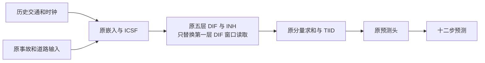
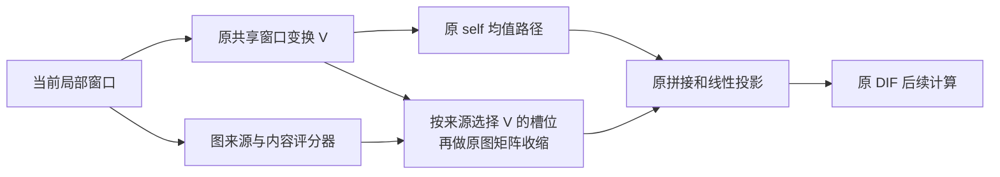

# GW1：IGSTGNN 图来源 × 局部窗口内容选择

日期：2026-10-17。性质：既有创新候选 A 的最小模型实现，不是原论文提出的方法，也不是已经证实有效的新贡献。

## 1. 为什么改这里

原模型已通过拼接图消息和 `gcn_updt` 对不同图 bank 使用不同的固定线性参数，不能说原模型完全不区分图。
待检验的缺口是：**不同图来源是否应该根据当前局部窗口内容，选择不同的窗口槽位？**

历史筛查中，DIF 读出与动态图路径有明显同检查点依赖，局部 ST 卷积也有较大计算开销。这支持优先在现有 DIF 内改造，不能据此推导新选择器必然提高精度。
GW1 只改第一层 DIF 的一个 `STLocalizedConv`；原 INH、图构建、残差分解、其余四层、ICSF、TIID、输出头都沿用冻结实现。没有新增图传播步数或图专家。

对应材料：

- 原论文 [arXiv 2602.02528v2](https://arxiv.org/abs/2602.02528v2)，结构与 DIF 描述；作者源码 Git 对象 `558ab01` 的冻结副本。
- 本地候选设计：`IGSTGNN_论文驱动创新候选方案_20261017.md` 的候选 A（工作区材料，未随源码发布）；本文件给出其完整实现定义。
- 相近工作 [TimeFilter, ICML 2025](https://proceedings.mlr.press/v267/hu25ac.html) 已研究按内容筛选时间/空间关系。GW1 的具体改动是对 IGSTGNN 既有图来源与局部槽位进行选择；不声称首创图过滤、动态门控或交通中的此类方法。

## 2. 模块与数据流



第一层 DIF 内部：



默认五个来源依次为 `PREDEFINED_0, PREDEFINED_1, DYNAMIC_0, DYNAMIC_1, ADAPTIVE_0`。
每个来源保留原一、二阶 bank，合计十个，顺序为“来源优先、阶数其次”；同一来源的两阶共享选择权重。
图轴仍为 `[接收节点, lag × 发送节点]`；权重位于发送节点的窗口，不能错误地使用接收节点权重或 `[节点, lag]` 展平。

同一个选择器用于该层历史编码和原 DIF 自回归预测调用；预测调用只读当前已有或自身产生的隐藏状态，不读未来真实交通。
内容中继承原 ICSF 和时间/节点估计门的影响，**不能称作严格无事故的交通专用编码器**。本轮没有单独增加报告特征。

## 3. 精确定义

局部窗口 `U` 的形状为 `[B,Tlocal,N,Kt,C]`；沿用原变换：

\[
V=\operatorname{ReLU}(W_{\rm local}\operatorname{vec}(U)),\qquad z=\tanh(W_e\operatorname{vec}(U)+b_e).
\]

对来源 `g`，完整模型的分数与系数为：

\[
s_{g,l}=b_{g,l}+u_l(z)+v_{g,l}(z)-\frac1G\sum_{g'}v_{g',l}(z),
\quad a_{g,l}=K_t\operatorname{softmax}_l(s_g)_l.
\]

`encoder` 隐藏宽度固定为 16，不做宽度搜索；评分头和静态分数均零初始化。
源 `g` 的每个图阶都计算 `A[g,order] × reshape(a[g] × V)`，保持原拼接与投影；self 路径仍为 `mean_l(V)`。

代码采用代数等价的 `1 + Kt × (softmax(s) − 1/Kt)`，使均匀分数下系数精确为 1。
浮点下总质量约为 `Kt`，实际偏差写入诊断，不能宣称无限精度守恒。

可验证的性质和限制：

1. 零评分退回原计算；不设依赖 `.item()` 的零门分支，不阻断评分头梯度。CPU 单元及真实 CUDA 小批验证训练/评价输出、原状态、随机数一致性。
2. 理论系数非负、总和为 `Kt`，单系数不超过 `Kt`；这只是选择系数的质量，不保证隐藏能量、输出均值或真实车辆流守恒。
3. 原 `W_local` 已混合所有时间槽位。因此 `a` 选择的是变换后**混合隐藏槽位**，不能直接解释为过去第几分钟、物理传播时延或因果影响。
4. 输入函数结构不引用未来标签；仍继承发布数据的可用时间、归一化和次序认证限制。未来反事实情景、事故解除时间均不在本实现主张中。
5. 新评分头零初始化时，编码器第一次反向梯度为零；评分头已能学习，后续才打开编码器梯度。测试同时检查非零评分头之后编码器可训练。
6. 门本身没有递归状态，不等于整个 IGSTGNN 有稳定性或误差上界证明。保留原 DIF 自回归后，远时距仍可能放大偏差。
7. 相同函数的原参数梯度可能因新增乘法和归约顺序产生浮点差异，不承诺完整训练轨迹与原模型逐位一致。只要求相同运行自身断点续训可复现。

## 4. 四组结构对照

| 训练组 | 使用静态来源分数 | 读取窗口内容 | 内容分数区分来源 | 用途 |
|---|---|---|---|---|
| ORIGINAL | 无新增 | 原计算 | 原计算 | 同运行原 IGSTGNN 主基线 |
| STATIC | 是 | 否 | 否 | 判断固定的来源/槽位偏好是否足够 |
| SHARED_DYNAMIC | 无来源专属分数 | 是 | 否 | 判断共享内容选择是否足够 |
| GRAPH_CONTENT | 是 | 是 | 是 | 完整来源 × 内容结构 |

三种候选注册同样的 1,873 个新增参数，原模型 455,220，候选共 457,093（约增加 0.41%）。
STATIC 活跃新增参数只有静态分数 15 个；SHARED_DYNAMIC 活跃 1,603 个，完整组 1,873 个。**相同注册量不等于相同活跃容量**，此对照不能完全排除额外活跃容量解释；不计算独立贡献百分比。

评价额外保存完整组的两个同检查点状态：

- `GRAPH_CONTENT_UNIFORM`：直接执行原局部卷积，相当于同检查点关闭选择器，保留当前联合训练主干。
- `GRAPH_CONTENT_STATIC_ONLY`：保留静态来源分数，关闭内容评分。可能是分布外干预，不代表单独重训 STATIC。

固定四组与第一层位置均预先写入代码，没有按验证集自动搜索层数、门温度、学习率或候选组合。

## 5. 实验身份与判据

默认按原配方从头训练，四组相同种子、原张量、样本初始顺序、数据、batch48、Adam、学习率/调度、梯度裁剪和原课程。新增参数初始化保留原随机数状态。
五轮只作试跑；不同组都完成相同预算，不启用早停。`--epochs` 表示累计完成轮数，而非追加轮数；最多 100 轮。
阶段 0 不参加从头训练选模。报告相同完成预算内各自 best 和 common last，独立四组未完成前禁止配对评价。

主比较为 `GRAPH_CONTENT_vs_ORIGINAL` 的原尺度验证 pooled MAE。若只优于 STATIC、只在某个流量桶有收益或只在关门干预上有效，不算超过原基线。
联合检查 RMSE、MAPE、十二时距、流量、道路、原支持区域和固定困难窗口。尤其保留低流量/MAPE 恶化、负消融和高分位恶化。
若完整组未优于 SHARED_DYNAMIC/STATIC，只能支持较简单结构，不能坚持“图 × 内容交互必要”。

较完整的后续验证为相同 100 轮预算，种子 2025、2026、2027，同时报告 best/last 与成本，不先以某个种子的最好结果下结论。
当前验证集已用于前期设计，不能再当未见测试；本开发没有自动启动这些正式长训练或测试评价。
需要方案冻结后的独立评价，且窗口/预测点有重叠，不充当数百万独立事故样本。

## 6. 文件与使用

- 模型：`experiments/chronological/original_graph_window.py`
- 四组训练：`experiments/chronological/train_original_graph_window.py`
- Slurm 入口：`experiments/chronological/run_original_graph_window.sh`
- 等价性/梯度/batch48：`experiments/chronological/verify_original_graph_window.py`
- 六状态评价和只读重分析：`experiments/chronological/evaluate_original_graph_window.py`

独立分支的更新和工作目录建立步骤见 [GW1 服务器运行说明](igstgnn_graph_window_gw1_server.md)。启动脚本默认定位自身所在仓库，避免误用原分支目录；仍支持 `ORIGINAL_IGSTGNN_REPO_DIR` 显式覆盖。

服务器同步这些代码后，在 GW1 仓库根目录、已申请 GPU 的环境运行：

```bash
python -u experiments/chronological/verify_original_graph_window.py --check --output experiments/chronological_runs/gw1_check_s2025.json
```

严格 batch48 的一次前向/反向检查（ORIGINAL 与完整组，无更新、不自动减 batch）：

```bash
python -u experiments/chronological/verify_original_graph_window.py --stress --batch-size 48 --output experiments/chronological_runs/gw1_batch48_s2025.json
```

四组五轮试跑（脚本在无 Slurm 分配时自行 `sbatch`；有分配时直接运行）：

```bash
bash experiments/chronological/run_original_graph_window.sh --run-dir experiments/chronological_runs/contra_original_gw1_s2025 --epochs 5
```

被中断后在相同环境续上；保留已有目录和锁文件，进程仍在运行时不重复启动：

```bash
bash experiments/chronological/run_original_graph_window.sh --run-dir experiments/chronological_runs/contra_original_gw1_s2025 --epochs 5 --resume
```

四组完成后分别保存 best 和 last 结果；输出目录必须新建：

```bash
python -u experiments/chronological/evaluate_original_graph_window.py --run-dir experiments/chronological_runs/contra_original_gw1_s2025 --checkpoint best --output-dir experiments/chronological_runs/contra_original_gw1_s2025/eval_best
python -u experiments/chronological/evaluate_original_graph_window.py --run-dir experiments/chronological_runs/contra_original_gw1_s2025 --checkpoint last --output-dir experiments/chronological_runs/contra_original_gw1_s2025/eval_last
```

只读重新生成报告，无推理、训练或检查点加载：

```bash
python experiments/chronological/evaluate_original_graph_window.py --archive experiments/chronological_runs/contra_original_gw1_s2025/eval_best/paired_predictions.npz --output-dir experiments/chronological_runs/contra_original_gw1_s2025/reanalysis_best
```

所有训练检查点保存优化器、调度器、课程长度、训练排列、CPU/CUDA/NumPy/Python RNG；半轮失败从上一原子轮检查点重放。源码、运行时、数据或初始化身份改变时拒绝续训。
验证预测必须重放匹配保存的 MAE/RMSE/MAPE 后才发布归档。报告的 NumPy64 统计可与原 Torch32 指标有舍入差异。
推理计时独立于统计：同首批量、两次热身、三次完整同步前向；不是训练吞吐，也不是单样本延迟。

## 7. 数据和来源边界

主基线始终是原 `558ab01` IGSTGNN，不是 MIN、F1/F2 或 v0.3 适配器。冻结九文件的清单 SHA256 为 `fdaf7bd006f70e86d6a1ee3069f858387a7c541149adba55a96f82b1c7879531`，开发没有修改这些文件。
发布模型就绪数组按作者行顺序取训练 `[0,3909)`、验证 `[3909,4746)`；归一化不重拟合，绝对日历次序和归一化拟合来源不新增认证。
原发布 object 数组还包含测试载荷，加载时会反序列化整个数组；没有创建或评价测试批次，不能写成“从未读取包含测试载荷的文件”。

本方案没有新增事故字段、真实流量分组门控、物理传播约束、未来解除标签或部署时增益 oracle。

## 8. 开发验收证据

最终实测范围、硬件、单元检查、断点重放、批量压力和文件哈希记录于 `docs/verification/graph_window_gw1_development_20261017.json`。
出现过的失败日志保留；以该最终记录引用的 PASS 制品为准。小样本指标只用于检查流程，不作为模型优越性证据。

本次已完成：50 项单元/回归检查；真实 496 节点 batch2 的训练/评价逐位退回；四组两轮工程试跑；连续与断点续训完整状态一致；best/last 六状态重放与报告；batch48 的 ORIGINAL/GRAPH_CONTENT 前向和反向。
尚未执行完整验证 837 窗口上的 GW1 实验、四组五轮试跑、100 轮多种子或测试集评价。独立发布分支为 `research/graph-window-gw1`；发布记录见服务器运行说明。

本地设备为 Windows RTX 4060 Laptop GPU，物理显存约 8.59 GB；Torch 记录的 batch48 峰值 allocated 为 ORIGINAL 13.12 GB、完整组 13.36 GB。
这说明本机运行涉及虚拟化/分页等设备内存管理条件，**不构成 8 GB 原生显存可容纳的认证**，也不作为服务器 V100 的速度结论。服务器必须执行自己的 batch48 检查。
