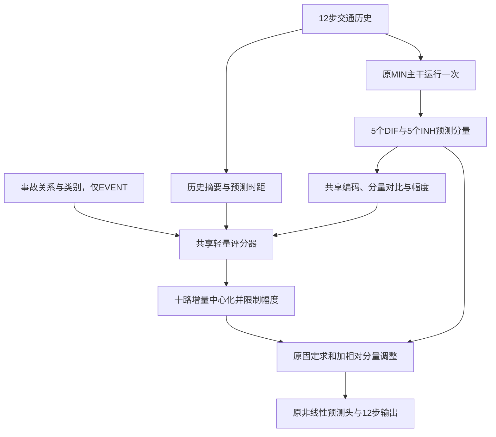

# MIN-F2分量内容感知的事故条件融合

日期：2026-10-15。状态：开发与本地工程验证；正式效果待服务器实验。主baseline为原IGSTGNN，MIN为中间结构对照。本方案承接[F1相对权重结果](igstgnn_f1_relative_probe_results_20261015.md)，只增加一个融合候选。

## 📋 问题与可检验目标

F1原完整融合MAE pooled为13.69626，固定求和13.63676，去共同均值13.64742。中心化改善MAPE及固定困难集，但仍存在正负修正抵消。旧评分器没有读取被加权的十个预测分量；它只根据历史摘要、时距和报告给权重。

F2检验一个候选架构：让评分器同时读取实际预测分量，训练时直接使用受限零和增量，并与同预算纯MIN微调比较。不能保证这些变更改善指标，不能把检查点内容关闭实验当作独立训练的内容消融。

## 🧩 完整数据流



| 模块 | 输入与作用 | 选择依据 |
|---|---|---|
| 原MIN主干 | 原图、历史容量先验、五层解耦结构生成十个forecast | 复用成熟MIN最佳权重，先保持已有有效部分 |
| 共享分量编码 | 每个forecast经LayerNorm与小投影编码 | 直接观察正在融合的内容，避免十套独立大网络 |
| 分量对比 | 编码与同位置十路平均编码之差 | 提供分量之间不同的内容；不把差异当作准确率 |
| 分量幅度 | 每个forecast的log1p RMS | 归一化编码可能丢失尺度，因此保留幅度摘要 |
| 历史与时距 | 嵌入历史末帧、均值、末首差压缩，加入时距及分量身份嵌入 | 让同一分量可随交通状态和预测步调整 |
| 事故上下文 | 原关系编码及类别嵌入，仅原支持位置 | 保留事故增量对照，不新增未经核实的事故持续时间 |
| 受限相对融合 | 十路增量去均值，必要时统一收缩 | 训练时即限制共同增益漂移，不进行事后挑时距 |
| 原预测头 | 原顺序求和及原非线性读出 | 零初始化严格回到同权重MIN，避免同时更换读出器 |

共享编码保留原forecast到评分器的梯度，主干与融合器联合训练。评分器采用紧凑分块计算，避免构造完整`[B,12,N,10,F]`张量；无额外主干前向、输出偏置或新增物理传播模块。

正式MIN为435,856参数，F2新增4,997参数，总计440,853；F1为440,950。原嵌入宽度32、forecast特征宽度256，二者不可混用。分量编码宽度8、状态上下文宽度8、共享评分隐藏宽度16；这些是本轮固定实现配置，不按当前验证分组逐项调整。

## 🧮 系数定义

十个score分别对应原5个DIF、5个INH。令`a=0.1`：

```text
d_k = a * tanh(score_k)
r_k = d_k - mean_k(d)
alpha = min(1, a / max_k(abs(r_k)))，全零时alpha=1
delta_k = alpha * r_k
weight_k = 1 + delta_k
```

每个样本、节点、时距独立计算，增量和近似零且绝对值不超过0.1。最后评分投影零初始化，初始delta严格为零，保持原MIN预测。有限精度误差须由测试和机制诊断检查。

零和只限制系数共同项，不保证输出无整体偏移、交通流守恒或真实容量可识别。MIN内已有容量仍为无量纲隐变量交换预算，不把它称为车辆通行能力。

## 🧪 三组训练与比较

| 训练组 | 来源 | 新融合 | 事故输入 | 回答的问题 |
|---|---|---|---|---|
| CONTROL | 同一已有MIN A最佳权重 | 无 | 无 | 相同额外优化预算下纯MIN能改善多少 |
| STATE | 同一已有MIN A最佳权重 | 分量内容感知的相对融合 | 无 | 新融合候选相对纯MIN微调的整体效果 |
| EVENT | 同一已有MIN A最佳权重 | 与STATE相同 | 原关系与类别 | 同架构条件下加入事故信息的增量 |

CONTROL不是重新从零训练成熟MIN，而是补齐此前缺少的同预算微调控制。已有MIN A以及F1训练均不重复。三组从同一源最佳权重出发，源epoch0参与选模；不是直接从已看过验证结果的F1最佳模型分别挑权重。

默认先到阶段5轮，batch64、每轮62更新；相同seed、训练样本顺序、全12时距损失、主干Adam学习率1e-4、融合学习率1e-3，调度与早停规则固定。CONTROL没有融合参数组，STATE/EVENT注册参数相同但有效语义参数与支持范围不同。

这里相同预算指训练样本、更新次数和核心优化规则相同，不代表FLOPs、显存或耗时相同；正式轮次时间由history.json记录，尚未承诺新结构更快。

5轮用于检查候选趋势和机制，不足以证明收敛、泛化或可发表。若继续，使用同一目录增加绝对`--epochs`目标；只续跑未完成的组。三组轮次不齐时只报告共同前缀，不冒充同预算整体比较。

## 🔍 评估与改进依据

评估保存的CONTROL/STATE/EVENT各自最佳权重，先完整回放原验证批次和选模指标，通过后再干预。EVENT干预后逐批恢复ON完全一致。

| 状态 | 干预与解释 |
|---|---|
| CONTROL_ON、STATE_ON、EVENT_ON | 同源、同额外预算模型比较，分别选验证最佳 |
| EVENT_REPORT_OFF | 清零报告上下文，保留内容与状态融合 |
| EVENT_FUSION_OFF | 同一EVENT训练后主干的固定求和，非历史MIN |
| EVENT_CONTENT_OFF | 清零分量内容、对比和幅度，保留历史、时距、身份与报告；可能分布外 |
| EVENT_SEMANTIC_UNK | 类别未知，保留关系与支持；可能分布外 |
| EVENT_LOCATION_SHUFFLE | 固定种子重排关系和支持，保持类别；可能分布外 |
| SOURCE_MIN | 复用已有认证验证预测，作为源参照 |

报告MAE、RMSE、MAPE、逐时距、道路、事故区域、流量区间、当前固定求和高低估组、固定困难窗口、正负抵消以及预测响应。真值分层仅用于事后定位，不能作为推理输入。固定困难窗口由同一已保存源MIN预测按固定规则确定，并显式记录计算来源，避免随候选重选；不能把重新计算说成直接复制既有ID。

权重统计不等于模块重要性。CONTENT_OFF只测当前权重依赖，不能证明去掉内容后重新训练是否退化。STATE相对CONTROL包含新评分器、内容输入和训练内中心化的共同变化；若需要独立识别内容输入贡献，须后续同结构从训练开始关闭内容的控制，不把本次推理干预冒充该控制。

原IGSTGNN主比较继续复用[已审计的历史证据](igstgnn_f1_paper_baseline_audit_20261015.md)，原作者实现和公式对齐版明确分开。当前三组实验不能直接与论文测试表作验证集对比；正式论文主比较和独立确认仍需单列。

## 💾 运行与复用策略

训练入口`experiments/chronological/run_min_component_fusion.sh`，评估入口`experiments/chronological/run_min_component_fusion_evaluation.sh`。Git更新与Bash运行分开；Bash无Git、无`--mem`资源申请。训练脚本在已有Slurm作业内直接运行，否则通过sbatch提交；评估脚本在现有GPU作业内运行。

服务器先更新代码：

```bash
cd /seu_share/home/huangkai/220243809/paper/IGSTGNN/IGSTGNN-code
git pull --ff-only origin research/chronological-tiid
```

三组先运行到阶段5轮，然后自动评估验证集：

```bash
bash experiments/chronological/run_min_component_fusion.sh \
  --run-dir experiments/chronological_runs/contra_min_component_f2_bs64_seed2025 \
  --epochs 5 \
  --evaluate-after
```

中断后运行同一条命令，从完整轮次续跑；已经完成到目标的组不更新权重。若以后只续EVENT，在同一目录增加`--only EVENT`；三组预算不齐时评估会逐对标注。主要回传自动评估输出目录的`report.md`、`mechanisms.json`及三组训练`latest_stage.json`。

优先复用F1保存的`source_reference.json/npz`，先核源最佳模型、数据包、样本/站点轴、目标、掩码、原批次和指标；复用不写成新增源回放。缺少认证归档才允许一次完整源验证推理，仍不训练源模型。

每组独立子进程，退出后释放内存；保存模型、优化器、调度器、随机状态及训练顺序，支持中断后从已提交完整轮次续跑。旧实验源码和检查点不修改。

## ✅ 验收状态

31项不同测试通过：模型10项、训练入口10项、评估入口10项、正式规模合成指标1项。模型及训练入口合并测试20项35.890秒；评估10项15.517秒；正式数组轴837×12×496、338,686有效点合成指标测试1.491秒。Bash语法通过。

496站四窗口真实格式工程集成通过：CONTROL/STATE/EVENT各1轮、各2次优化更新、相同训练顺序，正式参数量分别435,856/440,853/440,853。已有源预测逐字节复用，完整源验证前向0；首次初始化仅2个训练例上的1次源与3次新组前向，不冒充全量回放。

九状态评估通过：26次新前向，SOURCE_MIN与初始化前向均0，全部ON回放通过、干预逐批恢复完全一致、60个受保护文件及三模型状态保持不变。已有原模型/训练/数据21项指纹不变。单独EVENT重复同一已完成目标时更新0、检查点字节不变。工程源仅为少量训练的检查点，以上数值不构成成熟模型或正式效果结论。

机器可读证据见[开发验收记录](verification/igstgnn_min_component_fusion_f2_20261015.json)。正式服务器改善尚未知，未训练正式F2或评价测试集。
