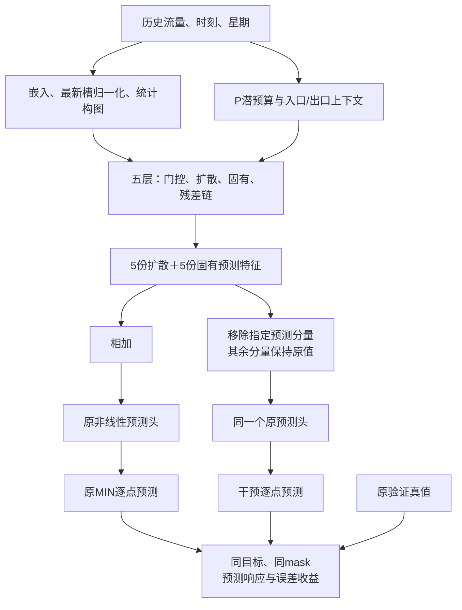

# MIN 数据流与逐预测点贡献审计方案

日期：2026-10-14。状态：方案设计完成；诊断工具尚未实现，不把代码审查当作服务器消融结果。

## 🎯 目的与研究方向

先解释现有最佳MIN为何有效，再选择一处小幅改进。复用`contra_min_i_v1_bs64_seed2025/A/last.pt`中的`best_model_state`（最佳28轮），不重新训练MIN，不训练新适配器，不评价测试集。

R2输出域硬约束重构已出现严重退化，退出当前默认主线；详见[R2退化与可行性审核](igstgnn_min_r2_failure_audit_20261014.md)。原MIN源检查点不变。旧L/S、冻结位置、service-budget、B3R的TIID×D结果保留，不能换名称重复运行。

本轮评估三个层次：**模块是否执行、改变它是否影响预测、这种影响是否改善误差**。内部隐藏状态没有真实标签时，能评估的是对最终预测的功能贡献和敏感性，不能报告它的独立准确率或真实物理准确性。

## 🧩 MIN真实数据流与审计对象

| 对象 | 实际作用 | 本轮怎样审计 |
|---|---|---|
| 流量嵌入、站点/时刻/星期嵌入 | 将历史和位置时间信息组织为隐藏特征 | 记录维度、数值范围及后续消费位置；输入级归因放在后续代表窗口 |
| `icsf_module.output_norm` | 仅对最新历史槽归一化；完整事故ICSF已经删除 | 单独登记活跃，不能把整个ICSF都标为关闭 |
| 作者邻接、学习静态图、两路动态图 | 统计图消息传播；动态图每完整前向构建一次 | 记录消息规模/图分布；后续固定形状移除消息通道，不破坏支持维度 |
| 五个estimation gate | 读取站点与时刻/星期embedding，乘到当前历史；不直接读取流量值或事故 | 记录门值、饱和率和输出变化；门值大不直接等于有用 |
| P、inlet、exit | 从最新槽归一化之前的嵌入历史及截止时钟生成4维潜预算/边界 | 记录预算、边界与约束主导率；不把它解释成真实道路容量 |
| 五个潜交换模块 | 每层独立参数；在局部图卷积输出上添加交换增量 | 首轮整体OFF；有作用再逐层/逐调用OFF |
| 五个扩散分支 | 图时空编码、预测递推及backcast | 单预测分量移除测直接输出贡献；总路径作用需要另行完整重跑 |
| 五个固有分支 | GRU、位置编码、时间注意力及backcast | 同上；注意力图只作辅助记录 |
| 残差链 | 将前层backcast解释后的历史送到后层 | 不能随意整层置零；需区分直接forecast与后续层间接作用 |
| 共享预测头 | 非线性变换、gap通道选择，产生12步预测 | 所有对照使用原权重、原顺序和原函数，不新增拟合读出 |

正式配置每层局部图卷积调用4次：历史处理1次、后续预测块递推3次；共20次潜交换，每次有2个局部子步。40次局部更新不是40个真实物理时间步，潜状态在每次交换调用重新编码。追踪应校验实际调用数，不默许缺失或额外调用。

代码层号0～4在报告中显示为第1～5层。每层历史处理输出长度为10、8、6、4、2。中间特征的历史窗、预测块和局部子步必须分轴标注，不能把它们统称未来时距。

## 🔍 两张表回答“每次数据流是否有效”

**执行表**记录：模块、层、分支、调用序号、历史/预测阶段、输入/输出shape、数值范围、门控分布、图消息与交换增量规模、约束统计、消费者路径。

**贡献表**的基本单位是`干预状态 × 原验证sample_id × station_id × horizon`，记录原预测、干预预测、真值、有效性、预测响应和误差收益。

执行表能证明数据经过何处；贡献表能说明干预路径后哪些预测改变、误差如何变化。不能仅用范数、attention或梯度大小把每条内部数值标成“正确”。第一阶段得到全量逐预测点的路径效用图；逐输入元素和逐神经元的唯一贡献通常不存在，不做巨型全Jacobian枚举。

## 📐 统一指标

对原预测\(\hat y_j\)、移除路径m后的预测\(\hat y_{-m,j}\)，固定同一真值和原有效掩码：

\[
r_{m,j}=\hat y_{-m,j}-\hat y_j,
\qquad
g_{m,j}=|\hat y_{-m,j}-y_j|-|\hat y_j-y_j|.
\]

- r描述方向与幅度；非零只说明预测响应。
- g>0：保留路径时该预测点的绝对误差较低。
- g<0：该路径在这个预测点上有负作用。
- g=0：该干预下误差不变，不代表任何重新训练后都冗余。

例如真值100、原预测110、移除后130，则g=30−10=20。它是当前权重与当前参照下的功能收益，不是真实交通因果效应或唯一分摊份额。

报告正收益\(G^+=mean(max(g,0))\)、负收益\(G^-=mean(max(-g,0))\)、净收益\(G=G^+-G^-\)和抵消比例\(1-|G|/(G^++G^-)\)。分母为0时标记不可用。

同时报告MAE/RMSE/MAPE、预测变化、改善/变差点占比、逐窗口胜负与固定困难窗口。MAE贡献按有效点权重汇总；RMSE不强行做可加贡献分解。MAPE保留源有效性规则并排除零分母，不擅自加入新掩码。

## 🧪 首轮14种预测状态，新增训练0组

| 状态 | 数量 | 操作 | 解释范围 |
|---|---:|---|---|
| 原MIN | 1 | 原始模型与原输入 | 基准验证及数据流捕获 |
| 单个扩散/固有forecast分量移除 | 10 | 五层各两份，指定分量置零后按原顺序求和，送入原头 | 直接进入预测头的边际作用 |
| 全扩散forecast分量移除 | 1 | 仅移除五份扩散预测特征 | 扩散预测特征整体直接作用 |
| 全固有forecast分量移除 | 1 | 仅移除五份固有预测特征 | 固有预测特征整体直接作用 |
| 全潜交换OFF | 1 | 所有实际调用中的交换增量置零，完整前向 | 潜交换对预测的总路径依赖 |

10份原始forecast隐藏量是`[B,4,496,256]`，相加后经非线性头变成`[B,12,496,1]`。12个预测分量对照复用同一次原始前向，增加原预测头计算；不是12次完整主干推理，更不是12套训练。全潜交换OFF才需要完整主干重跑。

移除forecast时保留原backcast与后续层输入，故不能称为删除整个模块。不能把`decode(单分量)`当成可加流量贡献。原头有ReLU与偏置，各路径的边际收益不必相加等于总误差。

原始头的捕获/重组必须先严格复现原预测；使用原分量求和顺序，避免浮点重排造成伪小收益。身份干预（系数1）应等于原始输出。OFF结果写成功前验证原始恢复预测、参数/缓冲区/RNG/输入及hook覆盖；发生异常必须清理所有hook。

原保存指标回放容差沿用已有探针；同一执行环境中的身份干预与恢复预测要求逐元素一致。若有环境差异，单独报告重复回放数值抖动；不能把与抖动同量级的小差值解释为模块增益。

## 🪜 按证据逐步加深，不展开所有组合

首轮交换整体显示重要作用或明显抵消，再增加5个“逐层交换OFF”；关闭的是该层交换增量，原图卷积、其余层、P和预测头继续运行。

对最明确的层再分调用：call0为历史处理，其作用可以进入forecast、backcast、固有分支和后续层；call1～3属于扩散预测递推，不进入该层backcast及后续层历史残差。两者必须分别评估。

如果证据指向图、门控、归一化或边界，再定义对应的合法干预。图消息保持原shape与支持通道数；归一化/GRU/attention等不能直接把整个输出置零再把崩溃称为模块必要性。关键路径可补0.5倍/1倍的小扰动，检查零置是否只是离开训练分布。

只对筛出的两个关键路径补四组合交互，不枚举全部模块的指数级组合，也不首轮计算全模型Shapley值。需要输入级解释时，使用预声明的代表窗口与明确参照的梯度归因；归一化0表示源均值，不能冒充真实零流量。

## 🗺️ 逐点结果如何汇总

- 层/分支 × 12个预测时距：看作用是短期、长期还是全程。
- 层/分支 × 道路/站点：看收益是否仅来自局部区域。
- 历史流量与真实目标流量分别分组，不混用可观测输入和事后标签。
- 原MIN高估/低估固定分组：看路径是否只是整体抬高或压低预测。
- 事故关系支持、候选传播包络、其余节点：均为评价分组，MIN前向仍不读取D。
- 固定原MIN困难窗口及尾部分布：不用各干预自身的不同困难集替代配对集合。

真实目标流量桶、误差正负及本轮g均是事后诊断，不能输入未来门控。窗口重叠不能当独立事故重复；当前反复使用的验证集属于开发性探索，不输出点级伪精确信心或用测试集挑模块。

## 💾 复用、来源与资源

保持作者发布3909训练/837验证划分、原batch64与尾批、原站点轴、源选模和有效掩码。模型eval、无优化器；source_MIN_training_updates=0，test_evaluated=false。

R2目录已有`source_reference.npz/json`可核验来源后复用，因为它保存的是原MIN回放；R2候选自身预测不能代替MIN。必须核对source状态指纹、原sample_id、目标、batch分区、尺度、mask及缓存字节。插桩仍需一次原始MIN前向。

每批捕获、计算、释放；不保存全验证集的密集动态图和10份完整隐藏张量，不一次性导出数千万行CSV。按case分块保存float32预测与共享真值/mask，收益可按需计算。中间张量保存摘要，只为预先指定少量窗口保留详细trace。半精度、批大小改变等效率试验不混入贡献审计。

建议制品：`execution_trace.jsonl`、`interventions.json`、`paired_predictions.npz`或分块数组、`metrics.json`、`layer_horizon.csv`、`region_metrics.csv`、`report.md`、`replay.json`、`preservation.json`。这里只定义产物，尚未生成正式审计结果。

## ✅ 怎样据此决定小幅改进

| 证据 | 可支持的判断 | 后续动作 |
|---|---|---|
| 没有消费者/从未调用，等价预测核验通过 | 计算图死路径或未用参数 | 等价清理；不冒称提高准确率 |
| 输出变化大、稳定净负收益 | 当前检查点中存在有害作用或补偿 | 检查位置/尺度/分布变化，再选一处小改 |
| 正负作用大但严重抵消 | 作用具有条件差异 | 用仅可观测历史解释条件，不按未来真值开关 |
| 效果局部明显、全网均值小 | 有局部作用证据 | 评价对应道路、时距与风险，不能简单淘汰 |
| 移除后几乎无变化 | 当前参照下依赖弱或被其他路径补偿 | 复核干预是否执行及交互，不能直接宣称可删 |

静态审查已发现BN、未消费时间投影、最终未使用inherent backcast等参数清理候选；最终层diffusion backcast仍供本层inherent使用，不能一起删除。先验证等价，不把它们当精度创新。

首轮结束后才选择**一个**作用点。后续候选完整保留MIN功能基座，初始回放一致；允许候选内部低学习率联合微调，不新增MIN-only对照训练，不重复旧capacity/service适配器。删除后重训能否保持性能是另一问题，本轮检查点干预不替它作结论。

## 📚 方法依据

- [Sundararajan等，ICML 2017：Axiomatic Attribution for Deep Networks](https://proceedings.mlr.press/v70/sundararajan17a.html)提出Integrated Gradients用于输入归因。本方案仅把它作为后续代表窗口的辅助工具，不把梯度归因替代误差收益或独立物理真值。
- [Jain与Wallace，NAACL 2019：Attention is not Explanation](https://aclanthology.org/N19-1357/)在NLP任务展示注意力权重作为解释的局限。这里借鉴检验思想；MIN各路径是否有效仍需本模型自身的配对实验。
- 当前MIN真实依赖以`incident_spatial_minimal.py`、`igstgnn.py`和`incident_spatial.py`为准；旧chronological/ICSF/TIID审计不与发布版MIN数值混合。
