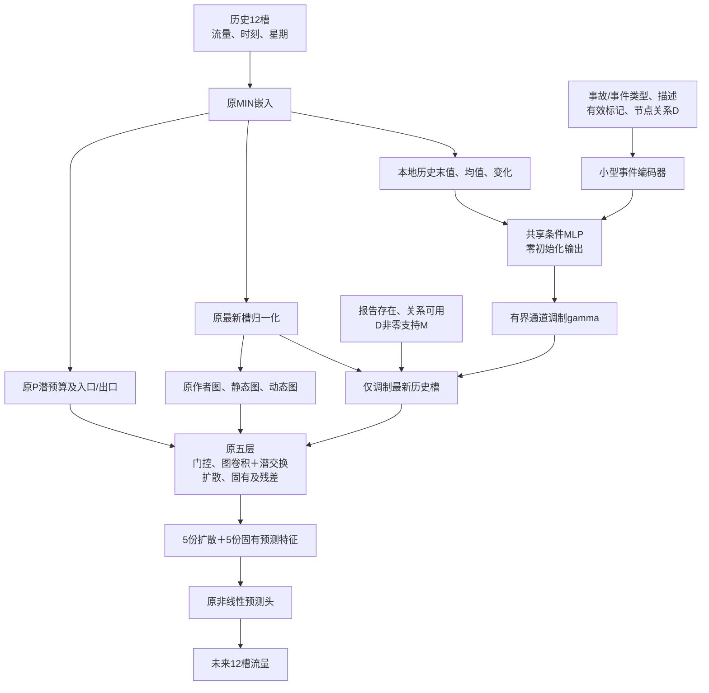

# MIN-E1：单次事故条件通道调制与从头训练方案

_2026-10-14。设计提案与实现约定；效果须由服务器配对训练验证。_

---

## 🎯 选择这套方案的理由

本轮选择在MIN内部加入一个小型事故条件模块：对最新历史槽的隐藏通道进行有界乘性调制，之后仍由原时空分支生成预测。它是目前最值得先试的方案，不是已经证明最好的模型。原MIN各模块的可删除性研究保留；本轮不同时删模块，避免混淆事故增加的效果。

选择依据来自已回传实验：冻结适配器主要学成整体上调，低流量与高估点受损；位置内容重排与state/location对照差值很小；输出域R2重构又引入了不适配现有观测的强约束。详见[已有实验复用清单](igstgnn_min_experiment_reuse_ledger_20261014.md)与[R2审核](igstgnn_min_r2_failure_audit_20261014.md)。这支持缩小改动范围，但不能证明任何新结构必然有效。

本轮从头联合训练新候选，主干和新增模块都可更新。默认不重训已有原MIN；新训练的状态对照用于区分事故信息与额外状态适配。前期少量轮次主要检验接通、学习趋势与配对差异，不据此宣布最终优胜。

## 🧩 完整模型结构

潜交换属于各层局部图卷积内的增量；原参数与局部子步保留。图用于说明依赖，执行顺序以源码与调用审计为准。

| 模块 | 功能与选取理由 | 本轮变化 |
|---|---|---|
| 原流量/站点/时间嵌入 | 保留已有效的历史编码能力 | 保留 |
| 原最新槽归一化 | 维持MIN原输入尺度；事故调制放在它之后，避免立即被同一归一化消除 | 保留 |
| 原构图与P/inlet/exit | 从未加事故调制的历史生成，避免一次改动同时改变图、预算和初始状态 | 保留 |
| 事件语义编码 | 类型/描述使用嵌入，未知类别与真实类别0分开 | 新增且三模式同参数 |
| 单共享条件MLP | 将本地历史状态与事件证据相互作用，输出各隐藏通道的调制 | 新增一次 |
| 有界乘性残差 | 允许增强或减弱不同通道；初始恒等，不增加输出域截距或自由流量残差 | 新增一次 |
| 原五层与潜交换 | 条件后的状态能进入扩散、固有、backcast与后续残差，而非仅在最终预测外叠加 | 保留并联合训练 |
| 原预测头 | 保持已有预测空间与12步映射，不新增硬守恒输出解码器 | 保留 |

## 📐 条件模块与时间含义

设原归一化后的最新隐藏状态为\(z_{n}\in\mathbb R^{32}\)，本地历史摘要为\(s_n\)，节点关系为\(D_n\in\mathbb R^3\)，事件语义为\(e\)。共享小型MLP给出：

\[
\gamma_n=0.25\tanh\bigl(f_\theta(s_n,D_n,e)\bigr),\qquad
z'_n=z_n+M_n\gamma_n\odot z_n.
\]

最新槽之前的11槽保持原值。历史摘要可包含最新状态、历史均值与末值减初值，并在条件模块内部规范数值尺度；不能引入未来目标。条件模块输出末层权重与偏置为0，因此初始预测精确等于相同随机权重的MIN。三模式采用相同参数注册和相同随机初始化；条件模块构造不改变后续数据顺序及dropout随机流。

正式hidden=32、条件宽度32时新增5,468个参数，总计441,324，相对MIN的435,856增加约1.25%。三模式注册数一致；实际被数据激活和接收梯度的参数范围另行解释。

通道倍率在[0.75,1.25]内。0.25是本轮预设的优化稳定性上限，不是认证的最佳超参数，也不代表事故严重程度。零隐藏通道不由该乘性操作凭空生成非零偏移；最终流量仍能因非线性时空处理发生双向变化。不得把“没有beta”解释为绝对不可能产生预测偏置，需用评估实测。

事件是在预测截止时条件化历史表征，不声称这条报告在前12个历史槽均已被观测。它只注入一次；原20次交换、每次2个局部子步仍是计算调用，不是事故持续40个真实时间步。

M由报告存在、关系可用及D非零支持共同产生，并在输出投影之后施加。无可用定位时回到未加条件的当前模型；这意味着证据缺失时不注入，不意味着样本已认证无事故。条件增量在M之外直接为0，随后原图传播可能使外部节点预测改变。

## 🧾 使用与排除的数据

保持作者发布5585样本，3909训练、837验证、839测试，496站点；X三通道是流量、tod、dow，Y使用流量通道。沿用作者尺度、邻接、有效掩码和发布文件指纹，不转换成另一个chronological数据包。

使用原关系D、Type、Description及独立有效标记。D不是经认证的公里距离，不擅自用道路速度换算传播时间。类别数6和29，未知类别另设token；类别0仍可为有效类别。

不输入Incident Time、durations、Holiday、incident_position，也不虚构封道率、车道数、处置进度、清障时间或真实容量轨迹。Type/Description的首次报告可用时点尚未认证，因此本轮范围为`published_archive_attributes_conditional_offline`。现有测试对象数组会整体反序列化，但默认不评价或用测试目标选模型。

## 🧪 最少充分的训练对照

| 组 | 历史状态 | M/D | 类型/描述 | 用途 |
|---|---|---|---|---|
| STATE，默认新训练 | 有 | 不读取；条件支持为全站，D为0 | UNK及无效标记 | 同架构、同参数量的纯状态适配对照 |
| EVENT，默认新训练 | 有 | 真实可用关系与支持 | 真实可用语义，否则UNK | 完整事故候选 |
| LOCATION，可选后续 | 有 | 真实可用关系与支持 | 恒为UNK | EVENT的语义增量对照 |
| 原MIN，已有 | 有 | 无 | 无 | 复用历史参照，不默认重训 |

STATE不读取真实M，因此不是“保留事故位置的无语义组”。EVENT vs STATE的差异包含事故内容及内容决定的支持策略；不是只检验D的数值。三新模式参数完全相同；各模式未使用的语义参数不能算有效学习自由度相同，报告保留这一限制。

新候选都从相同种子随机初始化开始，主干与新模块联合训练，不从已训练最佳MIN热启动。训练数据顺序、dropout流、优化器和选模规则配对。首轮默认STATE和EVENT各5轮，查看工程与开发趋势；需要时同目录续到10轮。LOCATION不是默认第三组，只有需要分离语义增量时才增加到预先声明的组集合。

作者原优化协议继续使用：batch64、学习率0.002、既定调度、梯度裁剪与课程。前期完整12步训练；恰到第30轮课程长度会降到1，此后逐步增加，必须读取每轮记录，不把30轮末轮与前29轮解释成相同损失范围。首轮不为追求显著差异改变loss。

已有MIN最佳28轮验证13.944357872009277，测试平均MAE14.041218439737955。新候选5轮与已有28轮最佳不是同训练预算比较；主要早期比较是STATE vs EVENT相同轮次、相同前缀最佳与完整曲线。训练预算相符后仍需核对全部协议，不能只靠轮数称公平复现。

## 🔬 与评估方案的接口

详见[MIN-E1模型评估与改进依据](igstgnn_min_early_event_evaluation_20261014.md)。它将整体预测效果、事故内容依赖、各层直接预测贡献分开输出。

首轮重点观察：EVENT是否超过STATE；调制是否接通梯度；改善是否仅来自整体上调；低流量与困难窗口是否恶化；位置重排和语义UNK是否改变预测效用；哪些扩散/固有预测分量值得进一步审计。若事故与STATE几乎相同，不继续以扩大轮数代替内容机制检验。

原P/潜交换仍是无量纲表征先验，当前不声称识别实际道路通行能力。保留其作用不等于宣称它必要；后续模块审计可据证据删除，但需另行验证，不能在本轮事故比较中同步修改。

## 📚 思想来源与决策记录

跨领域借鉴[FiLM，AAAI 2018](https://ojs.aaai.org/index.php/AAAI/article/view/11671)：条件信息可以调节已有特征通道。这里采用其乘性特例，改为本地历史与事件联合条件、支持掩码、单次有界残差。FiLM的视觉实验不能证明交通任务的收益或本设计新颖性。

[Deep Residual Learning，CVPR 2016](https://arxiv.org/abs/1512.03385)提供围绕恒等映射学习残差的设计启发。本轮末层全零与0.25边界是本实现选择，不能借该论文宣称已获得优化或泛化保证。

独立方案讨论收敛于单一路径；未采用“early条件＋新容量分支＋自由输出残差”的同时叠加，因为这会增加归因难度。也未采用R2输出域重构，因为现有数据与其约束已有反证。保留反证：单次注入可能太弱；类别可能不够丰富；事故字段可能含事后属性；模型可能仍只学习位置相关校准。评估必须允许这些结果出现。

研究组织使用scientific-brainstorming与experimental-design技能的独立生成、反证与对照检查流程；方法工具来源：[Kassis等，Scientific Agent Skills，2026](https://arxiv.org/abs/2609.00065)，已核对v2记录。它不是本交通模型的效果依据。
