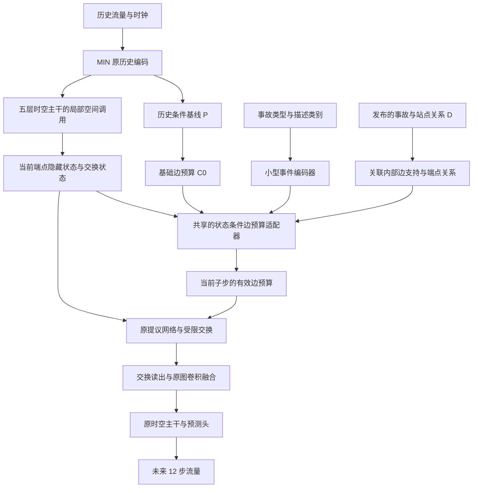

# IGSTGNN MIN-I：事故条件边预算模块设计草案

日期：2026-10-13。状态：首轮设计规范；A/L/S 训练与局部诊断已实现，验收见 [开发与运行说明](igstgnn_min_event_budget_20261013.md)，预测收益尚未验证。用户提出在 MIN 上加入事故信息，本文件把这一方向具体化为可开发、可消融的版本。

## 1. 研究问题与现有证据

研究问题：在交通历史已经包含部分事故影响的情况下，事故报告的关联位置、类型和描述，能否进一步改善 IGSTGNN 的局部传播和远期流量预测？

现有 MIN 使用作者发布的 Contra Costa 数据，3909 / 837 / 839 条训练、验证、测试样本，batch 64，435856 参数。第 28 轮最佳权重的测试结果为 MAE 14.04121844、RMSE 23.55155055、MAPE 17.89513566%。原论文平均结果为 13.43 / 22.50 / 15.84%，当前 MIN 尚未超过原论文；历史原发布实现复现的 MAE 为 13.9406，但 batch 48，不能作为严格同配置排名。

MIN 的价值是提供不读取显式事故报告的参照。它的 P 已能从历史推测部分异常状态，因此新增报告不能预设为必然有效。这里 P 是“历史条件基线”，不是“无事故反事实”。

可证伪预测：加入报告的版本，在同训练规则下应改善验证表现，并在报告关联区域、远期或预先固定的困难窗口中表现出可解释的增量。如果只增加预测变化，净收益仍被正负误差抵消，则这一版本没有达到目的。

## 2. 思想来源与拟研究的改变

| 来源 | 已有思想 | 本提案如何借鉴 |
| --- | --- | --- |
| [IGSTGNN，KDD 2026](https://arxiv.org/html/2602.02528v2) | 事故语义与空间关系参与预测，ICSF 和 TIID 分别处理融合与时间影响 | 保留其时空主干，研究另一种事故信息的内部接入方式。事故信息加入本身不是创新。 |
| [Daganzo，CTM，Transportation Research Part B，1994](https://its.berkeley.edu/node/4777) | 局部交通交换、瓶颈与队列传播的结构联系 | 报告首先作用于关联道路连接的交换条件，再由受限交换影响隐藏状态。当前缺真实密度、储量和单位标定，只借鉴结构。 |
| [Perez 等，FiLM，AAAI 2018](https://ojs.aaai.org/index.php/AAAI/article/view/11671) | 由另一种信息条件化网络的内部运算 | 借鉴视觉与语言任务的条件化思想：报告控制局部算子，而不只追加一个预测偏置。本模块不是原 FiLM 公式的直接复制。 |
| [Horie 与 Mitsume，ICML 2024](https://proceedings.mlr.press/v235/horie24a.html) | 将守恒关系放在图上的更新结构中 | 沿用同一内部边通量同时计入源端流出和目的端流入的隐藏更新。此性质不等于最终流量预测满足真实车辆守恒。 |

上述研究提供设计来源，不证明本提案有效。本轮没有开展全面新颖性检索，不宣称首次提出事故条件预算或条件化传播。

## 3. 为什么不直接恢复旧 B3-R

旧 B3-R 的 D 接收历史摘要、报告时间/年龄编码和关系，先修正节点容量，再取边两端容量的最小值。容量每次完整前向计算一次，在后续局部调用中复用；同时保留 TIID。

本轮推荐的变化是：

1. 使用当前发布包明确存在的类型、描述类别和关系，不搬用旧 v8 的报告年龄契约。
2. 直接修正有向内部边的预算，避免新修正首先被节点到边的最小值映射屏蔽。
3. 在每次局部交换的子步中，结合当前端点隐藏状态与交换状态计算修正；共享一个小模块。
4. 报告只通过这一处预算接口参与模型，保留 MIN 的预测头及历史基线组织。

直接边更新仍可能被发送或接收预算抵消，不能保证通量或预测一定变化。新版本也可能仍只学会调整预测偏差，必须保留机制反例和消融。

备选方案及暂缓理由：一次计算的静态边更新更简单，留作后续验证当前状态条件化必要性的对照；直接调制交换提议也是合理竞争方案，若预算长期不成为瓶颈，应优先检验它；显式未来预算序列需要改动预测解码和时距接口，放在后续阶段。

## 4. 可用数据与边界

本轮只读审查了发布包的训练与验证事件字段，共 4746 条；未为新设计重新读取测试标签。

| 输入 | 已核实情况 | 首版处理 |
| --- | --- | --- |
| 历史 X | 12×496×3：标准化流量、日内时钟、星期 | 原样沿用 MIN；这三个通道不是流量、速度和密度 |
| Type | 0–5，含 hazard、accident、other、police、breakdown、weather | 小型类别 embedding；0 是真实类别 |
| Description | 发布 mapping 29 类，训练与验证出现 28 类 | 小型类别 embedding；不能把类别码当连续数值 |
| incident_distances | 每样本 496×3 的接近度/方向编码 | 转 float32 后沿用；不解释成公里，不据此计算真实传播时延 |
| incident_position | 训练与验证全部为 11 | 是历史对齐槽，不是事故发生站点；首版不为常量建 embedding |
| Incident Time | 仅 0、0.2、0.4、0.6、0.8，与槽内分钟余数编码相容 | 不是事故年龄；首版排除 |
| durations | 长度 12、仅 0/1，构建语义未认证 | 首版排除，不当清障时长或未来恢复标签 |
| Holiday | 0/1，构建规则未认证 | 首版排除 |

Type 或 Description 缺失用独立 UNK 和有效标记，不能用类别 0 替代。报告不存在、报告关系未知、节点没有发布关联是三种不同状态，审计分别记录；更新可能都退回零，但不据此将未知解释为无事故。

关系支持采用模型实际 float32 的 `abs(D).sum(-1)>0`。训练与验证中有 468 条样本的极小关系值在 float64 转 float32 时发生支持变化；不悄悄更换精度、阈值或支持定义。

现有字段没有证明每条描述在预测截点前已经形成。首轮限定为“发布事件属性条件下的离线实验”，不据此宣称在线首报预测。每样本是一个触发事件，也不能宣称已处理同一时刻的全部事件。训练与验证均有事件关联，因此人工关闭报告只能检查退化行为，不能代替真实无事故情境的性能证据。

## 5. 推荐结构：MIN-I

这是一处新的条件化接口；首先验证报告能否改变有用的局部交换。首版不恢复 TIID、原 ICSF 报告注入、旧 D 或额外最终预测残差，不同时修改损失和主干。

### 5.1 事件编码与关联边

候选维度：Type embedding 4 维，Description embedding 8 维，连接有效标记后投影到 16 维。只增加一个小事件编码器，不使用大语言模型，不制造严重度或封道类别。实际参数量与耗时在实现后记录。

对有向内部边 e=(u,v)，关联掩码定义为报告与关系可用、候选连接有效，并且至少一个端点具有发布关系支持。两端按有向图源/目的顺序输入，避免无序拼接。

这里叫“报告关联候选边”，不是已认证的事故准确发生边。D 的第三列先当作发布关系特征，不替代有向图、也不直接解释为车辆上下游。

### 5.2 当前状态条件更新

P 保持原接口，生成基础节点预算并映射为基础边预算 C0。对第 l 层某次局部调用的第 s 个交换子步，适配器输入为：

$$
v_{e}^{l,s}=[h_u,h_v,z_u,z_v,C_{0,e},D_u,D_v,E].
$$

h 为当前局部隐藏特征，z 为当前 4 通道有界交换状态，E 为事件编码。适配器候选为单个 `Linear -> ReLU -> Linear(4)`，隐藏宽度 16，各层和子步共享。

令 a=tanh(A(v))，以保持零修正严格恒等的有界插值更新预算：

$$
C_e^{l,s}=C_{0,e}+m_e a_e^{l,s}
\begin{cases}
1-C_{0,e},&a_e^{l,s}\geq0,\\
C_{0,e}-\epsilon,&a_e^{l,s}<0,
\end{cases}
\qquad \epsilon=0.001.
$$

乘法、分支与更新按通道执行，得到 epsilon≤C≤1。每个子步都从 C0 重新条件化，不把多层修正累加成越来越大的容量变化。A 末层权重和偏置置零，初始 a=0、C=C0；隐藏层正常初始化，不再叠加一个零初始化乘法门。

带符号更新是潜在预算参数化选择，不能解释为真实车道容量有时增加。四个潜通道没有已识别的车辆单位；若要研究事故只能降低容量，另设可证伪的单向限制对照。

### 5.3 交换接口和物理含义

有效 C 同时进入原提议网络 Q 和显式边上限，再经过原发送、接收预算：

$$q=Q(\ldots,C),\quad b=\min(q,C),\quad f=\mathrm{BudgetLimit}(b,z),\quad z'=z+0.5(I-O).$$

内部边同一 f 同时贡献源端流出、目的端流入；边界 inlet/exit 第一版保持原 MIN 参数化和预算。P、原图卷积、4 潜通道、2 子步及读出形式均保留。

层、内部窗口索引和交换子步都不是 5 分钟物理时钟。本版应称“当前隐藏状态条件的预算更新”，不能称为未来 12 步容量轨迹、真实容量恢复或解除时间预测。

原统计图仍存在。报告首先局部改变候选边，但预测变化可能经原图卷积间接影响其他站；不能宣布所有事故影响都只沿候选图传播。

### 5.4 信息不足时的退化

- 整份报告关闭或关联关系不可用：适配器更新为零，保留当前共享参数对应的 MIN 运算。
- 只有语义缺失、关系可用：使用 UNK/有效标记，仍可学习位置条件作用，不删除样本。
- 候选边不存在：不执行新增边更新，继续由原图和时空主干预测。
- 新模块初始化为零输出：在 eval 模式下必须与同权重 MIN 的完整预测一致。

训练后的报告 OFF 对应同一检查点的退化结构，不保证等于另一组独立训练的 MIN，也不保证回到此次第 28 轮旧权重的预测。

## 6. 首轮只做三个核心训练组

| 组 | 输入与结构 | 主要比较 |
| --- | --- | --- |
| A：MIN | 现有历史输入模型 | 无新增模块的参照 |
| L：MIN-LOC | 当前状态条件边适配器，读取历史与 D，不读取 Type/Description | L−A：位置条件和新增结构的联合效果 |
| S：MIN-SEM | 同一预算接口、支持和状态条件，增加 Type/Description | S−L：加入语义条件化后的训练增量；S−A：完整版本的实用效果 |

L 已使用报告关系，即使 D 只用于掩码，也不能称为纯历史对照。S 增加类别嵌入，实际参数差异单列，不能冒称完全排除了额外参数效应。三个组不能同时识别位置、语义、参数量和状态条件化的全部独立贡献。

若 S 有稳定收益，再补匹配输入的静态边更新，检验逐子步状态条件化是否必要；必要时再补能实际训练的历史条件适配器或重新训练的语义移除对照。已有 S 检查点的语义打乱、整个适配器 OFF 只作为依赖性诊断。

完整原 IGSTGNN 作为最终外部目标基线，同作者发布包、batch 64、统一选模及评价。S 胜过 MIN 但没有胜过原 IGSTGNN，只说明新事故模块对 MIN 有增量，研究总目标尚未完成。

三组正式比较从同一个未训练 canonical MIN 初始化建立，共同参数逐张量相同，优化器随后创建。训练顺序、掩码和所有预处理固定；额外模块参数和随机数消耗记录，不要求不同结构的训练轨迹相同。旧已训练 MIN 可用于工程启动检查；未经完整初始化和协议核验，不直接冒充新三组的配对 A。

第一轮沿用原发布训练协议与 batch 64，避免同时更改结构和课程。作者课程在第 30 轮附近切换监督长度、早停可能先终止，全部组一致记录。若另研究全程 12 步监督，建立独立协议并同时用于参照与候选。

10 轮用于检查优化和机制响应，不凭早期均值自动淘汰。结构选择主要基于验证集；现有测试已读出，后续不围绕这 839 条测试样本不断选择结构。

## 7. 评估与反例

主评价：相同选模规则的验证平均 MAE；同时报告 RMSE、MAPE、H3/H6/H12、道路方向、报告关联区、候选传播区、固定困难窗口和尾部分布。报告关联掩码、候选图覆盖掩码和标签有效掩码分别保存，不能混用。困难窗口由预先固定的 A 或历史规则定义，不按每组重新挑选后混称同一集合。

机制链：有效报告输入 → 预算修正 → 提议与实际通量响应 → 隐藏读出 → 预测变化 → 正负误差收益。保留正收益、负收益和抵消比例，不把预测变化大当作模块有效。

| 必须检查的情况 | 目的 |
| --- | --- |
| 零初始化、报告 OFF、缺失报告 | 检查与同权重 MIN 的恒等退化、无 hook/缓存串扰 |
| 明确容量瓶颈且收发有余量 | 检查完整预测损失能更新适配器末层，后续编码器/隐藏层获得任务梯度 |
| 提议低于容量、发送或接收饱和 | 保留预算变化可能不改变通量的反例；不能把零梯度都当工程错误 |
| D 支持外及边界 | 检查直接新增预算修正为零；不要求最终预测绝对不变 |
| 语义打乱但 D 不变 | 检查模型是否依赖类型/描述；不代替重新训练消融 |
| 全部值有限、预算范围与内部收支 | 检查新增模块维持原受限交换的隐藏数值性质 |
| 连续训练与断点续跑 | 检查共享参数、优化器、课程、数据顺序和随机状态恢复 |

若 S 只胜 A、不胜 L，优先解释为位置与结构改动，不能说事故语义有效。若预算改变但实际通量几乎不动，转向瓶颈激活或提议接口分析。若平均改善而远期或固定困难窗口明显退化，保留这一代价，不用单一平均值宣称全面改进。

## 8. 开发拆分

1. 输入模块：发布事件字段白名单、类型/描述有效性、独立 UNK、D float32 支持、站点轴和候选图轴一致性；生成输入审计。
2. 模型模块：独立 MIN-I 类与共享边适配器；从 MIN 精确复制共同状态，保持原历史入口不变；新增 context 和逐子步预算接口。
3. 验证模块：恒等退化、完整任务梯度、瓶颈正反例、有界收支和无状态串扰；实际统计参数、显存和耗时。
4. 实验模块：A/L/S 独立目录和运行身份、原子检查点、续跑、共同预算报告；Bash 不含 Git，不设置 Slurm `--mem`。
5. 分析模块：先验证 ON 回放，再做语义和整模块干预，支持按道路/时距/困难窗口的收益归因。

首轮已实现输入、模型、工程验收及 A/L/S 训练入口，具体记录见开发与运行说明；分道路与固定困难窗口的完整收益归因入口属于后续阶段。

## 9. 本地实现依据与方法说明

- [MIN 的 P、历史前向与参数裁剪](../src/models/incident_spatial_minimal.py)
- [原局部交换与预算限制](../src/models/incident_spatial.py)
- [旧 B3-R 节点容量残差](../src/models/incident_spatial_residual.py)
- [旧 G1.1 的强度参数化边界](../docs/igstgnn_b3_r_strength_g11_20261012.md)
- [原作者发布包加载与时钟 offset 0](../src/utils/igstgnn_published.py)
- [原事故字段与 batching](../src/utils/dataloader.py)

本提案由 AI 辅助形成，使用 scientific-brainstorming 的独立候选、反例审查和证据边界流程；跨学科来源与具体新公式的归属已分开。流程来源：Kassis, T., Agarwal, V., He, Y., Patel, D., & Brueckner, A. M. (2026). [Scientific Agent Skills: A Library of Procedural Knowledge for Research Agents](https://doi.org/10.48550/arXiv.2609.00065)。本轮核对当前 arXiv 元数据；它提供工作流程，不作为交通模型有效性证据。
