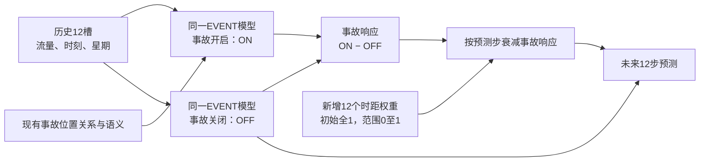

# MIN-E1-H1：事故响应的预测时距衰减

_2026-10-15。新结构的配对验证方案；开发获用户授权，正式效果待服务器运行。_

---

## 📋 依据与本轮问题

用户回传837窗口的已有预测分析，源评估为`early_event_evaluation_20261014_231449_3fb243`，分析为`early_event_gain_analysis_20261014_235728_eaed6c`。整体EVENT相对STATE的pooled MAE收益0.069762637；当前事故路径ON/OFF收益0.000026634，正负收益抵消99.9746%。路径让60.10%的预测上升、39.59%下降，不能称为单向上调。[已有分析定义](igstgnn_min_early_event_saved_gain_analysis_20261014.md)统一同点T=P+R，R不能单独称训练收益。

事故路径在第1～7步的净MAE作用为负，第8～12步为正；在固定困难窗口改善0.02143，而整体候选在该集退化0.56210。直接关联区域内部也同时存在较大收益和损害。当前证据支持研究时距适配，尚未证明根因，也没有证明哪一层抹掉了事故信号。

本轮假设：给现有事故响应增加可学习的时距衰减，能否减少短期代价，同时保留部分后期或困难窗口收益？仅检验此小假设，不同时删除MIN分支、不扩大语义、不新增物理解码器。

## 🔍 先补已有预测的方向核对

新增纯NumPy方向审计，以EVENT_OFF残差定义高估/低估，而不沿用STATE残差来判定事故修正是否正确。固定原有效掩码、样本与站点轴、流量桶和事故区域，检查STATE×OFF偏差九格及每步结果。

将ON−OFF分为：不变、朝向真值未越过、到达真值、越过但改善、越过后误差相等、越过后变差、远离真值、OFF本来精确却被改坏。朝向真值并不保证改善，修正过头也可能更差。报告用于事后诊断，真实流量、误差符号与越过标签不进入模型。

该入口直接复用已保存的五组预测和证书，不加载模型/检查点/原数据，不训练，不重新推理。它与新结构开发独立，不用诊断真值生成时距权重或预设哪些时距关闭。

## 🧩 完整数据流



图中的两次EVENT计算共享全部参数，不是两个独立网络。每次仍保留原历史嵌入、未加事故的构图/P/边界输入、单次最新槽事故调制、五层扩散/固有与潜交换、原预测头。

记当前共享权重为θ，事故开启/关闭的预测为Oθ、Fθ，新增时距权重为g_h：

\[
\hat y_h=F_{\theta,h}+g_h(O_{\theta,h}-F_{\theta,h}),\quad 0\leq g_h\leq1.
\]

实际用`ON + (g−1)*(ON−OFF)`计算，使g=1时逐位等于原ON，避免浮点相减再相加破坏初始恒等。g=0时在正常浮点舍入范围内等于当前OFF，不等于历史MIN。

g_h为12个全局标量，同一步对各窗口、各站点相同；事故内容仍通过原ON−OFF响应发挥作用。权重只衰减，不放大、不反转、不增加自由输出偏置。原事故模块本来已读历史并允许正负gamma，本轮没有重复增加“历史融合”或“双向门控”。

## 📐 训练与初始化

源目录为`contra_min_early_e1_bs64_seed2025`，只读加载`EVENT/last.pt`中的`best_model_state`。源最佳第3轮，last优化器对应第5轮；因此本轮两组均重建相同优化器和调度器，称为从最佳权重开始的配对适应，不称无缝续跑。

| 组 | 初始核心权重 | 时距权重 | 活动参数 | 用途 |
|---|---|---|---:|---|
| CONTROL | 同一源EVENT最佳 | 恒为1，新增offset冻结 | 441,324 | 原E1结构在相同新训练阶段的对照 |
| HORIZON | 同一源EVENT最佳 | 从全1学习，投影至[0,1] | 441,336 | 检验12个时距参数的增量 |

两组注册参数均441,336；活动参数相差12，不宣称完全相同学习自由度。两组的主干和原事故模块均联合更新，不再训练原MIN-only组。原MIN结果、旧E1结果、源权重及旧源码均保留。

每个时距用offset参数a_h，初始0，`g_h=1+clamp(a_h,−1,0)`；每次optimizer.step后再将offset投影至[−1,0]，避免参数越过边界后梯度停滞。offset不施加weight decay。核心学习率默认1e−4，offset默认1e−3；两组核心优化协议相同。

保持原作者发布数据、batch64、完整12步loss、新阶段默认最多先5轮。新阶段不进入旧第30轮的课程切换。新轮次从0计数，记录源已训练/最佳轮次，不能把新阶段轮次和旧曲线混合成同一训练轨迹。epoch0源最佳可作为新阶段最佳候选，避免训练退化后强行选一个较差的新检查点。

正式训练前完整回放源最佳ON验证集，通过后将来源预测与证书存于新目录；同一新目录恢复时复用该证书，核对源哈希，不反复增加源全验证推理。

## 🛠️ 双路计算的正确性与成本

两条当前权重路径都保留完整梯度，不能缓存旧OFF或detach OFF来代替联合目标。训练时复用ON起点的随机流给OFF，使相同位置使用相同dropout随机性；OFF不额外推进全局随机流。

原模型含BatchNorm。OFF及反向重算使用私有运行缓冲，只有原始ON前向更新持久统计一次；退出/异常时恢复缓冲引用。采用non-reentrant activation checkpoint降低双份激活常驻开销，所需context_fn接口已核对[PyTorch 2.3.1源码](https://github.com/pytorch/pytorch/blob/v2.3.1/torch/utils/checkpoint.py)。

HORIZON正式推理通常需要两次核心前向，CONTROL一次；训练还包含激活重算，不能把新增12参数等同于几乎无计算代价，也不声称两组FLOPs相等。V100实际显存与运行时间以服务器测量为准，不在旧身份中提高batch。

## 🧪 评估与失败判据

先完整回放CONTROL/HORIZON各自选中的最佳ON验证指标，再做HORIZON_OFF、HORIZON_GATE1、语义UNK、完整位置重排。保存配对预测，复用同一个CONTROL定义的困难窗口集。首轮不重复十二种forecast读出消融，不评价测试集。

同时检查MAE/RMSE/MAPE、逐时距、流量与事故区域、固定困难窗口、预测变化、正负抵消及学到的12个权重。HORIZON vs CONTROL评估整个新方案；HORIZON vs同权重GATE1评估当前衰减器的依赖；HORIZON vs同权重OFF评估保留事故路径的依赖。三者不混作事故因果效果。

若权重全接近0，说明这套方案倾向舍弃当前事故响应，不应写成更好理解了事故；若只略改善平均MAE却继续损害RMSE/困难窗口，不自动扩大轮数。全局时距权重不能解决同一时距内的节点方向错配，若方向审计证实这一问题主导，应另行提出更局部的可观测状态适配假设。

现有潜预算仍是无量纲表征先验，不认证真实道路容量；H1未增加物理容量识别或真实守恒证据。单种子、重复开发验证集、源最佳选模与位置重排的分布外限制保持记录。

## 🚀 服务器运行

更新Git与运行Bash分开，脚本不包含Git。先运行低成本已有预测方向审计：

```bash
bash experiments/chronological/run_min_early_event_direction_analysis.sh \
  --run-dir experiments/chronological_runs/contra_min_early_e1_bs64_seed2025
```

在已有GPU作业中启动新结构的1轮配对检查并评价：

```bash
bash experiments/chronological/run_min_event_horizon.sh \
  --source-run experiments/chronological_runs/contra_min_early_e1_bs64_seed2025 \
  --run-dir experiments/chronological_runs/contra_min_event_horizon_v1_bs64_seed2025 \
  --epochs 1 --evaluate-after
```

后续同目录`--epochs 5`表示新阶段累计到5轮，不重跑已经保存的新阶段轮次。支持只运行尚未完成的一组，具体选项以入口帮助为准。训练/评估制品与源保护记录保存在新目录。

## 📚 方法与来源

本设计直接来自上述已有实验和当前E1实现，尚不是已被文献证明有效的新交通模型。投影时距衰减是本轮待验证的工程选择，不借其他领域结果宣称保证。配对控制与可证伪组织参考experimental-design技能，文档和流程图采用markdown-mermaid-writing技能。

方法工具来源：Kassis, T., Agarwal, V., He, Y., Patel, D., & Brueckner, A. M. (2026). [Scientific Agent Skills: A Library of Procedural Knowledge for Research Agents](https://doi.org/10.48550/arXiv.2609.00065)。已核对2026-10-15时arXiv最新v2记录；它是流程工具来源，不是交通预测效果证据。

## ✅ 本地验证范围

27项测试通过，覆盖八方向手算、OFF基准与贡献守恒、初始化ON恒等、实际MIN双路梯度、dropout/BatchNorm与重算、投影、源回放阻断、stage0最佳、连续/分段训练精确恢复、缓存复用、单组空续跑、评价恢复与制品保护。最后的工程报告标记调整又通过相关评价测试。

已复用旧496站、4训练/4验证窗口工程源，完成CONTROL/HORIZON各新阶段1轮、2次更新和7状态评价。HORIZON权重确实更新；再次同目标空续跑更新0次，未重复源完整回放。源E1与原MIN未重新训练。本地4窗口数值不构成正式改进收益，服务器837验证窗口的效果仍待运行。[验证记录](verification/igstgnn_min_event_horizon_h1_20261015.json)保存范围与命令。
