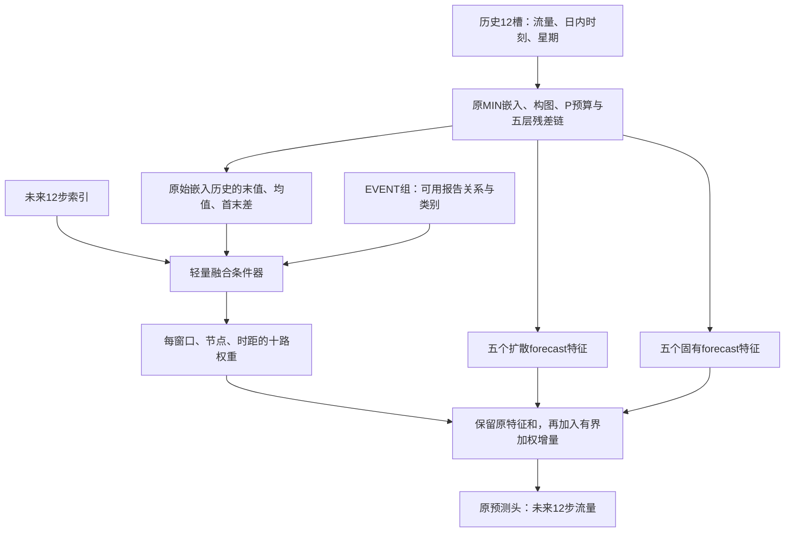

# MIN-F1：状态与预测时距条件的预测分量融合

日期：2026-10-15。状态：代码与本地工程验证完成；正式预测效果待服务器实验。

## 本轮目的与已有依据

本轮以提高预测指标为首要任务，改进已有 MIN 的预测分量组合方式。复用成熟 MIN 最佳检查点，不从头重训旧 MIN，不继续叠加 H1 双轨推理。

已有 E1 检查点的五层扩散与五层固有 forecast，逐一移除均使误差变差。这支持保留这些预测分量、研究有条件的组合，但不证明成熟 MIN 每个模块都必要，也不证明固定求和是错误。原生分解本来就允许各分量学习互补表示。

E1 当前事故路径的正负收益高度抵消；OFF 基准方向审计中约49.88%的有效点远离真值，越过真值后恶化约0.12%。H1只按时距统一衰减，不能区分同一时距的不同节点。H1首个新阶段的CONTROL/HORIZON两组均未超过源最佳；HORIZON每轮250.82秒，CONTROL126.40秒。这些结果提供设计约束，不是F1有效性的证据。

本轮假设：已有预测分量在不同交通状态和预测时距下需要不同组合；事故属性可以作为组合条件，而不直接生成最终流量偏移。

## 模型与数据流



每次预测只运行一次 MIN 主干。历史编码、图、原有潜交换、五层 backcast 和残差传递均保留；事故不修改这些输入，也不再改变最新历史槽。

十个分量固定按 `DIF0..DIF4, INH0..INH4` 排列。原特征为四个预测块，每块由原头的三个通道预测三步；F1先将分量映射到真实十二步，再进行逐时距融合，最后执行原头和原通道选取一次，不能重复展开时距。

设展开后的第k个特征为F_k，原特征和为F_base：

`delta_k = 0.1 * tanh(score_k(history_summary, horizon, event_context))`

`F_fused = F_base + sum_k(delta_k * F_k)`

因此各分量系数为 `1+delta_k`，范围0.9至1.1。输出投影零初始化时delta严格为0，保持原求和顺序与原预测。小权重变化不保证最终预测变化小，尤其各分量相互抵消时，需要实际记录特征增量与预测变化。

条件器读取三项原始历史嵌入摘要，经LayerNorm后与8维时距嵌入、三列报告关系、16维类别表示拼接，以宽度32的MLP输出十路score。本轮不同时改时序摘要、递推位置编码或未来时钟，不用未来目标和高低估标签生成权重。

正式结构注册参数440,950，比原MIN的435,856增加5,094。两个候选注册数量相同。单次主干不代表零额外计算，十二步特征融合与条件器的实际V100耗时、显存仍以服务器记录为准。

## 两个训练候选

| 组 | 状态与时距条件 | 事故输入 | 可训练范围 |
|---|---|---|---|
| STATE | 所有站点使用 | 不读取；关系与语义上下文为零 | MIN全主干和融合条件器 |
| EVENT | 所有站点使用 | 仅原报告支持节点增加关系与语义条件 | MIN全主干和融合条件器 |

两组注册相同参数、共享完全相同的初始张量。STATE完全不读取事故，不因事故是否存在而改变作用范围。EVENT没有报告或关系不可用时继续执行状态融合；这不是“没有事故”的现实认证。注册参数相同不代表两组语义参数的活动范围、梯度或有效学习自由度相同。

EVENT的支持定义沿用发布关系编码：报告存在、关系可用且关系向量非零。支持外事故上下文置零。语义缺失使用已有类别编码的UNK契约；整条报告关闭则关系与语义上下文都置零，仍保留状态条件器。

由于报告只在最终节点融合中使用、之后没有跨节点消息传递，同检查点的事故内容ON/OFF差异直接局限于原报告支持内。STATE融合可以影响全网，但本轮没有新增事故空间传播机制；支持外内容差应严格为零。后续若研究传播，需另立结构候选，不能用本轮最终融合代替事故—容量—传播链。

本轮默认不增加独立MIN-only worker；已有MIN预测作为只读历史参照。STATE与EVENT在相同新增训练预算下比较，用于判断事故条件增量。任何候选相对旧MIN的变化都同时包含新结构与新增微调效应，不能全部归因于结构本身。

## 源、训练与续跑

默认源：`experiments/chronological_runs/contra_min_i_v1_bs64_seed2025/A`，读取其 `last.pt` 内的 `best_model_state`。已有A最佳第28轮、验证MAE13.944357872；以实际源身份、最佳指标和检查点哈希为准，不因指标数字相同就断言与其他MIN目录权重逐值相同。

源最佳权重与源last优化器可能来自不同轮次。因此新阶段对称重建优化器和调度器，不载入旧last优化器，不称为源实验精确续跑。新阶段内续跑则保存并恢复优化器、调度器、随机状态和样本顺序。

- 默认正式batch64，源批大小不可静默更改；工程源使用原batch2。
- 原作者发布划分：训练3909、验证837、测试839；原标准化与掩码保留。
- 每次更新监督完整未来十二步，不从旧第30轮课程状态续接。
- 主干学习率1e-4，融合条件器1e-3；联合更新，不冻结主干。
- 默认先累计到5个新阶段轮次；首次可运行1轮检查，再同目录续至5轮。
- 新阶段epoch0源预测参与最佳选模，防止强行选择退化的新权重。
- 训练前完整回放源最佳验证集，成功后缓存源预测与证书；恢复时核对缓存及源哈希，不重复全源回放。
- 独立worker、原子检查点、明确退出码；已有源与旧训练身份保持不变。
- GPU型号名变化只记录环境审计，数据、Torch/CUDA、模型和批次身份仍核对。

初始预测恒等只代表安全起点，不代表联合训练后保留旧MIN。`--epochs 5`表示累计到新阶段第5轮，`--only EVENT`只运行尚需继续的该组。

## 配套评价

评价为显式可选步骤，先完整回放两组选中最佳，再允许干预；不自动评价测试集，也不重复旧十二种forecast关闭审计。

| 状态 | 用途与边界 |
|---|---|
| STATE_ON | 独立训练的状态融合候选 |
| EVENT_ON | 独立训练的事故条件融合候选 |
| EVENT_REPORT_OFF | 同EVENT权重下移除事故上下文，保留状态融合；不是独立STATE模型 |
| EVENT_FUSION_OFF | 同EVENT权重下恢复固定求和；是当前MIN主干，不是历史源MIN |
| EVENT_UNIFORM | 同EVENT权重下十路系数取均值，只保留共同缩放；不是独立训练校准组 |
| EVENT_SEMANTIC_UNK | 保留关系与支持，检查类别依赖；可能分布外 |
| EVENT_LOCATION_SHUFFLE | 完整站点关系重排敏感性；可能分布外，不认证事故因果 |
| SOURCE_MIN | 复用训练开始前缓存的源预测，不新增源推理 |

各干预结束后恢复ON并逐值核对；保护模型参数、缓冲、RNG、输入和源文件。保持原验证批次与共同有效掩码、站点/样本轴。固定困难窗口使用SOURCE_MIN选择的同一集合；偏差符号参照也统一来自SOURCE_MIN。未来真实流量桶和高低估仅作事后分析。

报告MAE/RMSE/MAPE、十二时距、道路、流量桶、事故区域、固定困难窗口、正负收益与抵消，并保存配对预测以供后续只读分析。十路权重与特征增量按时距汇总，不能把权重值直接称为模块重要性：它与分量自身尺度、共适应及非线性预测头有关。

选模沿用作者验证masked MAE。判断是否继续投入还需看RMSE与固定困难窗口是否持续恶化、主要道路是否出现一致损害。若最佳仍epoch0，明确记录“当前预算未获新最佳”；不由一轮结果直接宣布长期无效。选中最佳的权重诊断与last权重诊断不能混用。

若EVENT不优于STATE且内容干预近乎无效，不继续扩大事故分支；若差异化融合的收益与同点共同缩放相近，先考虑普通校准解释，必要时再增加独立训练校准对照，不自动安排所有组合。

## 数据与思想边界

原输入三通道为流量、日内时刻、星期，没有补造速度、占有率、容量、封道进程或恢复时间。原潜预算仍是无量纲特征交换，不是实际车辆容量。

事故属性仍属作者归档的条件离线范围，未认证预测截止时点可见性。单种子与反复用于开发的验证集不构成独立泛化确认；窗口、预测点不当作独立事故重复。

条件选择思想参考[TFT, IJF 2021](https://doi.org/10.1016/j.ijforecast.2021.03.012)；目标表示读取外部信息的组织思路参考[TimeXer, NeurIPS 2024](https://arxiv.org/html/2402.19072v4)。两者支持提出候选，不保证F1有效，也不构成该具体结构的新颖性认证。

## 运行入口

服务器更新Git与运行Bash分开，Bash不包含Git、Slurm脚本不申请`--mem`。

```bash
bash experiments/chronological/run_min_forecast_fusion.sh \
  --source-run experiments/chronological_runs/contra_min_i_v1_bs64_seed2025 \
  --run-dir experiments/chronological_runs/contra_min_forecast_fusion_f1_bs64_seed2025 \
  --epochs 1
```

完成首轮后，同目录累计至5轮并显式评价：

```bash
bash experiments/chronological/run_min_forecast_fusion.sh \
  --source-run experiments/chronological_runs/contra_min_i_v1_bs64_seed2025 \
  --run-dir experiments/chronological_runs/contra_min_forecast_fusion_f1_bs64_seed2025 \
  --epochs 5 --evaluate-after
```

仅评估已有本版检查点，可单独运行Python入口：

```bash
python -u experiments/chronological/evaluate_min_forecast_fusion.py \
  --source-run experiments/chronological_runs/contra_min_i_v1_bs64_seed2025 \
  --run-dir experiments/chronological_runs/contra_min_forecast_fusion_f1_bs64_seed2025
```

## 本地验收

31项不同测试全部通过，分别为模型11项、训练/续跑12项、评估8项。覆盖零初始化逐值恒等、相同RNG下训练输出/BatchNorm恒等、真实gap3通道顺序、单次主干、事故支持与缺失、状态/时距/语义/主干梯度、联合优化器、源最佳而非last初始化、epoch0选模、连续/分段精确恢复、缓存与源锁、回放失败阻断、八状态恢复、真实SOURCE_MIN困难集与偏差分组。

直接复用已有`contra_min_i_check_20261013_dev01/A`，完成一次原发布496站、4训练/4验证窗口工程集成，STATE/EVENT各2次优化更新；没有重训源MIN。随后在同一个新目录完成八状态评价，恢复ON逐值一致，源预测使用缓存且新增源调用0次。

同目标`--only EVENT --epochs 1`空续跑的新增更新为0，未重复完整源回放；源文件、两组last检查点、身份和源缓存共12项文件哈希保持不变。工程目录：`experiments/chronological_runs/local_min_forecast_fusion_check_20261015`。Bash语法检查通过。

以上四窗口数值仅用于工程验收，不构成正式精度、事故收益或V100速度结论。[机器可读验证记录](verification/igstgnn_min_forecast_fusion_f1_20261015.json)保存入口、范围与源保护信息。
