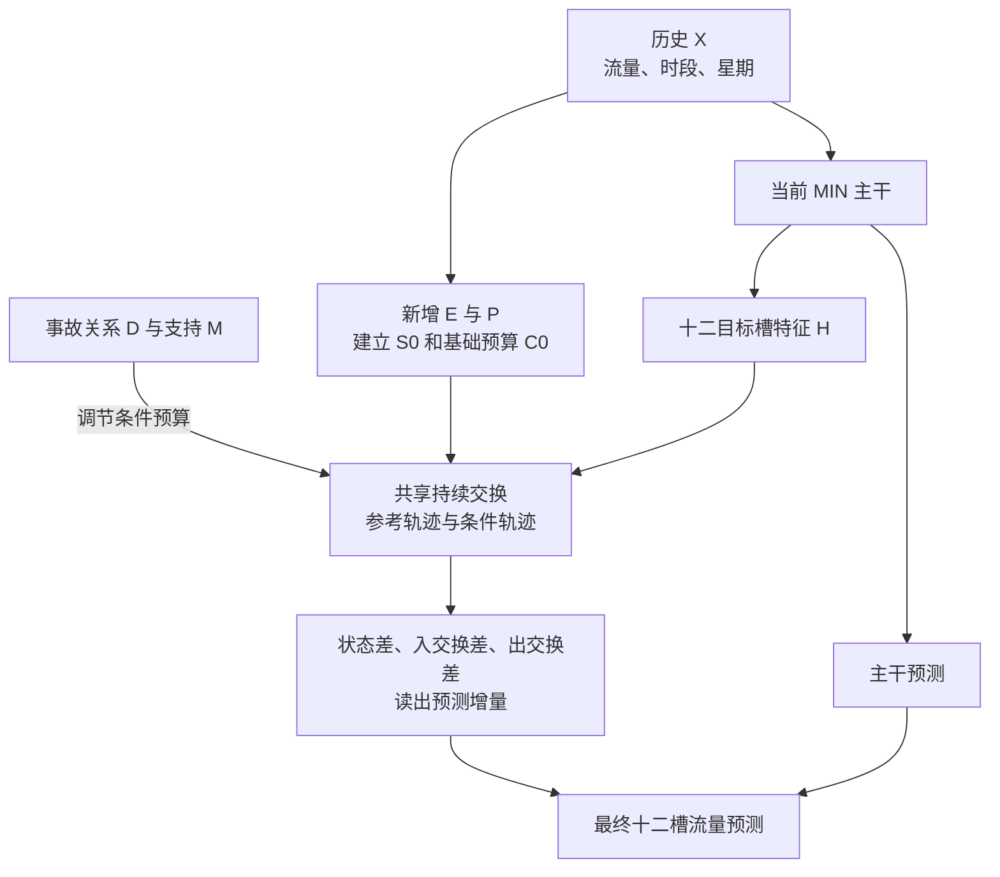

# MIN-R1 模型结构与数据流讲解

_2026-10-14；对照已开发代码 d678e11。本文解释实际结构，不增加训练任务，也不把工程检查当作预测收益证明。_

---

## 🧭 先认识整个模型

这版的结构是：**已有 MIN 主干＋一个共享的事故条件持续响应分支**。

MIN 根据历史交通给出主干预测；新增分支计算事故条件下的状态变化，再把变化读成预测增量。最终：

`最终预测 = 当前 MIN 主干预测 + 新分支预测增量`。

这里的“当前 MIN”是候选模型内部的主干副本。联合训练后，它的参数可能已经改变，不能与始终不更新的“原 MIN 参考”混用。

图中的两条轨迹是新增分支内部的两个计算过程，不是两个 MIN，也不是现实中的无事故与有事故两个世界。一次候选预测只运行一次 MIN，并共用它的预测与 H。

## 📥 输入究竟是什么

| 输入 | 实际内容 | 在模型中的作用 |
|---|---|---|
| X：B×12×496×3 | 十二槽历史；每站有流量、日内时间、星期 | 给 MIN 提供历史信息，并生成新增分支的起始状态 |
| D：B×496×3 | 作者发布的三列事故—站点关系编码 | location 组中调节条件转移；本说明不额外认证三列的具体物理语义 |
| M：B×496×1 | 从关系编码是否非零及报告可用标志形成的支持掩码 | 指定哪些内部边可以直接接受条件预算更新 |
| G | 已审查的内部传播图 | 指定新增状态可以沿哪些边交换 |
| Y：B×12×496×1 | 十二个目标槽的真实流量 | 只用于训练损失和评价，不作为预测输入 |

当前新增分支不读取事故 Type/Description 文本或类别，不读取未来封道、清除时间、真实容量，也没有新增速度或密度通道。D 与 M 分工不同：M 决定更新的支持范围，D 的数值用于决定如何更新。

输入时间槽沿用现有数据协议；本说明不把每个输出槽自动标成已认证的“事故后第几分钟”。

## 🏗️ 原有 MIN 保留了什么

MIN 保留历史嵌入、时钟与节点表示、静态/动态图构造，以及五个分解层。分解层中的扩散与内在预测特征汇总，再进入预测头。MIN 还保留已有历史预算 P 和受限空间交换，不能把它画成一个完全没有约束的普通 GNN。

MIN 版本已移除旧事故编码/融合路径、TIID 及原报告残差 D 路径；最新历史槽的归一化仍保留。新增 R1 分支没有重新启用这些旧事故模块。

MIN 先形成四个预测块，每块重复三槽，得到十二槽特征。新增分支使用的是输出头 `out_fc_1` 前、已经过 ReLU 的 H，正式模型宽度为256。**十二个 H 不是十二次独立编码**；同一组三槽起初来自相同块特征，新增状态及目标槽位置仍可让它们产生不同响应。

当前 D 没有直接进入 MIN 的图构造器或原有图卷积。它先影响新增分支；联合训练时，最终损失也会反向更新 MIN，使主干表示能够与新增分支配合。

## 🔄 新增分支按什么顺序计算

### 1. E：历史给出一次起点

每个站提取五个量：历史末端流量、历史流量均值、首尾流量变化、末端时段、末端星期。共享小网络 E 把它们映射成四维起始状态 S0，范围在0到1。

S0 只建立一次，不在每个目标槽重新生成。它是可学习的潜状态，不是已经测得的四种交通物理量。事故已经造成的影响也可能存在于历史 X 中，因此 S0 不叫“无事故状态”。

### 2. 新 P：决定基础交换预算 C0

新 P 从 S0 生成节点预算，再把一条内部边两端的节点预算取较小值，得到该边的 C0。直观上，它描述这条边在潜状态计算中允许多大交换。

这个 P 属于新增分支，**与 MIN 内原有 P 是两套参数**。新分支的外部/边界交换预算与提案为零，不虚构边界交通观测。

### 3. 提案网络：结合当前状态和预测上下文

当前目标槽的 H 先从256维压到16维。每条边使用源/目标站的 H、源/目标站的当前四维状态、C0 和槽位置，形成45维上下文。共享提案网络据此提出四维交换需求。

后续目标槽继续使用前一槽留下的状态。H 是转移的上下文，不把持续状态直接覆盖掉。

### 4. 条件器 g：让关系细节调节预算

location 组使用低秩交互：

`交互 = U(状态与上下文) × [1 + tanh(V(边两端的 D))]`。

U 把45维上下文变成8维，V 把两端共6维关系变成8维；逐元素相乘后，再投影成四维有符号调整 a。这样，同样的关系编码可以因当前交通状态不同而产生不同调整。它是设计上的表达能力，实际训练是否利用了 D 仍需检验。

预算更新在支持边上进行：

- a≥0：`C = C0 + a×(1−C0)`；
- a<0：`C = C0 + a×(C0−ε)`，ε=0.001。

因此预算可以上调或下调；无直接支持的内部边保持 C0。预算正负不直接决定最终流量预测正负，预测还经过状态传播与学习读出。

### 5. T：同起点、同规则运行两条持续轨迹

| 轨迹 | 起点 | 使用的预算 | 作用 |
|---|---|---|---|
| 参考轨迹 | S0 | 基础预算 C0 | 给新增分支提供计算参考 |
| 条件轨迹 | 同一个 S0 | 条件预算 C | 计算条件更新后的演化 |

两条轨迹共享提案网络和交换规则，但各自保存状态。轨迹分开后，输入状态不同，提案数值也可能不同；“共享参数”不等于“每一步交换量相同”。参考轨迹对应的 E/P/提案参数也会训练，并不是额外冻结的模拟器。

每个目标槽执行两个空间子步。单个子步先用预算限制提案，再按源节点可发送量与目标节点可接收量缩放交换，最后更新：

`新状态 = 旧状态 + 0.5×(入交换−出交换)`。

两个子步后的状态交给下一个目标槽，持续到第十二槽。同一套参数被所有槽使用，不是复制十二套模块。直接条件更新只出现在支持边；形成的状态差可继续影响邻接交换，因此不要求预测变化全部局限在原 M 内。

### 6. R：把过程差读成预测修正

每个目标槽、每个站拼接三种差：条件与参考的四维状态差、四维平均入交换差、四维平均出交换差，共12维。无偏置线性读出 R 把它变成一个流量预测增量。

R 读取的是两轨迹的过程差，不是直接把“事故发生”变成一个固定加数。差为零时增量严格为零；但无偏置并不保证训练后的修正均值为零，也不保证一定不再出现整体上调。

### 7. 与当前主干预测相加

增量与主干预测在标准化流量尺度上相加，再由既有评估流程还原作者尺度。未被新增算子覆盖的节点保持当前主干预测；缺少可用报告关系或显式关分支时，也返回当前主干。

条件输出层零初始化，因此新模型起步时增量为零，完整预测与已有 MIN 一致；读出层用小幅非零初始化，让条件器仍有首步学习梯度。

## 🧮 用一条边看懂交换

以下只演示一条内部边、一个潜状态通道，不是实际道路数据，也不预测车辆数。

假定源站状态0.8、目标站状态0.2，提案0.5，参考预算0.4，条件预算0.2。源可发送量和目标可接收量在这个例子中都不进一步限制交换：

| 计算 | 参考轨迹 | 条件轨迹 |
|---|---:|---:|
| 最终交换量 | 0.4 | 0.2 |
| 源站更新后状态 | 0.8−0.5×0.4=0.6 | 0.8−0.5×0.2=0.7 |
| 目标站更新后状态 | 0.2+0.5×0.4=0.4 | 0.2+0.5×0.2=0.3 |
| 两站状态之和 | 1.0 | 1.0 |

预算变小后，源站比参考多留下0.1，目标站比参考少获得0.1。这体现了“条件改变交换，交换改变后续状态”。R 再学习这些状态及交换差与目标流量的关系；这里不能直接断言最终流量会降低多少。

## 🧪 state 与 location 为什么都要有

| 项目 | state | location |
|---|---|---|
| 已有 MIN 初始化 | 同一最佳权重 | 同一最佳权重 |
| 持续状态、交换、读出 | 有 | 有 |
| 原报告支持 M | 保留 | 保留 |
| D 数值的低秩调节 | 不使用，乘子固定为1 | 使用 |
| 条件器能否学习非零更新 | 能 | 能 |
| 新增参数 | 6148 | 6196 |
| 含主干总参数 | 442004 | 442052 |

location 多出的48个参数是6→8的无偏置关系映射。两组使用相同新增训练预算、样本顺序和目标函数；它们主要检验 D 数值的额外作用。state 仍保留 M，所以不是无事故组，也不是一个被刻意设计成零输出的控制。

## 🎓 到底训练谁，原 MIN 为什么不重跑

已有 MIN 检查点分成两种用途：一份保持只读，作为原预测参照；另一份复制到每个新候选中，允许随新增模块联合适应。

| 对象 | 是否更新 | 当前学习率 |
|---|---|---:|
| 原 MIN 参考 | 不更新，不进入优化器；只推理 | — |
| 候选内 MIN 主干副本 | 更新 | 1e-4 |
| 新 E、新 P、提案、条件器、特征压缩、R | 全部共同更新 | 1e-3 |

这不是重新安排 MIN-only 基线训练，也不是从零重训主干。每个候选加载已有最佳权重后，再做本版联合微调。冻结入口仅保留为可选接通诊断，不要求额外跑一套正式冻结实验。

训练目标为完整十二槽 MAE，加上输入历史低流量组相对固定原 MIN 的平均超额 MAE 惩罚，权重0.25。低流量组由历史十二槽均值满足0≤均值<100定义，不由未来真实流量决定。它不能保证每点、每条道路或 MAPE 都不退化，仍须查看分层报告。

训练时，为计算固定风险参照，原 MIN 另做一次无梯度推理；它不更新参数。部署候选进行预测时只需候选本身，不需要再运行这一份原 MIN 参照。

联合训练后必须区分：原 MIN、当前候选关分支的 OFF、完整候选 ON。ON 比原 MIN 好是整个新方案与新增微调的总体收益；同预算 location 比 state 好才进一步支持关系细节的增量。ON/OFF 则检查当前权重对新路径的依赖。

## 🔎 这版对应五个问题，但没有宣告它们已经解决

| 原问题 | 当前结构给出的应对 |
|---|---|
| 关系细节没有额外价值 | 状态与 D 的低秩乘性交互，配同 M 的 state 控制 |
| 修正容易普遍上调 | 有符号预算、无偏置差值读出、历史低流量风险项 |
| 新增状态没有持续性 | S0 只建一次，状态跨十二槽传递 |
| 约束与预测联系弱 | 从状态差与交换差直接读出增量，记录作用链 |
| 仅训预算 MLP 限制适应 | 候选主干与完整新模块联合微调，源 MIN 只读复用 |

当前有两套约束传播计算：MIN 内已有交换，以及新增持续响应。保留前者是为了复用已验证的主干；后者用于新假设。这存在计算与功能重叠的可能，尚不能宣称没有冗余，但本说明不因此新增一轮删除或重训实验。

物理先验落实在潜状态的预算、发送/接收限制与局部平衡上。没有密度、真实容量等标定数据时，它仍是**物理启发的潜状态传播**，不能声称已识别真实容量下降、排队长度或事故因果；最终读出流量也不因局部潜状态平衡而自动守恒。

## 🧩 与代码对照

| 阅读内容 | 代码位置 |
|---|---|
| MIN 本身保留的历史路径 | `src/models/incident_spatial_minimal.py`：`MinimalIGSTGNN.forward` |
| 四块到十二槽的展开 | `src/models/igstgnn.py`：`IGSTGNN._decode_forecast` |
| E、P、低秩交互、持续交换与 R | `src/models/incident_spatial_response.py`：`PersistentResponse` |
| M、单次 MIN 特征获取与最终相加 | 同文件：`FrozenMINResponse._context`、`forward` |
| 有符号预算界限 | `src/models/incident_spatial_event_budget.py`：`signed_budget_update` |
| 发送、接收与状态更新 | `src/models/incident_spatial.py`：`exchange_step` |
| 候选主干与新模块共同训练 | `experiments/chronological/train_min_response_joint.py`：`build_joint`、`optimizer_for`、`train_epoch` |
| 训练风险项 | `experiments/chronological/min_response_metrics.py`：`paired_training_loss` |

源码与运行参数以仓库代码为依据；设计判据见 [五问题计划](igstgnn_min_response_r1_plan_20261014.md)，已完成实验见 [复用清单](igstgnn_min_experiment_reuse_ledger_20261014.md)。以上说明未修改模型或执行新训练。
