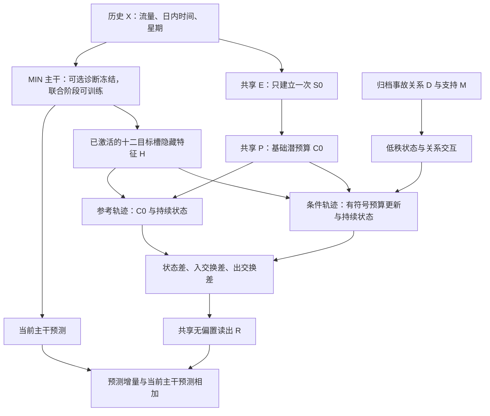

# IGSTGNN MIN-R1：五问题优化与开发计划

日期：2026-10-14。状态：开发与工程验证；尚无本版本正式预测收益结论。

本计划在已有 MIN 上开发一个共享的事故条件持续响应模块。下列五项是当前证据下的优先方案，不是已经通过实验确认的最优设计。**已有 MIN 只读复用，不再单独训练；冻结入口用于诊断，两个候选通过联合微调比较。**

## 五个问题与各自的优先方案

| 问题 | 已有证据及边界 | 本版选择的一个优化方案 | 实现与验收 |
|---|---|---|---|
| 1. 关系细节没有体现额外价值 | 原冻结适配器在固定支持范围内打乱 D，MAE 只改变约 0.000051；service 十轮 location 略逊于 state。这不否定原支持位置 M 的作用 | **状态与关系的低秩乘性交互**，让 D 调节状态转移条件，而非只作为 MLP 的附加输入 | location 使用 U(H,z,C0,slot) × [1+tanh(V(Dsrc,Ddst))]；state 保持相同 M、不读 D 数值。验证默认梯度、固定 M 下 D 的作用和共同初始化；48 个关系参数差异单独披露 |
| 2. 修正缺少选择性，容易形成上调偏置 | 旧冻结位置适配器约 96.16% 有效点上调，低目标流量桶及 MAPE 变差；不能自动推定新 service 版本也相同 | **有符号响应与输入历史低流量的配对风险惩罚** | 预算允许正负更新；读出无偏置、不强制预测向上。以历史十二槽均值定义低流量组，损失加入相对固定源 MIN 的组平均超额 MAE；未来目标及误差方向仅用于监督/事后分组 |
| 3. 新增物理路径没有跨目标槽的共同持续状态 | 既有 service 局部调用重新形成临时状态；已有 MIN 自身仍有时间递推，不能说整个模型没有记忆 | **从历史建立一次 S0，并共享跨槽持续状态** | 共享 E/P/T，前一目标槽的最终状态输入下一槽；MIN 隐特征只提供转移上下文，不逐槽覆盖状态。明确 target_slot 与 spatial_substep，不把网络层号当物理时间 |
| 4. 局部预算/平衡与最终预测的联系弱 | 局部约束满足不保证最终流量预测更准确；潜状态不是测得的交通密度 | **状态差与交换差的专用无偏置读出** | 同起点运行 C0 参考轨迹和事故条件轨迹；R 读取状态、入交换、出交换的差。零差必为零输出，并检查预算→交换→状态→输出及梯度链；不宣称输出流量严格守恒 |
| 5. 只训练预算 MLP，限制了联合适应 | 冻结主干能隔离机制，但主干不能学习更适合新模块的表示；这可能限制收益，并非已被证明的唯一失败原因 | **两个新候选的主干与完整响应模块联合微调** | 冻结入口仅作可选诊断。state、location 都从同一已有 MIN 最佳权重起步，其主干副本及 E/P/T/条件器/R 均可训练；源 MIN 与已有结果只读复用，不再训练 MIN-only |

## 数据流与结构责任

MIN 的四个预测块各重复三槽，得到十二槽上下文；捕获的是 `out_fc_1` 前已 ReLU 激活的特征。本版保留既有主干实现，在外部共享模块中建立额外持续响应，不给每个主干层重复装一套新模块。

潜状态宽度 4，特征宽度 16，交互秩 8，每目标槽 2 个空间子步，eta=0.5。只使用已审查的内部边，外部/边界预算与交换提案为零；新增算子未覆盖节点的预测增量为零。报告不可用时回退到当前候选主干，联合训练后不一定等于源 MIN。两条轨迹都可能以受事故影响的历史开始，参考轨迹不是现实中的“无事故世界”。

条件输出层零初始化；读出权重小幅非零初始化，避免两个末端同时为零导致首步学习断开。初始化时 ON=OFF=源 MIN。state 组的条件器可以学习非零响应，不把它设计成恒等的无效控制。

## 训练安排：纠正冻结与最终优化的混用

### 阶段一：冻结诊断，可选，不重复安排旧实验

只训练完整响应模块，主干保持冻结、eval 和无梯度。location 与 state 使用同一 MIN。用途是检查接通、默认初始化的可训练性、关系增量及保存/续跑。**它不能回答联合适应后能达到的最优预测水平，也不是最终优化方案。**

### 联合阶段：只训练两个新候选

| 组 | 可训练部分 | 使用的事故信息 | 用途 |
|---|---|---|---|
| state | MIN 全主干 + 完整共享响应模块 | 原支持 M，省略 D 数值交互 | 测试结构、支持条件与共同适应的联合作用 |
| location | MIN 全主干 + 完整共享响应模块 | 相同 M + D 数值交互 | 测试关系细节相对 state 的额外价值 |

两组从**同一个源 MIN 最佳检查点**开始微调，响应零初始化；不继承阶段一最佳响应，确保 location 与 state 新增训练预算相同。源 MIN 不进入优化器。冻结入口完成接通检查后，不要求服务器重复做一轮冻结正式实验；本轮优先运行联合候选。

采用新优化器，主干学习率 1e-4，响应学习率 1e-3；同一固定规则、全十二槽监督、源批大小（正式为 64）、源训练样本顺序和随机种子。分组学习率不同是明确的适配设计，不能称为所有参数的优化过程完全相同。先一轮工程检查，再在独立目录按绝对轮数续至十轮，结合风险与机制决定后续，不自动扩大轮数。

联合训练时保存三个不同参照：

1. **original MIN**：固定的源 MIN 预测，作为训练风险参照和旧模型参考；源文件保持不变。
2. **current OFF**：联合检查点关闭响应后的当前主干预测；不再承诺等于 original MIN。
3. **other candidate**：相同新增轮数的另一候选，作为关系细节增量的训练对照；不另开 MIN-only 训练。

同检查点 ON/OFF 只说明训练后对响应路径的依赖。候选对 original MIN 的变化是“新结构与新增联合微调的整体效果”，不能完全归因为事故模块；location 对 state 的同预算比较用于判断 D 数值的增量。我们明确保留这个解释边界，遵从复用已有 MIN、不浪费独立基线训练的要求。解冻允许表示共同适应，但不能保证一定优于冻结，也可能破坏源模型，因此保留零轮候选与小主干学习率。

## 风险目标与评价

对原尺度流量，训练目标固定为：

`L = masked_MAE(ON, Y) + 0.25 * max(0, MAE_history_low(ON,Y) - MAE_history_low(original_MIN,Y))`。

`history_low` 由输入 X 中十二槽流量均值满足 0≤均值<100 定义。100 为作者数据尺度上的探索阈值，不新认证车辆单位；0.25 为预先固定的试验权重，尚非最优超参。风险项保护的是这个组的**平均** MAE，不保证每个点、真实低目标桶、MAPE 或每条道路不退化。没有该组时风险项为零。future Y 只参与监督及固定的作者有效掩码，不提供给模型或推理门控。

最佳轮次按验证 pooled MAE 选取，包含零轮；同时报告 pooled/macro MAE、RMSE、MAPE、逐目标槽、源 MIN 固定困难窗口、历史低流量组、真实流量桶、高估/低估、预测上调/下调和正负收益抵消。所有配对共享有效掩码与样本索引。真实流量桶和高估/低估只是事后诊断；现有区域定义可另接已有分析工具，不能将新增图弱连通分量称为真实事故传播范围。

state 和 location 要在相同新增完成轮数下比较；分别选最佳轮次的结果应标注共同预算。已有 MIN 标注原训练轮次及最佳轮次，不虚称新增训练预算与候选相同。阶段一与联合阶段参数更新集合不同，不能把它们的差简单解释成单因素因果效应。

## 工程验收与运行边界

- 零轮 ON/OFF/source 回放通过；联合后分开保存 original 与 current OFF。
- 默认初始化数据上记录条件器的非零梯度批次数；人工激活约束的合成测试只是补充，不代替该检查。
- 验证状态确实跨槽传递、零差读出为零、缺报告及未覆盖节点回退、边界不伪造。
- 冻结模式检查主干哈希不变；联合模式检查主干实际获得梯度并更新。临时特征 hook 无论异常与否都移除。
- 检查源检查点、数据与代码指纹；原子提交 `last.pt`；保存优化器、随机状态和样本顺序，完成绝对轮次续跑。
- 连续两轮与一轮后续至两轮的模型、优化器、随机状态和顺序逐项一致。
- 独立运行目录/协议身份，拒绝混用冻结与联合检查点。GPU 名称改变只记录审计，不改变数据和模型身份。
- Bash 中没有 Git，没有 Slurm `--mem`；读取结果不触发测试集评价。

作者数据沿用 train=3909、validation=837、test=839；X 为十二槽、496站、三通道（流量/日内时间/星期）。本轮不评价测试集，不补造速度、密度、封道、事故时长或真实容量。当前验证集已多次参与研发，本轮仍是探索性研究，后续需要不同种子与独立时间/事件检验，不能凭一个检查点宣称超过原论文。

## 思想来源

低秩交互借鉴多模态融合中“不同模态通过乘性交互形成条件作用”的设计；本版省去其完整张量融合，不继承原论文的性能结论。[Low-rank Multimodal Fusion, ACL 2018](https://aclanthology.org/P18-1209/)。

共享持续状态和学习转移借鉴图模拟器的状态演化；约束交换借鉴守恒图模型。这里状态与预算未被识别为交通密度/容量，不能继承 PDE 求解器的物理保证。[GNS, ICML 2020](https://proceedings.mlr.press/v119/sanchez-gonzalez20a.html)，[FluxGNN, ICML 2024](https://proceedings.mlr.press/v235/horie24a.html)。

冻结侧支适合稳定接入与诊断，联合适应则需考虑表示漂移及比较条件；这些工作支持提出两类训练问题，并不证明本任务应永远冻结或必须全解冻。[Side-Tuning, ECCV 2020](https://arxiv.org/abs/1912.13503)，[Fine-Tuning can Distort Pretrained Features, ICLR 2022](https://arxiv.org/abs/2202.10054)。

本次设计采用独立提出、交叉质疑及预先固定比较条件的研究流程；使用 `experimental-design` 技能检查匹配预算和伪重复边界。AI 辅助流程参考：[Scientific Agent Skills (2026)](https://arxiv.org/abs/2609.00065)，不作为模型有效性的证据。
