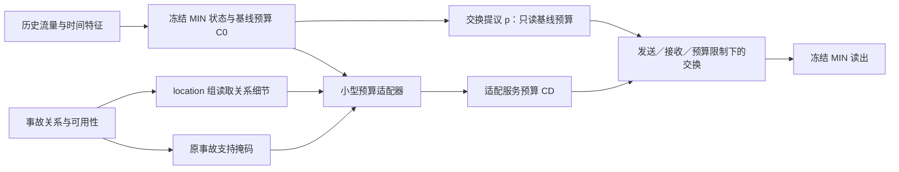

# 冻结 MIN：事故服务预算接口与状态对照

日期：2026-10-14。阶段：工程实现与小预算验证；不预先宣称预测收益。

## 研究问题与本轮改动

现有位置适配器在冻结 MIN 上取得小幅 MAE 收益，但伴随低流量代价和广泛预测上移；保留支持范围而打乱关系向量后，收益变化很小。本轮检查一个具体结构假设：事故预算同时进入交换提议和最终限制，是否容易成为通用状态校正接口。

新接口在每个计算子步中使用 `proposal(H,z,C0)`，再将适配预算 `CD` 交给已有受限交换器。事故预算不再直接作为 proposal 的条件输入。当前状态 z 仍随计算更新，因此不能说所有子步或整条 ON/OFF 轨迹的 proposal 相同。

已有发送、接收、预算范围和收支机制继续使用；不新增历史观察器、专家、损失加权或输出投影。预算继续允许正负修正，C0 不是已认证的无事故道路容量。



## 两个训练组

| 组 | 读取的数值条件 | 支持范围 | 新预算作用位置 |
|---|---|---|---|
| location | H、z、C0、事故关系 D | 原报告支持掩码 | 最终交换限制 |
| state | H、z、C0 | 同一原报告支持掩码 | 最终交换限制 |

state 仍利用事故支持位置，不是无事故模型。location 相对 state 的差异用于探索关系细节增量，仍包含小幅隐藏宽度/参数差异，不称完全同构或纯内容因果效应。

紧凑适配器去掉旧位置模式中一直为零的 16 维语义列。location 的有效权重从旧初始化逐列复制，保留数学函数；不同矩阵尺寸可能产生浮点舍入差别。state 完全不输入 D 数值，也不补零 D 列虚增参数量；默认隐藏宽度选择最接近 location 有效参数量的整数。正式 hidden=32、latent=4 时，预期 location 为 1396 个训练参数，state 为 1381 个，以运行证书为准。

两组读取同一源 A 最佳 MIN，主干参数和缓冲区全部冻结，处于 eval 模式；仅适配器更新。初始 ON 和每轮 OFF 均须精确等于同执行模式的冻结 MIN，逐批恢复 ON 须精确一致。原源检查点及源码指纹保持不变，新模型存于独立输出目录。

## 训练与续跑约定

- 使用原 MIN-I 源运行 `contra_min_i_v1_bs64_seed2025` 中的 A 最佳状态，不从当前 location 适配器继续训练。
- 批次大小、设备类型和线程数沿用源身份。GPU 型号只记录审计，不要求服务器固定 SXM2 或 PCIE。
- 固定全 12 步监督、Adam、恒定学习率 0.001、梯度裁剪 5、最多 10 个适配器 epoch；第 0 轮也参与最佳选择。
- 默认先跑至绝对 epoch 1；`--epochs 10` 表示续跑到 10，不是额外训练 10 轮。
- 两组依次在独立子进程运行。一组已完成、另一组中断时，重复同一命令恢复未完成部分，已完成组不新增训练更新。
- `last.pt` 是原子保存的续跑权威记录；保留优化器、随机状态和样本顺序。内部复用旧冻结训练检查点容器，外层实验及每组 identity 使用新版本并记录接口/条件模式，旧运行目录不可混用。
- 正式验证使用原完整验证集与批次尾部；`--check` 只能配工程检查源，不能裁剪正式验证集。
- 本轮不评价测试集。

## 服务器运行

在仓库目录单独更新 Git；Bash 文件不包含 Git 命令：

```bash
cd /seu_share/home/huangkai/220243809/paper/IGSTGNN/IGSTGNN-code
git pull --ff-only origin research/chronological-tiid
```

先完成一轮完整配对验证：

```bash
bash experiments/chronological/run_min_service_budget.sh \
  --source-run experiments/chronological_runs/contra_min_i_v1_bs64_seed2025 \
  --run-dir experiments/chronological_runs/contra_min_service_budget_v1_bs64_seed2025 \
  --epochs 1
```

已有 Slurm 作业内直接执行；登录节点上自动提交 sbatch，不申请 `--mem`。输出写仓库绝对路径，脚本先切换到仓库，避免当前目录无写权限。

一轮通过后，使用相同源和输出目录续跑：

```bash
bash experiments/chronological/run_min_service_budget.sh \
  --source-run experiments/chronological_runs/contra_min_i_v1_bs64_seed2025 \
  --run-dir experiments/chronological_runs/contra_min_service_budget_v1_bs64_seed2025 \
  --epochs 10
```

需要只处理某一组时，在相同命令末尾加 `--worker location` 或 `--worker state`，首次全局准备应由默认双组入口完成。Python 入口为 `experiments/chronological/train_min_service_budget.py`，参数相同。

## 输出与判断

根目录 `comparison.json` 比较共同训练轮次及共同前缀最佳结果，检查配对样本顺序；根目录 `report.md` 和 `risk_diagnostics.json` 汇总各组已保存最佳预测的全网误差、固定困难窗口、流量桶、原 MIN 高估/低估及预测修正方向。两组完成预算不同，延后比较各自最佳排名。

各组保留 `last.pt`、`history.json`、`summary.json`、`baseline_predictions.npz`、`best_predictions.npz` 和源保护记录。失败子进程日志和退出码保存在会话目录。

局部机制诊断比较同一当前状态、同一 proposal 下的 CD 与 C0，不是完整 OFF 轨迹归因。若干预前后预算均高于同一 proposal，则该单步的裁剪候选不变；实际发送/接收限制还可能进一步抵消预算变化。不能将预算绑定次数视为有效预测贡献。

目标流量和高估/低估分组是事后分析，不成为模型输入。若 location 与 state 收益相近，只能说明新接口对通用状态校正可能有效，仍不足以证明事故关系细节提供独特收益。报告关联是归档条件离线信息，不代表全部属性在真实预测时刻可获得。

## 思想来源

Daganzo 的 [CTM，1994](https://www.sciencedirect.com/science/article/abs/pii/0191261594900027) 提供局部服务限制与收支传播的思路；Horie 与 Mitsume 的 [FluxGNN，ICML 2024](https://proceedings.mlr.press/v235/horie24a.html) 展示将约束直接写入图计算结构的方法。本轮没有实现认证真实 CTM，也没有新增 MIN 已具备的守恒机制。

本实现由跨学科头脑风暴收敛而来；工作流程使用 scientific-brainstorming，按其要求记录 Kassis 等（2026），[Scientific Agent Skills: A Library of Procedural Knowledge for Research Agents](https://arxiv.org/abs/2609.00065)。该引用仅说明研究工具来源，不支持交通效果或模型机制主张。

## 本地验收

29 项新增测试与 36 项既有回归测试通过。实际 Bash 入口使用 496 站、4 个训练窗口和 4 个验证窗口的 CPU 工程源，完成两组第 1 轮训练并续跑至第 2 轮；每组续跑新增 2 次更新，冻结主干及源文件保护通过。四站真实主干 fixture 的连续训练与分段续跑在适配器、优化器、随机状态和样本顺序上逐位一致。

这只确认实现和续跑，不说明正式预测收益。正式 3909/837 窗口的 GPU 验证由服务器执行。验收详情见 `docs/verification/igstgnn_min_service_budget_20261014.json`。
