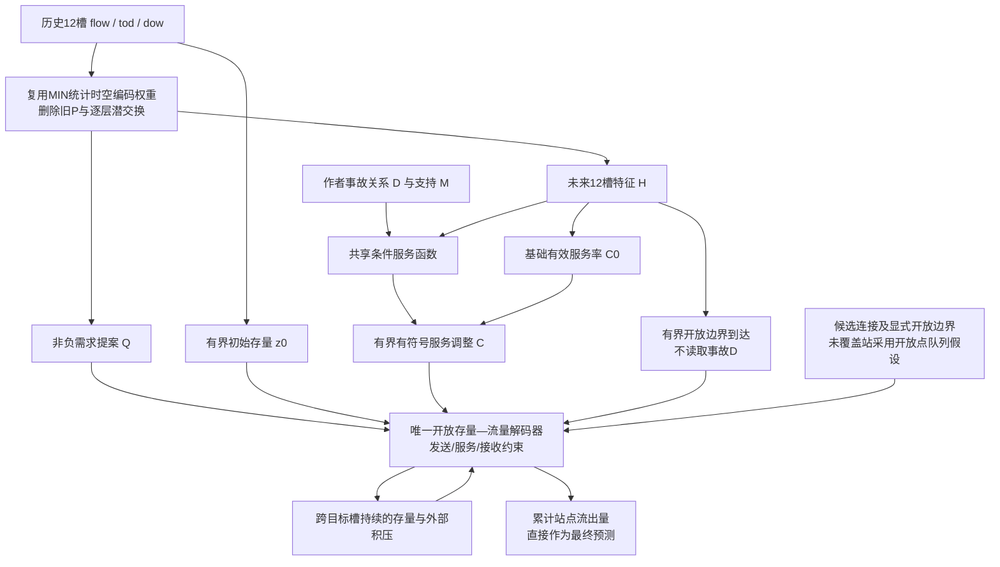

# IGSTGNN MIN-R2：从潜预算修补转向输出域开放存量—流量模型

日期：2026-10-14。状态：结构与代码重构；正式预测效果尚待服务器实验。

## 🎯 研究目标与本轮决策

研究问题仍是：**怎样利用已有事故关系与交通历史，让事故条件通过服务能力变化，影响跨时间、跨节点的流量预测？**

本轮不再围绕旧 MIN 叠加第二套潜预算和自由残差。保留已有 MIN 已学到的统计时空编码权重，删除旧潜物理路径，使用一个开放存量—流量解码器直接产生最终流量。事故信息只有一个入口：条件化有效服务率。

这里要区分两个层次：结构可以消除已经查明的重复路径、自由输出旁路和错误账本；真实道路的容量、库存、连接和观测映射是否正确，需要独立数据证据。当前不能承诺“理论最优”或已识别现实车辆守恒。

已有 MIN 不重训；R1 保留以便复现，不再作为默认下一阶段结构。当前默认开发和服务器入口是 R2。

## 🔎 八个问题与对应修改

| 问题 | 前期证据／代码事实 | 本轮修改 | 验收方式 |
|---|---|---|---|
| 1. 两套预算与传播职责重复 | R1 保留 MIN 的 P、逐层 exchange，再加独立 E/P、双轨迹和读出；尚无正式 R1 结果证明它导致退化 | 删除旧 P/inlet/exit、逐层 exchange 和 R1 残差分支；只保留一个输出域解码器 | 检查注册参数及完整输出依赖；旧路径不可执行 |
| 2. 输出偏置冒充事故机制 | 旧冻结适配器96.157%点上调、平均+0.466883；固定M置乱D几乎保留全部收益 | 取消事件自由 ΔY 读出；D只能进入服务率；最终预测直接来自通量 | 检查 D→服务→通量→存量→输出；禁止 D→边界/预测头 |
| 3. 关系信息独特贡献尚弱 | 支持内D置乱差约0.00005146；十轮service中state略好于location | 同源、同支持M、同公共初始化、同新增预算训练state/location | 同预算比较关系数值增量；不能据此断言M正确位置无用 |
| 4. 流量、储量和潜变量混淆 | 发布X是flow/tod/dow；旧四维隐藏状态并非已知车辆库存 | 需求/通量采用作者流量尺度；储量采用该尺度×名义时间槽，单坐标递推 | 单位表、训练X尺度来源、节点账本解析测试 |
| 5. 边界遗漏或补偿吞掉机制 | 候选图含匝道与开放边；未知流量不能被认证为0 | 明确内部/入口/出口；入口受拒需求进入外部积压；开放到达仅由历史/H驱动；标明未表示源项为模型内0假设 | 开放网络账本、积压守恒、边界贡献及上限诊断 |
| 6. 容量变了但真实通量未受影响 | 旧容量变化大于通量变化；proposal超容量不等于最终容量主导 | 同一旧状态计算发送/服务/接收；容量主导和非主导分别测试 | 匹配状态/需求的局部扰动、梯度与有限差分；非主导零响应合法 |
| 7. 容量、需求、库存、边界不可辨识 | 单独流量监督无法唯一分辨低需求、低服务或接收不足 | 初始库存有界、固定库存尺度、共享低复杂度边界、无自由物理读出；服务不称实测容量 | 库存/边界幅度、饱和及可辨识性敏感性；不靠拟合误差认定真实机制 |
| 8. 初始化与比较对象混淆 | 删除旧算子后不可能自动保留源MIN整个函数；MIN已多次训练完成 | 只迁移兼容权重；源检查点只读；明确三种比较对象 | 源保护、迁移证书、可续跑身份、ON/OFF恢复及固定旧参考 |

上述旧实验数字只用于提出假设，不作为新 R2 的实验结果。

## 🧭 发散方案及选择理由

| 路线 | 有价值的思想 | 当前取舍 |
|---|---|---|
| 单个潜空间传播器 | 合并逐层重复物理路径，保持模型简单 | 仍不能约束最终预测流量，暂不选作主线 |
| **单个输出域开放存量—流量解码器** | 排队论／网络演算分离到达、服务、积压和输出；有限体积思想统一出入账本 | 本轮可执行主线；以模型单位明确假设，不冒充已认证道路仿真器 |
| 完整 CTM／LTM | 发送、接收、空间储存、传播时延与累计曲线 | 证据补齐后升级；不能把可学习参数当作缺失单位、几何和边界的替代品 |
| 可微约束优化层 | 由神经网络给需求/参数，求解器给满足约束的最终输出 | 借鉴“输出来自求解器”的分工，当前不引入额外大型QP依赖 |
| 状态估计／数据同化 | 多传感器观测约束初始状态和物理参数 | 原始flow/occupancy/speed归档需先核验语义、口径及时间；不混进本轮发布版比较 |

取舍的关键不是换模块名称，而是改变**哪个变量被约束、谁负责最终输出**。过去service-budget仍在逐层潜空间中工作，R2删除这些路径，使最终流量由同一个递推过程生成。

## 🧩 新模型数据流

源 MIN 在图外作为固定比较参考，不是新候选输出的一部分。条件 OFF 仍运行完整 R2 解码器，只关闭服务调整，不等于源 MIN。

### 各模块为什么保留

1. **统计编码器**继承已训练历史规律与统计图传播能力，避免重训MIN；它估计需求和参数，不再承担第二套潜物理递推。
2. **需求提案**来自保留的预测头，表示希望离开的流量，不能跳过发送、服务和接收限制。
3. **初始存量**表示预测开始时可用的模型库存，由历史估计并受固定上限约束，不能把观测flow直接当stock。
4. **基础服务率**描述当前状态允许的有效处理速度。它受流量监督，但不是已识别的真实道路容量。
5. **条件服务函数**在同一状态上引入M/D，职责只有一个；无独立事件状态、独立输出残差或自由事件边界源。
6. **开放边界与外部积压**承认网络不是封闭系统。受拒绝的入口需求被保留，不凭空删除。
7. **单解码器**把前述量放在同一计量体系；同一内部通量在源减一次、在目的加一次；最后直接输出流出量。

## 📐 方程、单位与可证明性质

记目标槽长度为1，每槽分成2个模型子步，Δt=1/2。它是名义积分时间，不是已认证的真实分钟或CFL步长。

| 量 | 本轮含义／单位 | 不能自动解释为 |
|---|---|---|
| q、f、C、a | 作者流量尺度／名义目标槽 | 已核实的veh/h或veh/5min |
| z、K、外部backlog | 作者流量尺度×名义目标槽 | 实测车辆数、密度、排队长度 |
| D、M | 作者关系数值及有效支持 | 已认证事故持续时间或真实影响范围 |
| 候选边 | 条件模型中的转移假设 | 已认证物理直连道路 |

每一子步先用同一旧存量计算：

\[
S_i=\min(z_i/\Delta t,C_i),\quad R_i=(K_i-z_i)/\Delta t.
\]

内部/出口需求按源节点总发送量共同缩放；内部与入口提案再按目的节点总接收量共同缩放。得到通量f后：

\[
z_i^+=z_i+\Delta t(\sum_{e\to i}f_e-\sum_{i\to e}f_e),\qquad
b_e^+=b_e+\Delta t(a_e-f_e),\quad e\text{为入口边}.
\]

第二式包含旧外部积压；入口请求为b/Δt+a。不能丢掉被下游接收限制拒绝的需求。内部/出口边不存外部积压。

最终第h槽预测为子步站点流出积分：

\[
\widehat y_i^h=\sum_{s\in h}\Delta t\sum_{i\to e}f_e^s.
\]

它后面只允许源数据标准化/反标准化，不接任意可训练输出修正。站点观测映射到“节点总流出”是显式模型假设，仍须通过真实路段观测核验。

可证明的是模型内非负通量、发送/服务/接收受限、库存有界、内部账本与开放系统总账本。额外的神经需求提案也限制离开量，因此有库存且有服务余量时，流量仍可能受需求提案限制；它是受限需求的开放存量模型，**不是保证有积压就按最大服务排出的经典工作保持队列**，也不是完整CTM。有限库存造成的上游受阻只是本模型的阻塞机制，在缺少道路长度、密度和波速证据时不能称为已恢复真实拥堵回溢。

不进行事后stock clip来掩盖违约；浮点实现使用等价稳定形式并单独报告float64账本残差。

## 🛠️ 服务调整与先验取舍

\[
C=C_0\exp(\gamma),\qquad \gamma=0.5\tanh(g(H,z/K,h,D,M)).
\]

state和location都使用原支持M；location额外读取D数值。缺失或不支持节点的条件调整为0。

本轮选择有界、有符号的**有效服务调整**，而非保证“事故只减真实容量”。原因有二：当前报告属性和活动时刻没有完整as-of认证；严格非负容量损失在精确零初始化处的平滑导数为0，不能同时要求单向损失、精确零扰动和平滑非零初始梯度。

条件输出层零初始化，因此新候选初始ON=OFF；新候选不等于旧MIN。location额外投影按公共层之后构造，确保公共初始权重相同。约束非主导时零容量梯度正常，不能用softmin人为制造机制。

训练历史正流量中位数提供每站基础数值尺度，重复窗口按发布样本原有权重保留；零流量站使用全局正中位数回退。初版“固定4倍中位数”经过只读训练X审计后已修正：尺度取`max(正中位数或全局回退, 训练X峰值×1.25/4)`。这样基础服务上限至少覆盖已见历史峰值并有25%数值裕量，不依赖D调整才获得高峰表示能力。原中位数、扩展尺度、扩展站点及前后覆盖率分别保存；这不是从流量识别真实容量，也不保证未见未来峰值一定落在范围内。

实际审计3909个训练窗口的23,266,368个历史点：固定4倍中位数使89站至少出现一次超限，其中9站的P95超限、21站的P99超限；即使乘最高条件因子，仍有29站出现超限。402503站正中位数约1、P95为12、峰值34，说明全网超限比例小也不能掩盖个别站的结构性尾部风险。51站没有正历史值，回退只代表数值缺乏，不代表已认证无流量道路。

库存上限、服务/边界幅度和固定分流均是写入recipe的先验，**不是物理标定结果**。继续报告饱和率及机制，再决定是否需要敏感性实验，不因理论名称而无限加模块。

## 🗺️ 道路证据、全网覆盖与数据补充

当前固定候选图：496站、候选覆盖476站、456内部边、266显式开放边；联合物理认证0站。N/E升postmile、S/W降postmile仍是待核验方向假设。

未覆盖20站不补造内部道路连接；使用显式入口/出口开放点队列作为模型回退。其他缺入边或出边节点同样显式记录补全。模型可预测全496站，不意味着全496站具有相同物理证据。已表示入口是有界可学习到达，不默认0；未表示源项在模型定义中为0，现实中是否存在额外匝道等来源尚未认证，不能把显式开放边界等同于“所有未知边界已解决”。

`stock_flow_contract.py`记录候选覆盖、真实认证数、fallback、单位与观测映射；strict physical模式拒绝使用当前证据，且不修改旧物理合同的认证要求。

已有原始flow/occupancy/speed归档的通道顺序来自论文及数值范围推断，单位仍未认证；它不同于本轮X的flow/tod/dow。优先只读核验来源矩阵元数据、流量是否全车道汇总、速度及占有率单位、断面与相邻道路区间关系。匝道年度ADT不是五分钟匝道流量。补充数据成功后再引入密度观测、长度/车道库存、传播时延及真实CTM/LTM接口；不必让所有路段等待同样的数据完备程度。

## 🧪 实验协议与停止判据

- **不训练源MIN。**只读复用`contra_min_i_v1_bs64_seed2025/A/last.pt`中的best_model_state，源最佳28轮及全部源制品受保护。
- 两个新候选state/location从同一源复制兼容编码器参数，主干与新解码器联合训练；不要求先完整冻结训练。
- 只用作者发布3909训练/837验证窗口，保留batch64、站点轴、样本ID与掩码；不混合旧3604/917时序包。
- 先1轮接通，绝对续至10轮；不扩展长跑以代替机制判断。源MIN训练更新数恒为0。
- 当前默认完整12槽masked MAE，额外teacher loss与风险惩罚权重为0，避免同时增加结构和多个不明收益的目标。
- 原MIN验证预测首次回放并缓存，续跑和每个候选复用；每次候选验证使用同批次ON/OFF/ON检查恢复。
- 保留源MIN固定困难窗口；输出总体/逐槽MAE、RMSE、MAPE、流量区间、高估/低估及上调/下调风险；保存配对预测供后续区域分析。
- 新候选对源MIN代表结构替换与新增优化的整体效果；同预算state/location才针对D数值增量；同候选ON/OFF是路径敏感性。
- 未超过原MIN时先定位需求、边界、发送、服务和接收何者主导，再决定改方程还是退回更弱假设；不靠自由残差修回误差。
- 验证集已反复用于研发，本轮不再次用测试集挑结构，不把窗口重叠点当独立事故重复。

工程必须先通过：单边/串联/汇合/分流、入口积压、非负有界、开放账本、边重排、梯度与局部容量扰动；保留权重与源只读；无旧物理路径；输出等于实际流出积分；公共初始化相同；1→2轮与连续2轮续跑一致。另删除继承代码中已确认不参与预测的BN、时间槽投影及最后层backcast；候选的统计预测在这三类清理前后逐点一致。

## 📚 思想来源与借鉴边界

1. **Newell累计曲线**启发直接在累计进出上定义动态状态，避免任意潜变量读出冒充物理；并不意味着可以省去道路、边界和时延假设。[Part I](https://doi.org/10.1016/0191-2615(93)90038-C)、[Part II](https://doi.org/10.1016/0191-2615(93)90039-D)。
2. **排队论与通信网络演算**提供到达—服务—积压—输出的职责分离及受拒需求保留思想；通信服务曲线不是道路基本图。[Le Boudec与Thiran作者开放专著](https://leboudec.github.io/netcal/)。
3. **Daganzo CTM**提供同一通量共享出入账本、发送/接收限制及有限储存思想；真实交通解释需要对应单元与单位。[原始报告](https://escholarship.org/content/qt0b6612tk/qt0b6612tk.pdf)。
4. **Pereira、Lang与Kulcsár，TRC 2022**使用神经网络预测物理参数，再由交通模型直接生成预测。我们借鉴输出分工；该论文使用的流量/速度、空间和时间条件并不在本数据中自动成立。[原始论文开放全文](https://research.chalmers.se/publication/531205/file/531205_Fulltext.pdf)，DOI：10.1016/j.trc.2022.103772。
5. **可微凸优化层，NeurIPS 2019**启发把约束求解器作为最终预测层，而非只把物理写成训练时损失；当前采用简单可微限流核，不引入其完整求解器。[原始论文](https://papers.neurips.cc/paper_files/paper/2019/hash/9ce3c52fc54362e22053399d3181c638-Abstract.html)。
6. 本轮采用独立构思、互审及证据边界的方法组织头脑风暴；工具方法参考Kassis等，*Scientific Agent Skills*（2026）。[方法来源](https://arxiv.org/abs/2609.00065)。

## 📁 实现入口

- `src/models/open_stock_flow.py`：唯一数学限流与账本核。
- `src/models/incident_stock_flow.py`：MIN兼容权重迁移、旧路径删除、单解码器。
- `src/utils/stock_flow_contract.py`：模型单位、图证据与训练历史尺度来源。
- `experiments/chronological/train_min_stock_flow.py`、`min_stock_flow_r2.json`：独立训练及绝对轮次续跑。
- `experiments/chronological/min_stock_flow_metrics.py`：明确三种比较对象的只读评价。
- `experiments/chronological/run_min_stock_flow.sh`：服务器入口，脚本内不含git操作。

代码、单元测试及小样本验收与正式服务器预测效果分别记录，不用工程通过代替科学收益。
