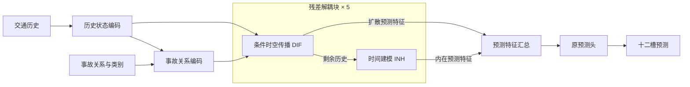

# IGSTGNN 模块职责重设计：把改进放进传播算子

日期：2026-10-15。状态：根据用户对模块设计的纠正形成的候选设计，尚未实现或训练。原 IGSTGNN 是主 baseline；F2/F3 继续作为已有实验与机制原型保留，不将新草图冒充当前代码。

后续理论审查已补入[数据与理论合同](igstgnn_conditional_propagation_contract_20261015.md)。下文保留为初始草图记录；后续实现以新合同为准，特别是同一算子同时条件化消息内容与权重、硬支持、11个图/阶/self bank、历史与生成块的类型区分。纯 logit 版本不再作为完整候选。

## 🎯 修正上一轮的方向

用户指出的核心是模块与计算流程，不是图形排版。上一轮 F3 在 F2 评分上追加历史交互、报告交互，并增加固定求和参考读出；报告也保留两个入口。把它们包进一个“选择器”不会减少真实计算或职责重叠。F3 仍可用于局部机制试验，但不再直接视为已经确定的论文主架构。

本轮重新核对[原论文](../../../01_IGSTGNN_Incident-Guided_Traffic_Forecasting_KDD2026.pdf)第4页 Figure 2，以及第3—5页方法。原图将总体数据流和 ICSF/TIID 内部算子分层表达；动态图服务于空间建模，时间影响与主干表示在预测前汇合。主干内是 GCN、残差分离、RNN/Attention 的执行串联，不能为了画出并联效果而把 DIF、INH 改画为互不依赖的两条输入路径。

## 🧩 一个值得继续推敲的候选

**候选：用事故条件时空传播核替换 DIF 的空间混合入口。** 新能力改变“从哪个邻站、哪个历史/已生成位置读信息”，保留 INH 的本站时间建模及原预测读出。不再把报告送入多个末端分量评分器。

| 模块 | 输入 → 输出 | 唯一职责 | 与现有模型的关系 |
|---|---|---|---|
| 交通历史编码 | 流量、日内时间、星期及既有节点表示 → 历史隐藏序列 H | 建立交通状态表示 | 复用兼容的编码权重，不增加新预测支路 |
| 事故关系编码（新） | H、类别、三列关系及可用性/支持 → 节点条件 R | 表达报告与当前交通状态的匹配及关联位置 | 取代独立 ICSF 初始注入；一个共享编码入口 |
| 条件时空传播核（新 DIF 算子） | 当前隐藏窗口、R、原可用图 → 空间预测/回溯特征 | 联合选择邻站和时间位置的消息 | 替换旧时空空间混合路径；不叠加旧潜交换与新模拟器 |
| INH 时间分支 | 扣除 DIF backcast 后的残差历史 → 内在预测/回溯特征 | 学习本站时间变化 | 保留执行职责和兼容权重 |
| 原预测读出 | 各层 DIF/INH forecast 汇总 → 十二槽流量 | 将学到的表征映射为目标 | 保留统计输出，不改成硬存量—流量账本 |



图中每个解耦块执行 DIF→扣除 DIF backcast→INH→扣除 INH backcast，再将剩余历史传给下一层。预测特征汇总是两类 forecast 的汇合，并非把 DIF/INH 的执行改为独立并行。原四块预测递推也与五个分解层分开，层号不代表未来时间。

## 🔬 新传播核具体改变什么

对接收窗口 q、接收节点 i、允许的源节点 j 和窗口内位置 ℓ，先计算历史条件分数，再加事故条件分数：

```text
base_logit(q,i,j,ℓ) = f_history(H_receiver(q,i), H_source(q,j,ℓ), position_ℓ, original_graph)
event_logit(q,i,j,ℓ) = f_interaction(H_receiver(q,i), H_source(q,j,ℓ), R_i, R_j, position_ℓ)
K(q,i,j,ℓ) = softmax_over_allowed_neighbor_and_position(base_logit + event_logit)
message(q,i) = sum_(j,ℓ) K(q,i,j,ℓ) * value(H_source(q,j,ℓ))
```

事故条件项必须在“邻站×位置”上允许不同响应；若只给原卷积的最终输出乘一个标量，就没有落实这项设计，仍接近旧门控方案。条件编码与核在各调用中共享职责，报告不另走输出修正支路。

事件不可用或支持为空时，条件项严格为零，退回**当前候选的历史传播核**，不承诺退回历史 MIN 权重。仅 M 的控制与完整关系/类别的控制分开，以免把支持位置价值误写为关系数值价值。

窗口中的时间位置必须在时空混合前可定位。历史编码时指已观测历史位置；forecast 递推时只能读取历史或已生成块，不能读取未来真值。原预测块 gap=3，因此“位置选择”不能未经额外定义就称为已识别的分钟级传播时延。不能在已经混合的隐轴上补一个名称便宣称估计了交通时延。

算子接口先固定为输入 `H[B,T,N,C]`，沿用本轮原 `k_t=3`，有效窗口数 `Q=T-k_t+1`。窗口 q 的接收状态取 `H[:,q+k_t-1,i,:]`，源位置为 `H[:,q+ℓ,j,:]`，`ℓ∈[0,k_t)`；只有原允许邻站及当前窗口位置进入 softmax，保留 self 支持以免出现空行。这里不把位置选择、窗口宽度与图范围同时做参数搜索。

| 张量 | 形状 | 时间轴责任 |
|---|---|---|
| 窗口值 | `[B,Q,N,k_t,C]` | 保留每个可定位位置，不先把整个时间窗混成一个节点向量 |
| 传播权重 K | 概念上 `[B,Q,N,N,k_t]`，实际应按有效邻边稀疏存储 | 每个 q、接收节点分别在邻站×位置归一化 |
| 消息与 DIF 隐状态 | `[B,Q,N,C]` | 不丢 Q；可经原 backcast 映射，与输入末 Q 槽相减 |
| 四块 DIF forecast | 原投影后 `[B,4,N,F]` | 首块沿用历史编码末状态，之后三次仅用历史/已生成状态组成窗口 |
| 最终预测 | `[B,12,N,1]` | 沿用 gap=3 的原展开与输出通道选择，不宣称十二次状态递推 |

预测递推调用时输入窗口长度为 k_t，故 Q=1；已有生成前缀之外的位置不可读。事故条件是预测时已知上下文，用于选择历史表示，不表示事故物理作用提前发生在历史槽。新核必须同时满足历史 backcast 与预测递推的输出合同，不能用一个跨全窗池化的向量冒充它们。以上合同已补入独立审查指出的实现前欠定义；网络因子化及初始化细节仍待开发设计，不称为训练就绪。

原预定义/静态/动态图只能按已有可核对的支持作为预测依赖；不新增未经认证的道路方向或弱连通全网事故范围。消息权重归一化约束的是表征混合，不是车辆守恒、密度或真实通行容量。

## 📐 明确替换与删除的计算

该候选不保留 F2/F3 的末端分量评分器、固定求和参考预测及评分残差；不恢复 ICSF 和 TIID 的独立报告输出路径。原 MIN 的额外潜 exchange 不再与新 DIF 空间核叠加，以免又成为两套空间修正。内在时间模型、残差分解和统计预测头保留。

这属于实际结构替换，不是接口封装。**删除 F2 融合并不代表已证明删除有益**：F2 的当前融合有正消融证据，所以它继续作为必须保留的竞争者；候选能否通过更好的内部表征补偿这部分能力尚未知。

新算子替换旧计算后，阶段0不保证精确复现 MIN/F2。只能复用形状和职责兼容的权重，记录新核初始化及参数变化，重新评价候选自身阶段0；不能把旧源指标当作其初始化指标。此处还没有建立可加载工厂，不能拿旧 checkpoint 直接按旧模型入口运行。

## 🔎 五问题逐项负责，避免全部宣称解决

| 五问题 | 候选负责什么 | 保留的未解部分 |
|---|---|---|
| 关系细节无额外价值 | 关系与历史共同改变实际消息分配，报告只有一个算子入口 | 信息仍可能冗余；结构不能创造不存在的事故信息 |
| 修正缺少选择性 | 选择作用于具体邻站与时间位置，避免额外统一输出修正 | 不保证低流量/MAPE 改善，仍须完整对照和分层 |
| 跨槽状态职责不清 | 只使用 DIF 原四块预测递推，不再加双轨状态 | 这是沿用并明确职责，尚未新增十二槽持续事故状态 |
| 局部约束与最终预测联系弱 | 约束直接作用于真正进入预测的消息；移除孤立潜预算支路 | 物理预算问题被移除而非验证；没有容量辨识或车流守恒结论 |
| 小模块限制共同适应 | 新核、编码与完整主干共同训练 | 联合训练已在 F2 采用，不算本轮创新 |

核内条件可以经后续传播影响原报告支持之外的节点，因此不能沿用 F2“支持外最终报告效应严格为零”的验收规则。新的范围验收应检查实际计算图可达性和不连通节点隔离，不能把范围扩大直接当作事故传播成功。

## 🧪 什么结果才支持它比原方案更好

先比较同结构、同初始化规则和同新增预算的 **HISTORY 核 vs EVENT 核**，检验事故条件；仅 M、完整关系/类别进一步区分支持与细节。原 F2 和原 IGSTGNN 均保留各自明确身份，最后完整方案必须对原 IGSTGNN 做同评价口径比较。

若改进被一般时空核能力解释，合理结论是传播结构改进，不能说事故机制成功。若没有跨站消息的同容量模型表现相当，则核心空间传播动机受损。若 EVENT 不优于 HISTORY/仅 M，则不支持关系条件增量。同检查点 REPORT_OFF 检查即时依赖，不能替代这些训练对照。

必须同时查看整体 MAE/RMSE/MAPE、低流量、逐时距及困难窗口，防止再次由高流量收益抵消其他区域损害。支持内外只是计算关系分组，不等同事故因果范围；验证 837 窗口已参与研发，最终确认仍需另行固定方案。

本轮已完成原论文图的视觉核对、两个独立模块候选和反方审查。选择继续推敲的是职责更集中的内部传播候选；简洁是设计约束，不是性能证据。没有修改模型代码、执行新训练或宣称新颖性。
