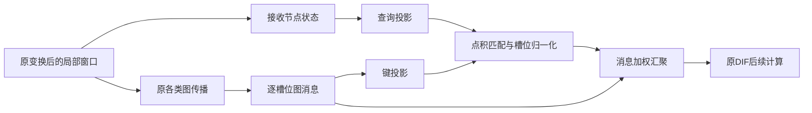

# GW3：接收状态—图消息匹配

开发状态：代码与服务器验证入口已编写；按用户要求，没有执行任何本地测试、模型前向、反向或训练。不能据此声明验证通过或精度提升。

## 实验依据与问题

用户回传的 GW2 五轮、837 个验证窗口：POST_MESSAGE MAE 15.156222029，STATIC 15.228789444，ORIGINAL 16.288489633。同检查点 POST_MESSAGE_UNIFORM 为 15.156640950，STATIC_ONLY 为 15.155602385。模型间差异较明显，而完整模型的在线非均匀评分收益很小，关闭动态评分的 MAE 还略好。

这些是已用于开发的验证证据。它们支持继续调查评分器与主干如何共同适应，不能证明动态路由贡献了训练组间的全部收益，也不能证明评分器训练时完全无用。

代码依据：GW2 `562b1d1` 的 `original_graph_message.py`。旧评分器读取消息与槽位内中心化消息，没有独立接收节点状态查询。GW3 检验的问题是：在相同图消息和传播实现下，以接收状态查询消息，是否比消息自身评分更有效？

## 唯一结构变化

只替换第一层 DIF 的评分器；保留 GW2 的 packed graph-message 归约、原图类型与阶数、自身路径、其余 DIF、INH、ICSF/TIID 和预测头。没有增加事故字段、未来标签、图跳数、损失项或调参搜索。

设原窗口经原线性层与激活后为 V，形状 B×T×N×K×C。当前 C=32、K=3。V 的槽位已经混合，不能称为物理传播时延。

对图来源 g：M[g,k] = A[g,1] V[k]。

- RECEIVER_MATCH 查询：U = mean_k V[k]。
- MESSAGE_SELF 查询：U = mean_k M[g,k]。
- 两组都计算 q=Wq U+bq，z[k]=Wk M[g,k]，s[k]=b[g,k]+q·z[k]/sqrt(16)。
- w=K softmax_k(s)，以 sum_k w[k] M[g,order,k] 代替原槽位求和。
- 一阶评分继续用于同来源的原高阶图；自身路径仍为 mean_k V[k]。
- FIXED_UNIFORM 从第一步训练就保持 w=1，不计算匹配分数。

Wk 没有偏置，因为对所有槽位加入相同键偏置会在 softmax 中消去。Wk 零初始化，Wq 保留随机初始化，b[g,k]=0。不能同时把两个投影置零，否则点积路径起步没有梯度。第一步查询投影的梯度为零是预期行为；键投影应先收到真实原损失梯度，后续查询才能学习。

两个匹配组新增参数均为 1055：查询投影 32×16+16，键投影 32×16，图槽位先验 5×3。原模型注册量455220，新组注册量456275。FIXED_UNIFORM 为方便初始化核对注册相同路由张量，但 requires_grad=False 且不读取它们；不能说固定组与匹配组活跃容量相同。GW2 POST_MESSAGE 新增1071参数，只作为历史参考，不冒称GW3同容量控制。

## 数据流

## 最小受控比较

| 组 | 是否新训练 | 作用 |
|---|---|---|
| ORIGINAL | 否，复用GW1认证结果 | 原模型同完成预算基线 |
| STATIC | 否，复用GW1认证结果 | 历史静态参考，归约内核不同 |
| POST_MESSAGE | 否，复用GW2认证结果 | 历史消息自评分参考 |
| FIXED_UNIFORM | 是 | GW3/GW2同packed内核固定汇聚控制 |
| MESSAGE_SELF | 是 | 与新模型相同投影/参数量，查询仅由图消息构成 |
| RECEIVER_MATCH | 是 | 查询来自接收节点自己的局部表示 |

沿用原 batch48、seed2025、Adam、学习率、dropout、损失、课程与调度器。所有组使用相同原模型初始化，新增参数构造不消耗原训练RNG。五轮是初筛，不预设一定超过成熟原模型。既有五轮不重复跑；若将来扩展预算，必须先有对应预算的认证历史参考，不把5轮参考和更长候选混比。

评估11种状态：上述6个训练组，加 MESSAGE_SELF_UNIFORM、MESSAGE_SELF_STATIC_ONLY、RECEIVER_MATCH_UNIFORM、RECEIVER_MATCH_STATIC_ONLY、RECEIVER_MATCH_QUERY_SELF。

QUERY_SELF 使用完整接收匹配模型自己的已训练投影，把查询输入改为该图消息均值。它检验对查询证据的同检查点依赖，可能分布外，不能代替 MESSAGE_SELF 独立训练组。STATIC_ONLY 不保留动态分数的训练均值，不能声称分离了纯跨样本变化贡献。

## 验收与失败判据

工程验收在服务器运行：原模型训练/推理容差恢复、原参数/RNG/输入保持、真实MAE梯度到达键投影、后续查询梯度、固定控制不更新路由、完整轮次精确续跑、认证来源/掩码/轴一致、原验证指标回放、相同best/last权重缓存复用。

研究验收：同时看 RECEIVER_MATCH 对 ORIGINAL、FIXED_UNIFORM、MESSAGE_SELF 的收益；联合MAE、RMSE、MAPE、窗口P95、固定困难窗口与逐流量/道路/时距结果。主指标仍为原尺度验证MAE，不因某一候选擅长MAPE而事后改主指标。

若只优于历史ORIGINAL而不优于同内核FIXED_UNIFORM，不能支持匹配模块有效；若不优于MESSAGE_SELF，不能支持接收状态查询带来增益；若关闭在线评分更好，应保留负结果并考虑简化，而不是调温度制造尖锐权重。没有预先设置有科学依据的显著性阈值，因此单次很小正差不视为可靠突破。

## 理论与解释限制

零键与零先验时 w=1，嵌套到同packed内核固定汇聚；与原作者计算的恢复仍是浮点容差，不保证相同训练轨迹。系数和K不保证预测均值、能量或车辆守恒。

点积是一种匹配假设，不是可靠性、传播因果或事故机制。它可能偏爱相似状态、漏掉邻居领先变化；局部槽位均值也会丢失顺序信息；未归一化的查询/键尺度可能导致分数过大和softmax饱和。通过按历史/预测调用阶段拆分的权重、熵、固定节点窗口跨样本方差及查询替换干预观察这些问题，本轮不额外堆叠归一化或多头结构。

本设计尚未进行新颖性文献检索，不能写作首次提出注意力/查询匹配。当前贡献候选是针对已发现失效的局部模块改造及其受控验证，而不是给通用点积注意力换名称。

## 制品与保护

新源码在 `experiments/chronological/*receiver_match*.py`，启动器 `run_original_receiver_match.sh`，两份新测试在 `tests/`。旧GW1/GW2源码和所有旧训练执行身份文件保持不变。

来源保存在 `reference_epoch_005.json`。缺少认证归档时直接报错，不回退到重训或重新推理旧模型。GW3每轮原子保存last.pt，best权重独立命名，记录优化器、调度器、课程、RNG和样本顺序。相同模型张量的best/last预测复用，新推理次数明确记录。

工程验证记录见 `docs/verification/receiver_match_gw3_development_20261017.json`；该文件只声明开发范围与待执行项，不是测试通过证书。
