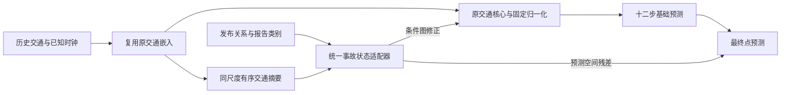

# IGSTGNN v0.3：交通核心与统一事故状态适配器

_2026-10-17；针对 v0.2 审查的独立修订。模型、训练身份和目录与 v0.2 分开；不向旧目录续入新模型。原发布九个冻结源码文件、原解析器与既有实验保持原样。_

## 主结构与改动理由

主候选仍只有原交通核心与一个适配器。保留嵌入、图构造、五层 DIF/INH、分量求和、输出头；移除旧 ICSF/TIID，最新槽 LayerNorm 固定保留。基础交通图不直接读报告。唯一适配器读取交通摘要、发布关系与报告类别，同时控制未来 DIF 图和预测输出修正。



1. 摘要来自最新槽归一化**之前**的嵌入。保留首末差、均值、离散度并加入有序历史投影，避免伪变化及旧摘要的内部顺序碰撞；不添加另一套历史 GRU。
2. 关系条件池化同时保留离散度、关系统计与支持比例。状态是当前窗口的潜在条件表示，不是认证事故阶段、严重度或真实恢复状态。
3. 图评分在显式边上读取发送和接收节点的交通摘要、事故关系与共享状态。邻居重分配之外，增加零初始化的有符号对数消息强度，单邻居行也能变化。它不是道路物理容量。
4. 图系数非负；合法边以受限指数权重重分配并调整总消息强度。保留原非道路 epsilon。高阶图不保证行归一，也不保证响应严格局限在一阶操作包络。
5. 时间出口改为读取状态、节点、关系与传感器上下文的交互解码器，在**原预测输出之后**添加十二步修正，不再经过原输出 ReLU。上界 0.1 是发布归一化 flow 坐标，反变换后的单独时间修正界为 0.1×目标标准差；不限制图路径或联合训练模型总差异。
6. GRAPH 不计算未使用的时间解码；无有效报告的完整批次走核心快路，混合批次逐行严格回退。未知、缺失、合法类别0和关系缺失有明确区别；不可用 NaN 占位在运算前替换，有效关系的 NaN 则拒绝。

结构边界保留并测试：状态开环生成；图只改变第2–4个三步预测块，第1块原图读出不变；不改变历史 backcast/INH；时间出口覆盖全部十二步。图关闭对前三步应严格零响应。固定“直接支持及一跳接收行”作为操作包络，不再每预测块人为扩一跳，不将其解释为传播速度。

## 少量有判别力的对照

| 组 | 输入/结构 | 回答的问题 |
|---|---|---|
| ORIGINAL | 完整原 IGSTGNN | 论文主 baseline |
| TRAFFIC_CORE | 固定归一化、无报告路径 | 交通零参考 |
| H_ONLY | 同适配器，只读交通及公共上下文，作用域全节点 | 额外交通校正网络是否已经足够 |
| R_ONLY | 同适配器，增加报告关系与可用性，事故类别/位置为UNK | R相对H的作用 |
| BOTH | 同适配器，增加合法事故类别/位置，共享递推状态 | C相对H+R的作用、主候选 |
| DIRECT | 与BOTH相同输入，按块直接MLP生成状态 | 递推是否必要 |

默认仅以上六组。TIME、GRAPH、SEPARATE、STACKED 可显式选择，分别检验单出口、分开状态或旧路径保留；不默认展开全部实验。注册相同新增张量和初始化不等于活跃语义参数或有效容量完全相同。H_ONLY 不读真实报告支持、关系或可用性，不能偷偷依靠R限定输出范围。

STACKED 是完整合法原报告下的次级总架构对照；其基础图也被旧 ICSF 改变，不能拿差值当旧模块独立贡献。原路径对混合缺报/UNK没有相同契约，因此该可选组明确拒绝这些输入。`report=False` 对它有歧义而拒绝，必须明确 `all_reports=True`；该回退遵守完整原版无报告语义，不冒称固定归一化核心。

## 数据、预算与成功标准

- 发布协议保留训练3909、验证837、原站点轴和scaler；没有测试评价。object数组加载仍可能反序列化测试区载荷，与评价测试不同，记录在身份中。
- 候选独立数据转换在原loader吞掉缺失之前执行；ORIGINAL仍用原loader/engine。Holiday、历史时钟与同一sensor解析属于公共上下文，不计为事故内容收益。Type、Description和位置非法值用独立UNK，合法0保留。
- 主比较固定 **BOTH_vs_ORIGINAL，pooled MAE**。各组在共同完成预算内按验证MAE最小、最早同分轮选检查点；共同末轮为次要结果。RMSE/MAPE和局部负收益完整保留，不事后更换主指标。
- 默认5轮只作工程与趋势；正式相同预算100轮，关闭早停。配对种子预设2025/2026/2027。先单种子筛查，最终候选与必要对照做配对重复；当前单次PASS不标记超过baseline已认证。
- 默认保留原课程：前30轮全十二步，随后缩回一步、每3轮增长。日志保存实际监督时距和新头真实MAE梯度。图头在长度≤3时无直接监督；可用独立身份 `--curriculum full` 作针对性复核，不将两种规则静默混用。
- 不把百万预测点作为独立事故重复；发布时间、绝对日历、重叠事故身份与真实解除时间仍未认证。当前是发布协议下的条件预测研究，不能宣称实时事故生命周期或因果识别。
- 验证集已多次用于设计。100轮、多种子和完整消融也不等于独立最终确认；方案冻结后的确认仍需单列。主训练入口不自动开放测试集。

## 配对预测、机制与成本

`predict_unified_adapter_v03.py` 校验训练代码、数据和检查点身份，只在所有注册组完成共同预算后归档。验证发布前，逐组核对对应选中轮的MAE、RMSE和MAPE回放；失败只写失败证据，不发布可拟合的归档。

归档只有一份真值、原有效掩码、样本行ID与站点ID；显式轴为 sample,horizon,node，NPZ禁object数组，元数据绑定文件SHA及生产脚本hash。模型读取的标签参数不含未来真值；真实流量桶、高低估和有效掩码仅用于监督/评价。

评估保留全网、十二时距、道路、直接支持、操作包络内外、流量桶、逐点正负收益、修正方向与窗口P95。固定困难窗口由同一 ORIGINAL 选最差10%，所有比较复用。BOTH增加同检查点 time-off、graph-off、adapter/report-off、semantic-UNK与匹配语义重排；这些是路径依赖诊断，不等于删除重训或事故因果。

语义重排在各split内部进行，按原支持道路、已知小时/星期、可用性分层，按历史交通排序构造循环donor；Type/Description成对移动，位置不变。只用X和报告元数据，不用Y、误差或未来duration。记录实际改变率、单例和历史匹配距离；类别恒定的重排可能没有判别力，不能把零响应当语义无用证明。

训练逐批累计真实任务梯度及全部验证批的sum/count/max统计，包含图变化、门均值/饱和率、输出修正与支持率；不再以最后一批代表整验证集。测量完整训练/验证阶段时间和峰值；归档前向计时明示冷启动、批大小和边界，不用它冒充独立稳态benchmark。

显式边评分降低了边特征构造开销，但原动态高阶图仍稠密。必须实测，不能从rank或参数量推断低成本。原批量压力检查严格48行，失败保存OOM且不缩批冒充通过；V100仍需服务器复核。

## 风险与采用决策：冻结模型后的两个检验

这两项是已实现的辅助研究入口，不往主数据流继续堆模块，也不把端到端门当价值估计。

主点预测默认不留校准行。若检验风险/采用，使用**另一运行身份**，例如 `--holdout-rows 782`：全部组仅拟合前3127个训练行，剩余782行预先保留，仍用同一837验证行选点模型。它与全3909训练的主实验分开报告，不能混成相同训练条件。

归档校准集必须引用相同检查点、相同生产代码且已经回放PASS的验证元数据。候选、H_ONLY回退的fit行、校准行和验证行均检查互斥；行身份是作者数组索引，不是认证事件身份。模型/辅助头的生产者声明会被一致性检查，但不因此升级为独立事件证明。无预留行或身份不匹配时直接拒绝拟合。

**风险入口：**在同一个冻结H_ONLY点预测中心上，分别用H、H+R、H+R+C拟合两个softplus半宽；固定pinball预算，类别内部one-hot，.1/.5/.9保序。比较pinball、80%覆盖、宽度与区间评分；全验证不下采样。H特征含历史、已知时距与Holiday；R含关系和可用性/支持位；C含独立UNK类别。该受限固定中心读出不代表任意条件分位分布，负结果不能否定所有风险信息，也不提供条件覆盖保证或精确CRPS。

**采用入口：**仅在保留集拟合固定ridge，目标为 `abs(y-base)-abs(y-candidate)`，输出预期MAE收益；正值采用候选，其余回退。比较全回退、全采用、半修正、校准集决定的全局策略、学习策略和同采用率随机诊断，oracle仅标不可部署上界。不用验证标签拟合、调阈值或选正则；全开/全关不视为选择性价值成功。

两个辅助头均记录实际CPU fit/predict时间、处理点数和固定预算，最多200000个校准有效点拟合，全验证分块评价。学习采用策略需要H_ONLY和BOTH两个不同检查点前向；辅助头耗时不是总部署延迟。风险输出和采用策略暂分别检验，不把未同步采用决策的区间拼接成最终预测。

## 本地验证与尚待证据

核验文件与最新执行结果见 [v0.3核验记录](verification/unified_adapter_v03_development_20261017.json)；正式精度结论尚未产生。小样本训练、回放和续训只证明入口可运行，不能证明超过原版。

最终147项单元/回归测试通过，含v0.2和ISP回归；日志见 [测试记录](verification/unified_adapter_v03_unit_tests_20261017.txt)。本机同进程混用Torch和NumPy时使用进程级 `MKL_THREADING_LAYER=SEQUENTIAL` 避免重复OpenMP运行时，不开启跳过冲突检查的选项。

本次实际验证包含六组各两轮小样本训练、连续训练与断点续训逐值对照、十一种验证状态回放，以及预留校准行到风险/采用分析的完整流程。两次小样本运行合计48次主模型优化器更新；压力和梯度检查各自为0次更新。风险读出另有固定CPU优化预算，这些均不计为正式训练结果。

全发布训练/验证元数据审计中，3909/837行均有报告及关系，Type、Description、Holiday和位置均为合法类别。缺失与UNK修复解决的是输入契约和稳健性问题，不能据此声称发布数据已经出现类别污染或自然漏报。字段存在仍不证明预测截止时已发布。

本机batch48真实MAE前后向通过：原版峰值allocated为13,124,994,560 bytes，BOTH为17,015,409,152 bytes。设备为RTX4060 Laptop，Windows显存超额分配环境；单次墙钟36.31/66.45秒不作为V100吞吐或显存驻留证据。稠密高阶图与额外条件计算仍有成本，尚不能声称新模型更快。

36项审查的逐条处理在 [v0.3问题处理表](igstgnn_unified_incident_adapter_v03_issue_resolution_20261017.md)。数据认证、正式配对效果、独立确认和服务器硬件表现需要真实证据，不能靠代码开关或测试数量宣布完成。

## 服务器操作

先同步全部新v03文件及依赖；旧v02、original_isp.py和冻结runtime仍是显式依赖。不要对v02目录执行新入口续训。

```bash
python experiments/chronological/verify_unified_adapter_v03.py \
  --output experiments/chronological_runs/unified_v03_server_stress48.json \
  --stress --batch-size 48 --device cuda:0
```

独立小样本检查与原协议试跑：

```bash
bash experiments/chronological/run_unified_adapter_v03.sh \
  --run-dir experiments/chronological_runs/contra_unified_v03_check_s2025 \
  --check --epochs 1

bash experiments/chronological/run_unified_adapter_v03.sh \
  --run-dir experiments/chronological_runs/contra_unified_v03_s2025 --epochs 5
```

共同续至总100轮使用同一命令加 `--resume --epochs 100`。其他种子用新目录与 `--seed`；不要直接把旧48轮结果与新短跑相比。作业默认8小时，按服务器实测调整调度时间；完整轮次中断可精确续训。

完成共同预算后，只读归档和分析：

```bash
python experiments/chronological/predict_unified_adapter_v03.py \
  --run-dir experiments/chronological_runs/contra_unified_v03_s2025 \
  --output-dir experiments/chronological_runs/contra_unified_v03_s2025/evaluation_best \
  --checkpoint best --split validation
```

配对重复完成后汇总三个种子。该入口核验当前代码、数据、各组检查点及逐轮训练顺序，在共同完成预算内重新计算各组最佳轮及末轮差异，不直接信任summary中的指标；重复种子与配方差异会被拒绝。

```bash
python experiments/chronological/summarize_unified_adapter_v03.py \
  --run-dirs experiments/chronological_runs/contra_unified_v03_s2025 \
             experiments/chronological_runs/contra_unified_v03_s2026 \
             experiments/chronological_runs/contra_unified_v03_s2027 \
  --output-dir experiments/chronological_runs/contra_unified_v03_paired_summary
```

缺少三个预设种子、默认必要对照或完整100轮，只能得到不足种子/描述性状态。`FORMAL_BUDGET_COMPLETE`也仅表示预算与配方完整，结果仍完整保留负收益，不宣布超过baseline或独立泛化。

若开展辅助检验，单独从头创建含 `--holdout-rows 782` 的同预算运行；先归档validation，再归档calibration并加 `--validation-reference <validation目录>/metadata.json`。辅助命令：

```bash
python -m experiments.chronological.unified_adapter_risk_v03 \
  --calibration-archive <校准目录>/paired_predictions.npz \
  --validation-archive <验证目录>/paired_predictions.npz \
  --calibration-metadata <校准目录>/metadata.json \
  --validation-metadata <验证目录>/metadata.json --output-dir <新风险目录>

python -m experiments.chronological.unified_adapter_decision_v03 \
  --calibration-archive <校准目录>/paired_predictions.npz \
  --validation-archive <验证目录>/paired_predictions.npz \
  --calibration-metadata <校准目录>/metadata.json \
  --validation-metadata <验证目录>/metadata.json --output-dir <新采用目录>
```

尖括号是需替换的路径说明，不是可原样执行的shell参数。所有评估输出目录必须新建，保留既有制品。

## 方法来源

实验设计及审查边界参考 experimental-design 与 scientific-critical-thinking 技能；模型公式、缺失契约和工程检查依据本地代码及执行证据。方法引用已列入本版本：Kassis, T., Agarwal, V., He, Y., Patel, D., & Brueckner, A. M. (2026). [Scientific Agent Skills: A Library of Procedural Knowledge for Research Agents](https://arxiv.org/abs/2609.00065)。
